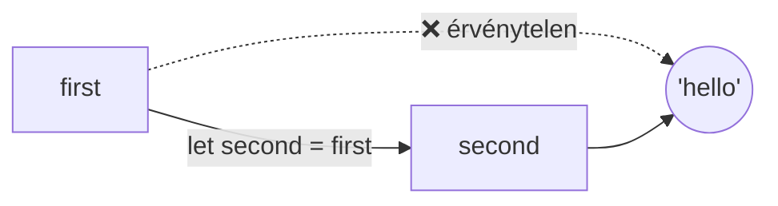
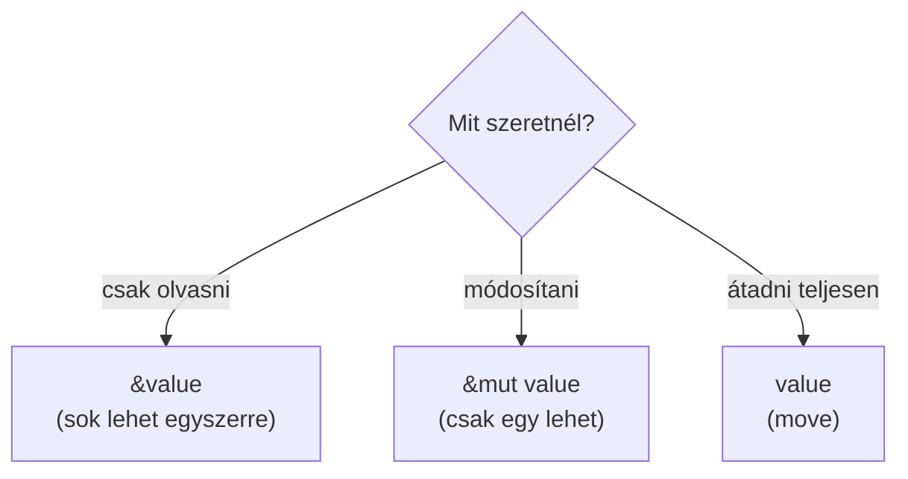

# 🦀 Rust alapok – hülyebiztos útmutató

> [!info] Hogyan használd ezt a jegyzetet?
> - Fentről lefelé haladj, minden rész az előzőre épít.
> - A kódokat **írd be magad**, ne másold (úgy jobban megmarad).
> - Az `> [!question]-` kezdetű részek **összecsukhatók**: előbb gondolkozz, aztán nyisd ki a megoldást.
> - Ha C++ vagy Python ismerősebb, nézd a [[#Összehasonlítás Python és C++ nyelvvel]] részt.

## Tartalom

- [[#1. Telepítés (a legkönnyebb út)]]
- [[#2. Az első program]]
- [[#3. Változók]]
- [[#4. Típusok]]
- [[#5. Függvények]]
- [[#6. Vezérlés: if, loop, for]]
- [[#7. Ownership – a Rust legfontosabb ötlete]]
- [[#8. Borrowing (kölcsönzés)]]
- [[#9. Struct és enum]]
- [[#10. Option és Result]]
- [[#11. Gyakorló feladatok]]
- [[#12. Puskalap]]

---

## 1. Telepítés (a legkönnyebb út)

Minden egy programon keresztül megy: a **rustup** feltelepíti a fordítót (`rustc`) és a csomagkezelőt (`cargo`).

**Linux / macOS:**
```bash
curl --proto '=https' --tlsv1.2 -sSf https://sh.rustup.rs | sh
```

**Windows:** töltsd le a telepítőt innen: https://rustup.rs

Ellenőrzés:
```bash
rustc --version
cargo --version
```

> [!tip] A legkönnyebb módszer
> **Ne használd közvetlenül a `rustc`-t.** Mindig a `cargo`-t használd, az mindent elintéz helyetted:
>
> | Parancs | Mit csinál |
> |---|---|
> | `cargo new my_project` | új projekt létrehozása |
> | `cargo run` | lefordítja **és** elindítja |
> | `cargo build` | csak lefordít |
> | `cargo check` | gyors hibaellenőrzés (nem épít) |
> | `cargo add rand` | könyvtár hozzáadása |

---

## 2. Az első program

```bash
cargo new hello_rust
cd hello_rust
cargo run
```

A `src/main.rs` fájl tartalma:

```rust
fn main() {
    println!("Hello, world!");
}
```

**Kimenet:**
```
Hello, world!
```

### Soronkénti magyarázat

| Kódrész | Jelentés |
|---|---|
| `fn` | függvényt definiálunk (*function*) |
| `main` | a program **belépési pontja**, itt indul minden |
| `()` | nincsenek paraméterei |
| `{ }` | a függvény törzse |
| `println!` | szöveget ír ki új sorral. A `!` jelzi, hogy ez **makró**, nem sima függvény |
| `;` | az utasítás vége |

> [!warning] Gyakori hiba
> A `println` és a `println!` **nem ugyanaz**. A felkiáltójel nélkül hibát kapsz.

### Értékek kiírása

```rust
fn main() {
    let name = "Anna";
    let age = 25;

    println!("Name: {}", name);
    println!("Age: {}", age);
    println!("{} is {} years old", name, age);
    println!("{name} is {age} years old"); // rövidebb forma
}
```

**Kimenet:**
```
Name: Anna
Age: 25
Anna is 25 years old
Anna is 25 years old
```

> [!note] Miért ez jön ki?
> A `{}` helyére sorban kerülnek be az értékek. A `{name}` forma közvetlenül a változó nevét használja.

---

## 3. Változók

### Alapszabály: alapból **nem módosíthatók**

```rust
fn main() {
    let x = 5;
    println!("x = {}", x);
    x = 6; // ❌ HIBA!
}
```

**Fordítási hiba:**
```
error[E0384]: cannot assign twice to immutable variable `x`
```

> [!important] Miért?
> A Rust azt akarja, hogy ne módosuljon véletlenül semmi. Ha változtatni szeretnél, azt **ki kell mondanod**: `mut` (*mutable*).

### Módosítható változó: `mut`

```rust
fn main() {
    let mut counter = 5;
    println!("counter = {}", counter);
    counter = 6;
    println!("counter = {}", counter);
}
```

**Kimenet:**
```
counter = 5
counter = 6
```

### Shadowing (árnyékolás)

```rust
fn main() {
    let value = 5;
    let value = value + 1;      // új változó, ugyanazzal a névvel
    let value = value * 2;
    println!("value = {}", value);
}
```

**Kimenet:**
```
value = 12
```

**Levezetés:**
1. `value = 5`
2. `value = 5 + 1 = 6`
3. `value = 6 * 2 = 12`

> [!tip] Mi a különbség a `mut` és a shadowing között?
> A shadowing **új változót** hoz létre, ezért a **típus is változhat**:
> ```rust
> let text = "123";
> let text: i32 = text.parse().unwrap(); // &str -> i32
> ```
> `mut` esetén a típus nem változhat.

### Konstans

```rust
const MAX_POINTS: u32 = 100_000;
```
A konstansnál **kötelező a típus**, és a neve általában NAGYBETŰS.

---

## 4. Típusok

### Egész számok

| Típus | Méret | Tartomány |
|---|---|---|
| `i8` | 8 bit | -128 … 127 |
| `u8` | 8 bit | 0 … 255 |
| `i32` | 32 bit | ≈ ±2 milliárd (**alapértelmezett**) |
| `u32` | 32 bit | 0 … ≈ 4,29 milliárd |
| `i64` | 64 bit | nagyon nagy |
| `usize` | gépfüggő | indexeléshez használjuk |

> [!note] Jelölés
> `i` = előjeles (*integer*, lehet negatív), `u` = előjel nélküli (*unsigned*).

### Egyéb alap típusok

```rust
fn main() {
    let integer_number: i32 = 42;
    let float_number: f64 = 3.14;
    let is_ready: bool = true;
    let letter: char = 'R';          // egy karakter, idézőjel: '
    let word: &str = "hello";        // szöveg, idézőjel: "

    println!("{} {} {} {} {}", integer_number, float_number, is_ready, letter, word);
}
```

**Kimenet:**
```
42 3.14 true R hello
```

### Típuskonverzió: **mindig kézzel**

```rust
fn main() {
    let small: i32 = 10;
    let big: i64 = small as i64;     // az `as` alakít át
    let result = big * 3;
    println!("{}", result);
}
```

**Kimenet:**
```
30
```

> [!warning] Python/C++ szokás, ami itt nem működik
> A Rust **nem alakít át automatikusan** `i32`-t `i64`-gyé. Ha nem írod ki az `as`-t, hibát kapsz.

### Tuple és tömb

```rust
fn main() {
    let person: (&str, i32) = ("Anna", 25);
    println!("{} {}", person.0, person.1);

    let numbers = [10, 20, 30];
    println!("{}", numbers[1]);
    println!("{}", numbers.len());
}
```

**Kimenet:**
```
Anna 25
20
3
```

> [!note] Miért 20 a `numbers[1]`?
> Az indexelés **0-tól** indul: `numbers[0]=10`, `numbers[1]=20`, `numbers[2]=30`.

---

## 5. Függvények

```rust
fn add(first: i32, second: i32) -> i32 {
    first + second      // nincs `;` -> ez a visszatérési érték
}

fn main() {
    let result = add(3, 4);
    println!("result = {}", result);
}
```

**Kimenet:**
```
result = 7
```

> [!important] A legnagyobb csapda: a pontosvessző
> - `first + second` **pontosvessző nélkül** = ezt adja vissza a függvény.
> - `first + second;` **pontosvesszővel** = az érték eldobódik, a függvény `()`-t ad vissza → **típushiba**.

**Levezetés a `add(3, 4)` hívásra:**
1. `first = 3`, `second = 4`
2. `3 + 4 = 7`
3. A 7 visszatér a `result` változóba.

Korai visszatérés a `return` kulcsszóval:

```rust
fn absolute_value(number: i32) -> i32 {
    if number < 0 {
        return -number;
    }
    number
}

fn main() {
    println!("{}", absolute_value(-5));
    println!("{}", absolute_value(8));
}
```

**Kimenet:**
```
5
8
```

---

## 6. Vezérlés: if, loop, for

### `if` – kifejezés is lehet

```rust
fn main() {
    let temperature = 25;

    if temperature > 30 {
        println!("hot");
    } else if temperature > 15 {
        println!("nice");
    } else {
        println!("cold");
    }

    let label = if temperature > 20 { "warm" } else { "cool" };
    println!("{}", label);
}
```

**Kimenet:**
```
nice
warm
```

> [!note] Miért `nice`?
> `25 > 30` hamis → `25 > 15` igaz → kiírja: `nice`.
> Aztán `25 > 20` igaz → `label = "warm"`.

> [!warning]
> A feltétel **csak `bool`** lehet. Az `if 1 { }` hibát ad (Pythonban működne).

### `for` – a leggyakoribb ciklus

```rust
fn main() {
    for index in 0..5 {
        println!("index = {}", index);
    }
}
```

**Kimenet:**
```
index = 0
index = 1
index = 2
index = 3
index = 4
```

> [!tip] Tartományok
> - `0..5` → 0,1,2,3,4 (az 5 **nincs** benne)
> - `0..=5` → 0,1,2,3,4,5 (az 5 **benne van**)

Lista bejárása:

```rust
fn main() {
    let names = ["Anna", "Bela", "Cili"];
    for name in names {
        println!("Hello, {}!", name);
    }
}
```

### `while` és `loop`

```rust
fn main() {
    let mut countdown = 3;
    while countdown > 0 {
        println!("{}", countdown);
        countdown -= 1;
    }
    println!("Go!");

    let mut attempts = 0;
    loop {
        attempts += 1;
        if attempts == 3 {
            break;
        }
    }
    println!("attempts = {}", attempts);
}
```

**Kimenet:**
```
3
2
1
Go!
attempts = 3
```

**Levezetés a `while`-ra:**

| Kör | `countdown` | `> 0`? | Kiírás | Utána |
|---|---|---|---|---|
| 1 | 3 | igen | 3 | 2 |
| 2 | 2 | igen | 2 | 1 |
| 3 | 1 | igen | 1 | 0 |
| – | 0 | nem | kilép | – |

---

## 7. Ownership – a Rust legfontosabb ötlete

> [!important] A 3 szabály
> 1. Minden értéknek van **egy tulajdonosa** (*owner*).
> 2. Egyszerre **csak egy** tulajdonos lehet.
> 3. Ha a tulajdonos **kiesik a hatókörből**, az érték **törlődik**.

### Miért van ez?

Nincs szemétgyűjtő (mint Pythonban), és nem kell kézzel `delete`-elni (mint C++-ban). A fordító **előre kiszámolja**, mikor kell felszabadítani a memóriát.

### Move (áthelyezés)

```rust
fn main() {
    let first = String::from("hello");
    let second = first;          // a tulajdonjog átkerül `second`-hez

    println!("{}", second);
    println!("{}", first);       // ❌ HIBA!
}
```

**Fordítási hiba:**
```
error[E0382]: borrow of moved value: `first`
```



> [!question]- Miért nem másolódik egyszerűen az érték?
> A `String` a **heap**-en tárolódik. Ha mindkét változó rámutatna, a függvény végén **kétszer** próbálná felszabadítani. Ezt hívják *double free* hibának C++-ban. A Rust ezt úgy előzi meg, hogy a régi változót érvénytelenné teszi.

### Megoldás 1: `clone` (valódi másolat)

```rust
fn main() {
    let first = String::from("hello");
    let second = first.clone();

    println!("first = {}", first);
    println!("second = {}", second);
}
```

**Kimenet:**
```
first = hello
second = hello
```

### Egyszerű típusoknál nincs move (`Copy`)

```rust
fn main() {
    let first = 5;
    let second = first;
    println!("{} {}", first, second);   // ✅ működik
}
```

**Kimenet:**
```
5 5
```

> [!note] Miért működik?
> Az `i32`, `f64`, `bool`, `char` kicsi, a **stack**-en él, olcsón másolható. Ezeket a Rust automatikusan másolja.

### Move függvényhívásnál

```rust
fn consume(text: String) {
    println!("got: {}", text);
}   // itt `text` törlődik

fn main() {
    let message = String::from("hi");
    consume(message);
    // println!("{}", message);  // ❌ már nem a tied
}
```

**Kimenet:**
```
got: hi
```

---

## 8. Borrowing (kölcsönzés)

Ha nem akarod átadni a tulajdonjogot, **kölcsönadod** a hivatkozást (`&`).

```rust
fn print_length(text: &String) {
    println!("length = {}", text.len());
}

fn main() {
    let message = String::from("hello");
    print_length(&message);
    println!("still mine: {}", message);   // ✅ még a miénk
}
```

**Kimenet:**
```
length = 5
still mine: hello
```

> [!tip] Hogyan jegyezd meg?
> - `&valami` = „megmutatom, de **nem adom oda**"
> - `&mut valami` = „megmutatom, és **módosíthatod is**"

### Módosítható hivatkozás

```rust
fn add_exclamation(text: &mut String) {
    text.push_str("!");
}

fn main() {
    let mut message = String::from("hello");
    add_exclamation(&mut message);
    println!("{}", message);
}
```

**Kimenet:**
```
hello!
```

### A kölcsönzés szabályai

> [!important]
> Egy időben **vagy**
> - akárhány `&` (olvasó) hivatkozás, **vagy**
> - pontosan egy `&mut` (író) hivatkozás.
>
> **Soha nem lehet mindkettő egyszerre.**

```rust
fn main() {
    let mut message = String::from("hello");
    let first_ref = &mut message;
    let second_ref = &mut message;   // ❌ HIBA
    println!("{} {}", first_ref, second_ref);
}
```

```
error[E0499]: cannot borrow `message` as mutable more than once at a time
```

> [!question]- Miért ez a szabály?
> Ha ketten írhatnának egyszerre ugyanabba a memóriába, **adatverseny** (*data race*) keletkezne. A Rust ezt már **fordításkor** kizárja.



---

## 9. Struct és enum

### Struct – adatok csoportosítása

```rust
struct User {
    name: String,
    age: u32,
    active: bool,
}

fn main() {
    let user = User {
        name: String::from("Anna"),
        age: 25,
        active: true,
    };
    println!("{} ({}) active: {}", user.name, user.age, user.active);
}
```

**Kimenet:**
```
Anna (25) active: true
```

### Metódusok: `impl`

```rust
struct Rectangle {
    width: u32,
    height: u32,
}

impl Rectangle {
    fn area(&self) -> u32 {
        self.width * self.height
    }
}

fn main() {
    let rect = Rectangle { width: 4, height: 5 };
    println!("area = {}", rect.area());
}
```

**Kimenet:**
```
area = 20
```

**Levezetés:** `self.width = 4`, `self.height = 5` → `4 * 5 = 20`.

> [!note] Mi az a `&self`?
> Ez a Python `self`-je, vagy a C++ `this`. A `&` azt jelenti, hogy a metódus csak **kölcsönkapja** az objektumot.

### Enum és `match`

```rust
enum Direction {
    Up,
    Down,
    Left,
    Right,
}

fn describe(direction: Direction) -> &'static str {
    match direction {
        Direction::Up => "going up",
        Direction::Down => "going down",
        Direction::Left => "going left",
        Direction::Right => "going right",
    }
}

fn main() {
    println!("{}", describe(Direction::Left));
}
```

**Kimenet:**
```
going left
```

> [!important]
> A `match`-nek **minden esetet le kell fednie**. Ha kihagysz egyet, a fordító hibát ad. Ez véd a hibáktól.

---

## 10. Option és Result

A Rustban **nincs `null` / `None` meglepetés**: a „lehet, hogy nincs érték" a típusban látszik.

### Option

```rust
fn find_first_even(numbers: &[i32]) -> Option<i32> {
    for number in numbers {
        if number % 2 == 0 {
            return Some(*number);
        }
    }
    None
}

fn main() {
    let list = [1, 3, 4, 7];
    match find_first_even(&list) {
        Some(value) => println!("found: {}", value),
        None => println!("no even number"),
    }
}
```

**Kimenet:**
```
found: 4
```

**Levezetés:** 1 → páratlan, 3 → páratlan, **4 → páros** → `Some(4)`.

### Result – hibakezelés

```rust
fn divide(numerator: i32, denominator: i32) -> Result<i32, String> {
    if denominator == 0 {
        Err(String::from("division by zero"))
    } else {
        Ok(numerator / denominator)
    }
}

fn main() {
    match divide(10, 2) {
        Ok(value) => println!("result = {}", value),
        Err(message) => println!("error: {}", message),
    }

    match divide(10, 0) {
        Ok(value) => println!("result = {}", value),
        Err(message) => println!("error: {}", message),
    }
}
```

**Kimenet:**
```
result = 5
error: division by zero
```

> [!tip] A legkönnyebb módszer: a `?` operátor
> ```rust
> fn parse_and_double(input: &str) -> Result<i32, std::num::ParseIntError> {
>     let number: i32 = input.parse()?;   // hiba esetén azonnal visszatér
>     Ok(number * 2)
> }
> ```
> A `?` azt jelenti: „ha hiba van, add vissza a hibát, ha nincs, folytasd".
>
> Gyors próbákhoz használhatod az `.unwrap()`-ot is (hiba esetén **összeomlik** a program), de komoly kódban kerüld.

---

## 11. Gyakorló feladatok

### Feladat 1: Összeg

> [!question]- Írj függvényt, ami összeadja 1-től `n`-ig a számokat. Mi lesz `sum_to(4)`?
> ```rust
> fn sum_to(limit: u32) -> u32 {
>     let mut total = 0;
>     for number in 1..=limit {
>         total += number;
>     }
>     total
> }
>
> fn main() {
>     println!("{}", sum_to(4));
> }
> ```
> **Kimenet:** `10`
>
> **Levezetés:**
> | `number` | `total` |
> |---|---|
> | 1 | 0 + 1 = 1 |
> | 2 | 1 + 2 = 3 |
> | 3 | 3 + 3 = 6 |
> | 4 | 6 + 4 = 10 |

### Feladat 2: Páros szám

> [!question]- Írj függvényt, ami `bool`-t ad vissza: páros-e a szám?
> ```rust
> fn is_even(number: i32) -> bool {
>     number % 2 == 0
> }
>
> fn main() {
>     println!("{}", is_even(8));
>     println!("{}", is_even(7));
> }
> ```
> **Kimenet:**
> ```
> true
> false
> ```
> **Miért?** `8 % 2 = 0` → egyenlő 0-val → `true`. `7 % 2 = 1` → nem 0 → `false`.

### Feladat 3: Mi a hiba?

```rust
fn main() {
    let text = String::from("rust");
    let other = text;
    println!("{}", text);
}
```

> [!question]- Megoldás
> A `text` tulajdonjoga átkerült `other`-be (**move**), így a `text` már nem használható.
>
> **Javítás:** `let other = text.clone();` vagy `let other = &text;`

### Feladat 4: Legnagyobb elem

> [!question]- Add vissza egy tömb legnagyobb elemét.
> ```rust
> fn find_max(numbers: &[i32]) -> i32 {
>     let mut max_value = numbers[0];
>     for &number in numbers {
>         if number > max_value {
>             max_value = number;
>         }
>     }
>     max_value
> }
>
> fn main() {
>     println!("{}", find_max(&[3, 9, 2, 7]));
> }
> ```
> **Kimenet:** `9`
>
> | `number` | `max_value` |
> |---|---|
> | (kezdet) | 3 |
> | 3 | 3 |
> | 9 | **9** |
> | 2 | 9 |
> | 7 | 9 |

### Haladásod

- [ ] Telepítettem a Rustot
- [ ] Lefuttattam a `cargo run`-t
- [ ] Értem a `let` és `mut` különbségét
- [ ] Értem az ownership 3 szabályát
- [ ] Értem a `&` és `&mut` különbségét
- [ ] Megoldottam mind a 4 feladatot

---

## 12. Puskalap

### Összehasonlítás Python és C++ nyelvvel

| Cél | Rust | Python | C++ |
|---|---|---|---|
| Változó | `let x = 5;` | `x = 5` | `auto x = 5;` |
| Módosítható | `let mut x = 5;` | `x = 5` | `int x = 5;` |
| Konstans | `const X: i32 = 5;` | `X = 5` | `const int X = 5;` |
| Függvény | `fn add(a: i32) -> i32` | `def add(a):` | `int add(int a)` |
| Kiírás | `println!("{}", x);` | `print(x)` | `std::cout << x;` |
| Ciklus | `for i in 0..5` | `for i in range(5):` | `for (int i=0;i<5;i++)` |
| Nincs érték | `Option<T>` | `None` | `nullptr` |
| Hiba | `Result<T, E>` | `try/except` | `try/catch` |
| Memória | ownership (fordításkor) | szemétgyűjtő | kézi / smart pointer |

### Gyakori fordítói hibák

| Hibaüzenet | Jelentése | Megoldás |
|---|---|---|
| `cannot assign twice to immutable variable` | nem `mut` a változó | `let mut` |
| `borrow of moved value` | már átadtad a tulajdonjogot | `.clone()` vagy `&` |
| `mismatched types` | rossz típus | `as` vagy típus javítása |
| `cannot borrow as mutable more than once` | két `&mut` egyszerre | csak egyet tarts egyszerre |
| `non-exhaustive patterns` | a `match` nem fed le mindent | add hozzá a hiányzó ágat / `_ =>` |

> [!tip] A Rust fordító hibaüzenetei **nagyon jók**
> Mindig olvasd el végig: gyakran **kiírja a megoldást is** (`help:` sor).

### Hasznos linkek

- 📖 The Rust Book: https://doc.rust-lang.org/book/
- 🧪 Rust by Example: https://doc.rust-lang.org/rust-by-example/
- 🏋️ Rustlings (gyakorló feladatok): https://github.com/rust-lang/rustlings
- ▶️ Online kipróbálás telepítés nélkül: https://play.rust-lang.org

---

> [!success] Ajánlott tanulási sorrend
> 1. Írd be a példákat és futtasd a `cargo run`-nal.
> 2. Töltsd le és csináld meg a **Rustlings** feladatait.
> 3. Olvasd a Rust Book 4. fejezetét (ownership), mert ez a legfontosabb.
