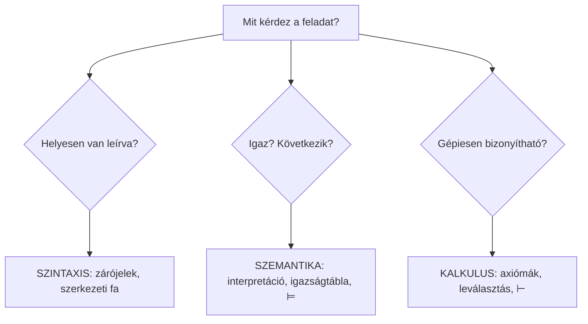
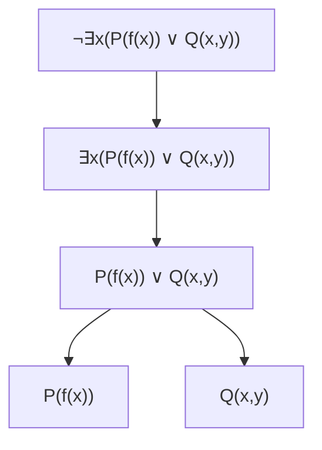
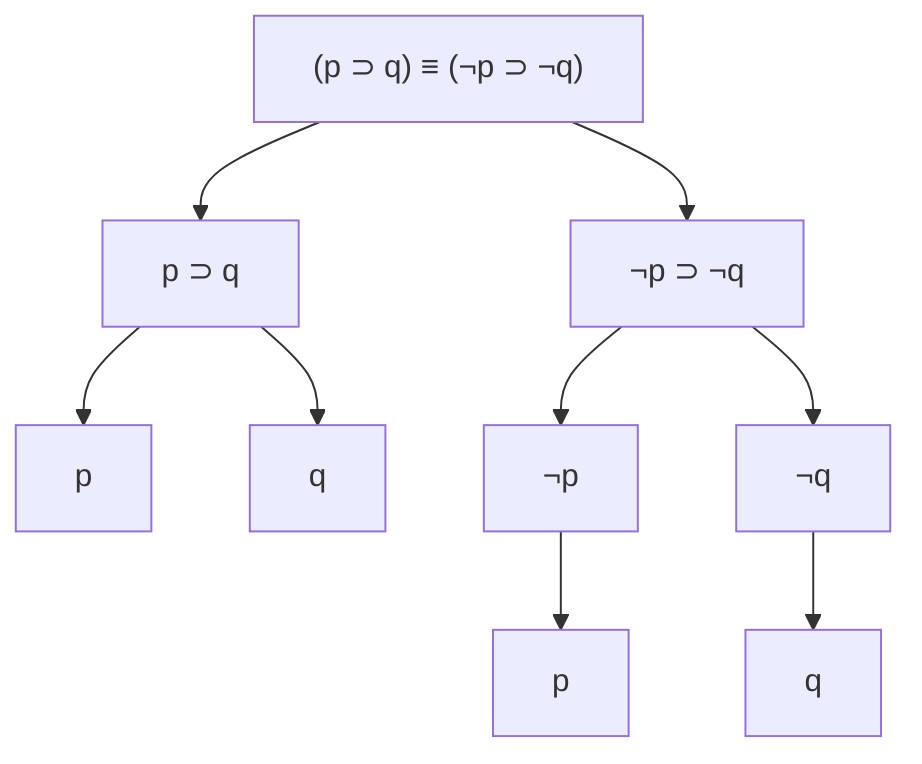
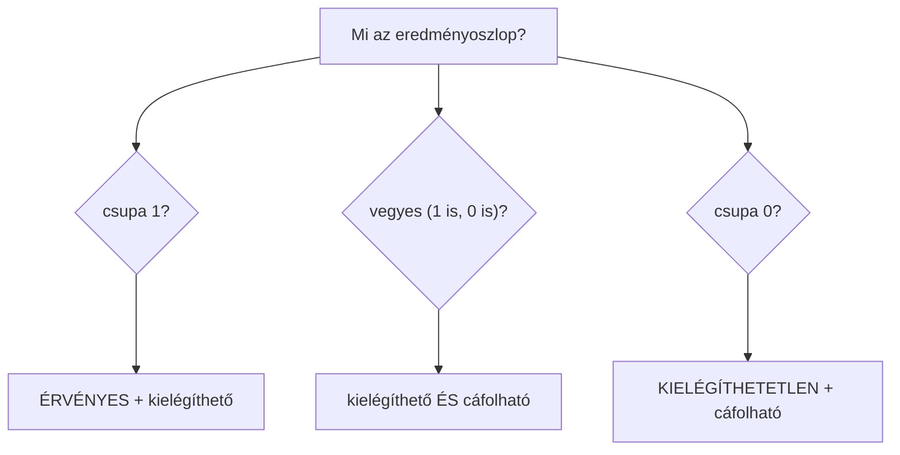

# 🧠 Az informatika logikai alapjai – ZH felkészülés

> [!abstract] Hogyan használd?
> 1. Olvasd el a **túlélőcsomagot** és a **10 trükköt** (kb. 10 perc) – ebben van a tantárgy lényege.
> 2. Ha egy jelnél elakadsz, lapozz vissza az **1. Jelölésszótárhoz**.
> 3. Menj sorban a fejezeteken. Mindegyikben van **Levezetés**, **⚡ Leggyorsabb módszer** és **Gyakori hiba**.
> 4. A kérdések alatt **lenyíló `Megoldás` dobozok** vannak: először oldd meg magad, aztán kattints rá.
> 5. A végén **gyakorló variációk** (14. fejezet) és a **ZH-lapozó** (13. fejezet) van.
>
> A fejezetszámok megegyeznek az eredeti jegyzet számozásával, így a „Hol van" oszlopok is stimmelnek.

> [!warning] ZH-tipp
> A „Select one or more" típusú kérdéseknél **minden** jó választ be kell jelölni, különben csak részpont jár.

> [!note] Jelmagyarázat
> - **Konyhai hasonlat** = hogy megértsd
> - **Recept** = lépések egymás után
> - **Csapda** = tipikus hiba
> - ⟦A⟧ = az $A$ formula igazságértéke (0 vagy 1). Az eredeti jegyzetben ezt $\lvert A\rvert_\rho$-nak írták.

---

## 0. Túlélőcsomag – 12 mondat

> [!abstract] A teljes tantárgy 12 mondatban
> 1. A logika két dolgot tanít: mikor **igaz** egy állítás, és mikor **következik** valami valamiből.
> 2. Három szint van: **szintaxis** (hogyan írjuk le helyesen – nyelvtan), **szemantika** (mikor igaz – jelentés), **kalkulus** (hogyan bizonyítunk gépiesen, szabályokkal).
> 3. Két építőkocka van: **nevek/termek** (dolgokra mutatnak: Péter, anyja(Juli)) és **formulák** (állítások, amik igazak vagy hamisak: elmegy(Juli)).
> 4. A formulákat **logikai jelekkel** kötjük össze: ¬ (nem), ∧ (és), ∨ (vagy), ⊃ (ha…akkor), ≡ (akkor és csak akkor), ∀ (minden), ∃ (van olyan).
> 5. Egy formula önmagában nem igaz vagy hamis. Kell hozzá egy **interpretáció**: megmondjuk, kikről beszélünk (univerzum), és melyik jel mit jelent.
> 6. Az igazságérték mindig **0 (hamis) vagy 1 (igaz)**.
> 7. **Modell** = olyan interpretáció, amelyben a formula (vagy a halmaz minden eleme) igaz.
> 8. **Kielégíthető** = van modellje. **Érvényes** (logikai törvény, tautológia) = minden interpretációban igaz. **Kielégíthetetlen** = nincs modellje.
> 9. **Γ ⊨ A** = ahol Γ minden eleme igaz, ott A is igaz. Másképp: Γ ∪ {¬A} kielégíthetetlen.
> 10. **A ⇔ B** (logikailag ekvivalens) = minden interpretációban ugyanaz az értékük.
> 11. Kvantoroknál: **∀ mellé ⊃ való, ∃ mellé ∧**. „Minden egyetemista sportol" = ∀x(E(x) ⊃ S(x)); „van sportoló egyetemista" = ∃x(E(x) ∧ S(x)).
> 12. A bizonyítások nagy része **indirekt**: tegyük fel az ellenkezőjét, vegyünk hozzá egy modellt, és fussunk bele egy ellentmondásba.

## ⚡ A 10 trükk, amivel a ZH feladatok 90%-a megoldható

> [!tip] 1. A ⊃ csak egyetlen esetben hamis
> $A ⊃ B$ **csak akkor 0**, ha $A=1$ és $B=0$. Minden más esetben 1. Ha az előtag 0 vagy az utótag 1 → az egész biztosan 1.

> [!tip] 2. ∧ és ∨ fejben
> - **∧**: csak az 1–1 ad 1-et. Egyetlen 0 elrontja.
> - **∨**: csak a 0–0 ad 0-t. Egyetlen 1 megmenti.

> [!tip] 3. Érvényes-e? Kielégíthető-e? – ne tölts ki egész táblát
> - **Érvényes?** Próbáld meg **hamissá tenni**. Ha találsz ilyen értékadást (ellenpélda) → nem érvényes. Ha nem sikerül → érvényes.
> - **Kielégíthető?** Próbáld meg **igazzá tenni**. Ha találsz egy értékadást → kielégíthető.

> [!tip] 4. Következik-e? Γ ⊨ A
> Kényszerítsd a premisszákat **1-re**, számold ki a többi változót, és nézd meg az A-t. Ha van olyan eset, ahol a premisszák 1, az A viszont 0 → **nem következik** (ez az ellenpélda).

> [!tip] 5. Fordítás kvantorokkal
> **∀ → ⊃, ∃ → ∧.** Fordítva szinte mindig hibás.

> [!tip] 6. Kvantorok és tagadás
> - ¬∀ ⇔ ∃¬ és ¬∃ ⇔ ∀¬ (a kvantor átfordul).
> - ∀y∃x **nem** ugyanaz, mint ∃x∀y. A kvantorok sorrendje számít.

> [!tip] 7. Átalakító szabályok (ezeket tanuld meg)
> - $A ⊃ B ⇔ ¬A ∨ B$
> - De Morgan: $¬(A ∧ B) ⇔ ¬A ∨ ¬B$ és $¬(A ∨ B) ⇔ ¬A ∧ ¬B$
> - Kontrapozíció: $A ⊃ B ⇔ ¬B ⊃ ¬A$

> [!tip] 8. Szabad / kötött változó
> Húzd alá minden kvantor **hatáskörét** (a közvetlenül utána álló legkisebb formulát). Az x **kötött**, ha van őt kötő kvantor a hatókörében, különben **szabad**.

> [!tip] 9. Kvantor kicsi univerzumban
> Írd ki az elemeket: **∀x A(x) = A(u₁) ∧ A(u₂) ∧ …**, **∃x A(x) = A(u₁) ∨ A(u₂) ∨ …**

> [!tip] 10. Bizonyítási sablon (indirekt)
> 1) Tegyük fel az ellenkezőjét. 2) Vegyünk egy modellt. 3) Írjuk fel, mi igaz és mi hamis benne. 4) **Ellentmondás** → az állítás igaz.

---

## 1. Jelölésszótár – mi hogyan néz ki és mit jelent

### 1.1 Logikai jelek (mindig ugyanazt jelentik)

| Jel | Neve | Olvasd így | Mikor igaz? | Konyhai hasonlat |
| --- | --- | --- | --- | --- |
| ¬A | negáció | nem A | ha A hamis | villanykapcsoló: átbillenti |
| A ∧ B | konjunkció | A és B | csak ha **mindkettő** igaz | két kulcs kell a páncélszekrényhez |
| A ∨ B | diszjunkció | A vagy B (megengedő!) | ha **legalább az egyik** igaz | „kávé vagy tea", de mindkettőt is lehet kérni |
| A ⊃ B | implikáció (→, ⇒) | ha A, akkor B | **csak 1→0-ra hamis** | ígéret: „ha esik, viszek esernyőt". Csak akkor hazudtál, ha esik és nem vittél |
| A ≡ B | ekvivalencia (↔) | A akkor és csak akkor, ha B | ha A és B értéke **egyezik** | két kapcsoló, ami mindig együtt áll |
| ∀x A | univerzális kvantor | minden x-re A | ha **minden** elemre igaz | „mindenki hozott tollat" |
| ∃x A | egzisztenciális kvantor | van olyan x, hogy A | ha **legalább egy** elemre igaz | „van, aki hozott tollat" |
| ( ) | zárójel | | | megmondja, mi mit fog össze |
| t₁ = t₂ | egyenlőség (elsőrendben) | t₁ egyenlő t₂-vel | ha a két név ugyanarra a dologra mutat | két név ugyanarra az emberre |

### 1.2 Nem logikai jelek (ezeket mi találjuk ki a feladathoz)

| Jel | Mi ez? | Példa |
| --- | --- | --- |
| p, q, r, X, Y, Z | állításjel: tovább nem bontott állítás | p = „havazik" |
| a, c, u, Péter, Éva | névjel (F⁽⁰⁾): egy konkrét dolog neve | J = Juli |
| f(·), anyja(·) | függvényjel (F⁽ⁿ⁾): **dolgot** ad vissza | anyja(Juli) = Juli anyja |
| P(·), E(·), S(·) | predikátumjel (P⁽ⁿ⁾): tulajdonság, belőle **állítás** lesz | E(x): x egyetemista |
| Q(·,·), R(·,·) | kétargumentumú predikátum: kapcsolat két dolog között | szereti(x,y) |
| x, y, z | változó: „üres hely" | ∀x P(x) |

> [!warning] Függvény ≠ predikátum
> A **függvény dolgot ad vissza** (anyja(Juli) egy ember), a **predikátum igaz/hamis állítás** lesz (elmegy(Juli)).
> Konyhán: a függvény egy gép, ami kiad egy hozzávalót; a predikátum egy kérdés, amire igen/nem a válasz.

### 1.3 Halmazok és kapcsolódó jelek

| Jel | Jelentése | Példa |
| --- | --- | --- |
| ∈ | eleme | A ∈ Γ |
| ⊆ | részhalmaza | Δ ⊆ Γ |
| ∅ | üres halmaz | |
| ∪ | unió | Γ ∪ {A}, gyakran: Γ, A |
| ∩ | metszet | LC ∩ Con = ∅ |
| ∖ | különbség | FreeVar(B) ∖ {x} |
| Γ, Δ | formulahalmazok | |
| U | univerzum: a világ, amiről beszélünk | U = {u₁, u₂} |
| Uⁿ | n-esek az univerzumból | U² = az összes pár |
| Dom(ρ) | értelmezési tartomány | Dom(ρ) = Con |
| ⟨ , ⟩ | rendezett pár/hármas | ⟨U, ρ⟩ |

### 1.4 A nyelv részei

| Jel | Jelentése |
| --- | --- |
| L⁽⁰⁾, L⁽¹⁾ | nulladrendű, illetve elsőrendű nyelv |
| LC | logikai konstansok (Logical Constants): ¬, ⊃, ∧, ∨, ≡, ∀, ∃, zárójelek |
| Var | változók halmaza |
| Con | nem logikai konstansok halmaza |
| F⁽⁰⁾, F⁽ⁿ⁾ | névjelek, n-argumentumú függvényjelek |
| P⁽⁰⁾, P⁽ⁿ⁾ | állításjelek, n-argumentumú predikátumjelek |
| Term, Form, AtForm | termek, formulák, atomi formulák halmaza |
| RF(A) | A részformuláinak halmaza |
| FreeVar(A), BoundVar(A) | szabad, illetve kötött változók |
| Cong(A) | az A-val kongruens formulák halmaza |

### 1.5 Szemantika jelei

| Jel | Jelentése | Példa |
| --- | --- | --- |
| ρ (ró) | értelmezés: melyik jel mit jelent | ρ(p) = 1, ρ(Péter) = lakó1 |
| ⟨U, ρ⟩ | interpretáció (nulladrendben elég a ρ) | |
| ⟦A⟧ρ | A igazságértéke az adott interpretációban (0 vagy 1) | ⟦p ∧ q⟧ρ |
| v | értékelés: minden változóhoz egy U-beli elemet rendel | v(x) = lakó3 |
| v[x:u] | ugyanaz a v, de x értéke most u | „x legyen u" |
| 0 / 1 | hamis / igaz (F/T, h/i is lehet) | |

### 1.6 Kapcsolat-jelek (formulák között)

| Jel | Jelentése | Hogyan olvasd |
| --- | --- | --- |
| Γ ⊨ A | szemantikai következmény | ahol Γ minden eleme igaz, ott A is igaz |
| Γ ⊭ A | nem következménye | |
| ⊨ A | A érvényes | ∅ ⊨ A, vagyis A mindig igaz |
| Γ ⊢ A | szintaktikai következmény | a szabályokkal levezethető |
| Cns(Γ) | Γ összes szintaktikai következménye | |
| A ⇔ B | logikai ekvivalencia | mindig ugyanaz az értékük |
| ⇒, ⟺ | magyarázó nyilak | **a mi mondatainkban**, nem a formulában |
| [A]ᵗₓ | behelyettesítés | A-ban x helyére t |
| A nand B | ¬(A ∧ B) | „not and" |

### 1.7 A legnagyobb csapda: négy „ha…akkor"

> [!warning] Ne keverd a szinteket!
> | Mi ez? | Hol él? | Mit jelent |
> | --- | --- | --- |
> | ⊃ | **a formulán belül**, logikai jel | az összetett formula része, van igazságtáblája |
> | ≡ | a formulán belül | ugyanígy |
> | ⊨ | **formulákról beszélünk vele** (metanyelv) | állítás arról, hogy A-ból következik B |
> | ⇔ | formulákról beszélünk vele | állítás arról, hogy két formula mindig egyforma |
> | ⊢ | formulákról beszélünk | levezethető |
>
> Kapcsolat: **A ⊨ B akkor és csak akkor, ha ⊨ A ⊃ B**, és **A ⇔ B akkor és csak akkor, ha ⊨ A ≡ B**.

---

## 2. A nagy kép



> [!info] Konyhai hasonlat
> - **Szintaxis** = a recept **helyesírása** (jó sorrendben, jó mennyiségekkel írtad le?).
> - **Szemantika** = a **megkóstolás** (finom-e, vagyis igaz-e?).
> - **Kalkulus** = a **receptkönyv szabályai** (csak engedélyezett lépéseket használhatsz).

## 3. Szintaxis – hogyan írunk le helyesen valamit

### 3.1 Két nyelv: nulladrendű és elsőrendű

| | Nulladrendű (ítéletlogika) | Elsőrendű (predikátumlogika) |
| --- | --- | --- |
| Angolul | propositional logic | first-order / predicate logic |
| Jelölés | L⁽⁰⁾ = ⟨LC, Con, Form⟩ | L⁽¹⁾ = ⟨LC, Var, Con, Term, Form⟩ |
| LC | {¬, ⊃, ∧, ∨, ≡, (, )} | + ∀, ∃, = |
| Mi van benne? | csak állításjelek (p, q, r, X, Y, Z…) | változók, nevek, függvények, predikátumok, kvantorok |

> [!info] Konyhai hasonlat
> A nulladrendű olyan, mint egy halom cetli, amire csak annyit írunk, hogy „igaz" vagy „hamis". Az elsőrendű olyan, mint egy recept, ahol hozzávalókra hivatkozunk és tulajdonságokat állítunk róluk.

**Formulák nulladrendben** (építőszabályok):

1. Minden állításjel formula.
2. Ha A formula, akkor ¬A is formula.
3. Ha A és B formula, akkor (A ⊃ B), (A ∧ B), (A ∨ B), (A ≡ B) is formula.
4. Más semmi nem formula.

**Atomi formula** nulladrendben = az állításjel (tovább nem bontható).

### 3.2 Elsőrendű: nevek (termek) és állítások (formulák)

**Term (összetett név) építőszabályai:**

1. Minden változó és névjel term. Példa: x, Péter, u.
2. Ha f n-argumentumú függvényjel és t₁, …, tₙ termek, akkor f(t₁, …, tₙ) is term. Példa: anyja(anyja(Péter)), f(x).

**Formula építőszabályai:**

1. Minden állításjel formula (havazik, p).
2. Ha t₁, t₂ termek, akkor (t₁ = t₂) formula.
3. Ha P n-argumentumú predikátumjel és t₁, …, tₙ termek, akkor P(t₁, …, tₙ) formula (özvegy(Péter), P(x, c)).
4. Ha A formula, akkor ¬A is.
5. Ha A, B formula, akkor (A ⊃ B), (A ∧ B), (A ∨ B), (A ≡ B) is.
6. Ha A formula és x változó, akkor ∀xA és ∃xA is.

**Atomi formulák** = az 1., 2., 3. szerintiek. Minden más **összetett formula**.

> [!question] Feladat – mi micsoda? (term / formula / hibás)
> 1. Péter
> 2. anyja(Péter)
> 3. anyja
> 4. elmegy(Péter)
> 5. elmegy(anyja(Péter))
> 6. anyja(elmegy(Péter))
> 7. elmegy(szereti(Péter, Éva))
> 8. ∀x elmegy(x)

> [!success]- ✅ Megoldás
> | # | Mi ez? | Miért? |
> | --- | --- | --- |
> | 1 | term | névjel |
> | 2 | term | függvény + term |
> | 3 | semmi | hiányzik az argumentum |
> | 4 | formula (atomi) | predikátum + term |
> | 5 | formula (atomi) | predikátum + összetett term |
> | 6 | **hibás** | függvény argumentuma csak term lehet, nem állítás |
> | 7 | **hibás** | predikátum argumentuma csak term lehet |
> | 8 | formula | kvantor + formula |

> [!example] ⚡ Leggyorsabb módszer
> Kérdezd meg: **dolgot vagy állítást** jelent? Dolog → term. Állítás (igaz/hamis lehet) → formula. Függvény és predikátum **argumentuma mindig dolog (term)**.

> [!warning] Gyakori hiba
> Állítást állítással csak ¬, ∧, ∨, ⊃, ≡ köt össze. Predikátumba predikátumot **nem** lehet tenni.

### 3.3 Fordítás: magyar mondat → formula

> [!tip] Recept
> 1. Keresd meg az **alapállításokat** (amik tovább nem bonthatók).
> 2. Nevezd el a **neveket** (Juli = J) és a **tulajdonságokat** (E(·) = elmegy).
> 3. A kötőszavakat cseréld logikai jelre.
> 4. Zárójelezz a mondat szerkezete szerint.

| Magyarul | Jel |
| --- | --- |
| nem, nincs, sem | ¬ |
| és, de, viszont, valamint, is | ∧ |
| vagy | ∨ |
| ha A, akkor B | A ⊃ B |
| csak akkor B, ha A | **B ⊃ A** (fordítva!) |
| A akkor és csak akkor, ha B | A ≡ B |
| sem A, sem B | ¬A ∧ ¬B |
| nem mindkettő | ¬(A ∧ B) |
| minden, mindenki | ∀ |
| van olyan, létezik, bizonyos | ∃ |

> [!example] Kidolgozott példa az előadásról
> „Juli anyja elmegy, és Éva itt marad, vagy mindketten elmennek, és Juli anyja vissza sem jön, de Éva vagy visszajön, vagy nem."
>
> **Nevek:** J = Juli, É = Éva, a(·) = valakinek az anyja. **Predikátumok:** E(·) = elmegy, IM(·) = itt marad, V(·) = visszajön.
>
> **Formula:** (E(a(J)) ∧ IM(É)) ∨ (((E(a(J)) ∧ E(É)) ∧ ¬V(a(J))) ∧ (V(É) ∨ ¬V(É)))

> [!warning] Gyakori hiba
> „**Csak akkor** B, ha A" = **B ⊃ A**, nem A ⊃ B! („Csak akkor megyek ki, ha süt a nap": kimenni ⊃ süt a nap.)

### 3.4 Részformula, közvetlen részformula, szerkezeti fa

- **Közvetlen részformula:** a közvetlenül alatta lévő darab. Atominak nincs; ¬A-nak az A; (A ∧ B) stb.-nek az A és a B; ∀xA-nak és ∃xA-nak az A.
- **Részformula:** a formula önmaga és közvetlen részformuláinak részformulái. Jelölés: RF(A).
- **Szerkezeti fa:** gyökér = a formula, gyerekek = közvetlen részformulák, levelek = atomi formulák.

> [!tip] Recept a fa megrajzolásához
> 1. Keresd meg a **főjelet**: azt, amit **utoljára** hajtanánk végre (a leggyengébb, legkülső).
> 2. Ez lesz a gyökér, alá a közvetlen részformulák.
> 3. Ismételd, amíg atomi formulákhoz nem érsz.

**Példa 1:** ¬∃x(P(f(x)) ∨ Q(x, y))



**Példa 2:** ((p ⊃ q) ≡ (¬p ⊃ ¬q)), a főjel a ≡



**Szerkezeti fa példák (1.I.15):**

- ¬¬¬(X ⊃ Y): ¬ → ¬ → ¬ → ⊃ → (X, Y), egy lánc.
- (X ⊃ Y) ∨ (X ⊃ Y ∧ Z): főjel ∨; bal gyerek ⊃(X, Y); jobb gyerek ⊃(X, ∧(Y, Z)).
- X ∨ Y ⊃ ¬Z ∧ ¬(X ⊃ ¬Z): főjel ⊃; bal ∨(X, Y); jobb ∧(¬Z, ¬(⊃(X, ¬Z))).

> [!warning] Gyakori hiba
> Zárójelek nélkül a fa **nem egyértelmű**! A (p ⊃ q) ≡ (¬p ⊃ ¬q) és a p ⊃ (q ≡ ¬(p ⊃ ¬q)) teljesen más fa. Ezért kell a zárójel vagy az erősorrend.

### 3.5 Zárójelek elhagyása – erősorrend

| Rang | Jel | Megjegyzés |
| --- | --- | --- |
| 1. (legerősebb) | ¬, ∀x, ∃x | egyenrangúak; a **közvetlenül utánuk álló legkisebb egységre** vonatkoznak |
| 2. | ∧ | |
| 3. | ∨ | |
| 4. | ⊃ | |
| 5. (leggyengébb) | ≡ | |

> [!info] Konyhai hasonlat
> ∧ olyan, mint a szorzás, ∨ mint az összeadás: a + b · c = a + (b · c). Így p ∨ q ∧ r = p ∨ (q ∧ r). A ⊃ és ≡ még az összeadásnál is gyengébb.

**Szabályok:**

1. A legkülső zárójelpár mindig elhagyható.
2. Az erősebb jel „magához húzza" a szomszédját: ha egy részformula főjele **erősebb**, mint a körülötte lévő jel, a zárójele elhagyható. Egyenlő vagy gyengébb → **marad**.
3. A negáció erősebb bármely kétargumentumú jelnél. A kvantorok erősebbek bármely állításlogikai műveletnél.
4. Azonos jelek egymás között: **a kiskáté és az előadás eltér!** A kiskáté: balról jobbra (p ⊃ q ⊃ r = (p ⊃ q) ⊃ r). Az előadás: p ⊃ (q ⊃ r). A ∧ és ∨ asszociatív, ott mindegy.

> [!warning] Gyakori hibák
> - Azonos jeleknél, ha számít (főleg ⊃-nál), **mindig tegyél zárójelet**.
> - ∀x P(x) ∨ Q(x) azt jelenti: (∀x P(x)) ∨ Q(x), tehát a Q(x)-beli x **szabad**! Ha a kvantor az egészre vonatkozik: ∀x(P(x) ∨ Q(x)).

> [!question] Feladat – rövidítsd a formulát (1.I.5)
> 1. ((X ∨ Y) ⊃ Z)
> 2. (¬(X ∨ Y) ⊃ Z)
> 3. ¬((X ∨ Y) ⊃ Z)
> 4. (((X ⊃ Y) ∧ (Y ⊃ Z)) ⊃ (¬X ∨ Z))
> 5. ((X ⊃ Y) ≡ (¬X ∨ Y))
> 6. (((X ∨ Y) ⊃ ¬Z) ≡ (X ∧ ¬Z))
> 7. ¬(((X ⊃ Y) ⊃ (Y ∨ Z)) ⊃ (¬X ∨ Z))

> [!success]- ✅ Megoldás
> | # | Rövidítve |
> | --- | --- |
> | 1 | X ∨ Y ⊃ Z |
> | 2 | ¬(X ∨ Y) ⊃ Z |
> | 3 | ¬(X ∨ Y ⊃ Z) |
> | 4 | (X ⊃ Y) ∧ (Y ⊃ Z) ⊃ ¬X ∨ Z |
> | 5 | X ⊃ Y ≡ ¬X ∨ Y |
> | 6 | X ∨ Y ⊃ ¬Z ≡ X ∧ ¬Z |
> | 7 | ¬(((X ⊃ Y) ⊃ Y ∨ Z) ⊃ ¬X ∨ Z) |

> [!example] ⚡ Leggyorsabb módszer
> Töröld a legkülső zárójelet, majd minden belső zárójelnél kérdezd: **erősebb-e a benne lévő főjel, mint a környező?** ∨ és ∧ erősebb a ⊃-nál, ezért (X ∨ Y) ⊃ Z zárójele elhagyható. A ¬(…) zárójele marad, ha a ¬ az **egész** ∨-ra vonatkozik.

### 3.6 Formula-e? (1.I.3)

> [!tip] Recept
> 1. Minden kétargumentumú jel körül **pontosan egy** zárójelpár van-e?
> 2. A zárójelek párosak-e?
> 3. Nincs-e két formula „egymás mellé dobva" jel nélkül?

> [!question] Feladat – formulák-e a következők?
> 1. (X ∧ Y)¬Z
> 2. ((X ∧ Y) ⊃ Z)
> 3. (Z ∨ X ∧ ¬Y)
> 4. (((¬X) ⊃ Y) ⊃ ¬(X ∨ Z))
> 5. ¬(X ∨ Y ⊃ ¬¬Z)
> 6. ¬(X ∨ Y ∧ ¬Z

> [!success]- ✅ Megoldás
> | # | Formula? | Miért |
> | --- | --- | --- |
> | 1 | **nem** | két formula egymás mellett, nincs köztük jel |
> | 2 | **igen** | főjel ⊃, bal gyerek (X ∧ Y), jobb gyerek Z |
> | 3 | szigorúan **nem** | két kétargumentumú jel egy zárójelben. Erősorrenddel (Z ∨ (X ∧ ¬Y)) rövidítése |
> | 4 | szigorúan **nem** | a (¬X) felesleges zárójele miatt. Hibátlan: ((¬X ⊃ Y) ⊃ ¬(X ∨ Z)) |
> | 5 | szigorúan **nem**, rövidítéssel igen | a ¬((X ∨ Y) ⊃ ¬¬Z) rövidítése |
> | 6 | **nem** | hiányzik a záró zárójel |

> [!warning] Gyakori hiba
> Az oktató szigorúságától függ, hogy a rövidítést elfogadja-e. Válaszold meg a **szigorú alapon**, és írd mellé, hogy az erősorrenddel mi lenne.

### 3.7 Szabad és kötött változók

- **Hatáskör (scope):** a ∀x vagy ∃x után közvetlenül álló legkisebb formula.
- Egy változó előfordulása **kötött**, ha beleesik egy ugyanazzal a változóval képzett ∀x B vagy ∃x B részformulába. Különben **szabad**.
- **Nyitott formula:** van benne szabad előfordulás. **Zárt formula:** nincs. Csak a zárt formulának van „önmagában" igazságértéke.
- **FreeVar(A)**: szabad változók halmaza. Atomiban minden változó szabad; FreeVar(¬B) = FreeVar(B); kétargumentumúnál a két oldal uniója; **FreeVar(∀xB) = FreeVar(B) ∖ {x}**. BoundVar(∀xB) = BoundVar(B) ∪ {x}.

> [!info] Konyhai hasonlat
> A kvantor egy **keret**: a bele eső változó „megkötött", ott értelmetlen kikérdezni, hogy ki az x. Ami a keretnél kívül van, az szabad: egy konkrét, még meg nem adott dolog.

> [!tip] Recept
> 1. Húzd alá minden kvantor hatáskörét.
> 2. Nézd végig az x-ek előfordulásait: van keret, és a keret **ugyanazt a betűt** köti → kötött. Különben szabad.

> [!question] Feladat (3.P.2) – add meg a szabad előfordulásokat, FreeVar-t, és hogy nyitott vagy zárt
> 1. ∃xP(x) ∧ P(x)
> 2. ∀xQ(x,y) ⊃ ∀yQ(x,y)
> 3. ∃x∃y(Q(x,y) ∧ P(z))
> 4. ∀x(Q(x,c) ⊃ ∃yQ(x,y))
> 5. ∀x(∀yR(x,y,z) ⊃ Q(x,y))
> 6. ∀y∃z(R(x,g(x,y),z) ⊃ ∃xQ(z,x))
> 7. ∃x∀y(P(x) ∨ Q(x,f(y)) ⊃ ∀yQ(x,y))

> [!success]- ✅ Megoldás
> | # | Szabad előfordulások | FreeVar | Nyitott/zárt |
> | --- | --- | --- | --- |
> | 1 | a második x | {x} | nyitott |
> | 2 | bal oldali y, jobb oldali x | {x, y} | nyitott |
> | 3 | z | {z} | nyitott |
> | 4 | nincs (c névjel, nem változó) | ∅ | **zárt** |
> | 5 | z az R-ben; y a Q-ban (a ∀y csak az R-re vonatkozik) | {y, z} | nyitott |
> | 6 | x az R-ben (a ∃x csak a Q-ra vonatkozik) | {x} | nyitott |
> | 7 | nincs | ∅ | **zárt** |
>
> A nem logikai konstansok (paraméterek) a 7. formulában: P, Q, f.

> [!warning] Gyakori hiba
> Ugyanaz a betű lehet egy formulán belül egyszer szabad, másszor kötött: ∃xP(x) ∧ P(x). Az első x kötött, a második szabad.

> [!note] Fiktív kvantor
> Ha az x nincs szabadon A-ban, akkor ∀xA ⇔ A és ∃xA ⇔ A, mert a kvantor nem köt semmit.

---

## 4. Szemantika – mikor igaz egy formula?

### 4.1 Interpretáció: „mi micsoda?"

A formula csak egy jelsor. Hogy igaz-e, azt csak akkor lehet eldönteni, ha megmondjuk, **mit jelentenek a jelek**.

**Nulladrendben:** az interpretáció minden állításjelhez 0-t vagy 1-et rendel. ρ(p) = 1, ρ(q) = 0 azt jelenti: „p igaz, q hamis". Ha n állításjel van, **2ⁿ** interpretáció van (az igazságtábla sorainak száma).

**Elsőrendben:** az interpretáció egy pár, ⟨U, ρ⟩:

1. **U** az univerzum, **nem üres** halmaz: akikről beszélünk.
2. ρ megadja, hogy
   - minden névjelhez egy U-beli elem tartozik: ρ(a) ∈ U;
   - minden n-argumentumú függvényjelhez egy Uⁿ → U függvény: ρ(f);
   - minden állításjelhez 0 vagy 1;
   - minden n-argumentumú predikátumhoz egy reláció, vagyis Uⁿ egy részhalmaza: ρ(P) ⊆ Uⁿ. Ez azoknak az n-eseknek a listája, amikre a predikátum **igaz**.

> [!info] Konyhai hasonlat
> Az univerzum a **vendégek listája** egy bulin. A ρ a **névsoroló**: megmondja, ki kicsoda („Péter = az 1. vendég"), és minden tulajdonsághoz kitölt egy listát arról, kikre igaz.

> [!example] Kidolgozott példa (előadás)
> U = {lakó1, lakó2, lakó3, lakó4, …}. ρ(Péter) = lakó1, ρ(Juli néni) = lakó13, ρ(Mari néni) = lakó4.
> ρ(édesanyja): lakó2 → lakó4, lakó1 → lakó3. ρ(tanul) = {lakó1, lakó2}, ρ(dolgozik) = {lakó4}, ρ(munkatársak) = {(lakó2, lakó5), (lakó5, lakó2), (lakó3, lakó4), (lakó4, lakó3)}.
>
> | Formula | Számítás | Érték |
> | --- | --- | --- |
> | tanul(Péter) | lakó1 ∈ {lakó1, lakó2} | **1** |
> | dolgozik(Mari néni) | lakó4 ∈ {lakó4} | **1** |
> | tanul(édesanyja(Péter)) | édesanyja(lakó1) = lakó3 ∉ {lakó1, lakó2} | **0** |
> | munkatársak(Juli néni, Mari néni) | (lakó13, lakó4) nincs a listában | **0** |

### 4.2 Szemantikai szabályok és az igazságtábla

**Nulladrendben** (A, B tetszőleges formulák):

- ⟦p⟧ρ = ρ(p)
- ⟦¬A⟧ρ = 1 − ⟦A⟧ρ
- ⟦A ∧ B⟧ρ = 1 pontosan akkor, ha mindkettő 1
- ⟦A ∨ B⟧ρ = 0 pontosan akkor, ha mindkettő 0
- ⟦A ⊃ B⟧ρ = 0 pontosan akkor, ha ⟦A⟧ρ = 1 és ⟦B⟧ρ = 0
- ⟦A ≡ B⟧ρ = 1 pontosan akkor, ha ⟦A⟧ρ = ⟦B⟧ρ

> [!tip] Az igazságtábla – ezt tudni kell fejből
> | A | B | ¬A | A ⊃ B | A ∧ B | A ∨ B | A ≡ B |
> | --- | --- | --- | --- | --- | --- | --- |
> | 0 | 0 | 1 | 1 | 0 | 0 | 1 |
> | 0 | 1 | 1 | 1 | 0 | 1 | 0 |
> | 1 | 0 | 0 | **0** | 0 | 1 | 0 |
> | 1 | 1 | 0 | 1 | 1 | 1 | 1 |

> [!example] ⚡ Fejben tartási trükkök
> - **∧**: csak az 1–1 ad 1-et.
> - **∨**: csak a 0–0 ad 0-t.
> - **⊃**: egyetlen hamis sor van: 1 ⊃ 0.
> - **≡**: 1, ha a két oldal egyforma.
> - **¬**: megfordít.

> [!info] Miért igaz a 0 ⊃ valami?
> Az ígéret-hasonlat: „ha esik, viszek esernyőt". Ha nem esik, nem hazudtál, akármit teszel. A ⊃ azt jelenti: **„nem lehet, hogy A igaz és B hamis"**, vagyis (A ⊃ B) ⇔ ¬(A ∧ ¬B).

> [!warning] Gyakori hiba
> A magyar „ha…akkor" gépi ⊃-t jelent: a hamis előtag mindig „igaz" eredményt ad. Ne akarj mellé ok-okozati kapcsolatot képzelni.

### 4.3 Hogyan tölts ki egy igazságtáblát (recept)

> [!tip] Recept
> 1. Számold meg az állításjeleket (n db). A sorok száma **2ⁿ**.
> 2. Az oszlopok: a **változók és a részformulák**, belülről kifelé.
> 3. Az eredményoszlop a **főjel** alá kerül.
> 4. Olvasd le: csupa 1 → **érvényes**; csupa 0 → **kielégíthetetlen**; van 1 → **kielégíthető**; van 0 → **cáfolható**.

**Példa:** (X ⊃ Y) ⊃ (Y ⊃ X)

| X | Y | X ⊃ Y | Y ⊃ X | eredmény |
| --- | --- | --- | --- | --- |
| 0 | 0 | 1 | 1 | 1 |
| 0 | 1 | 1 | 0 | **0** |
| 1 | 0 | 0 | 1 | 1 |
| 1 | 1 | 1 | 1 | 1 |

Van 1 → kielégíthető (X=1, Y=0). Van 0 → **nem** érvényes (X=0, Y=1 cáfolja).

> [!note] A ⊃ (¬A ⊃ B) minden sora 1 → érvényes
> Tanulság: hamis előtagból bármi következik („robbanás elve": ellentmondásból minden következik).

> [!tip] Gyorsabb módszer, ha csak egy interpretációt kérdeznek (5.I.6, 5.I.8)
> Helyettesítsd be a 0/1 értékeket, és számolj **belülről kifelé**.
> - X ∨ ¬Y ⊃ Z, ha X=1, Y=1, Z=0: (1 ∨ 0) = 1, 1 ⊃ 0 = **0**.
> - Ugyanez, ha X=0, Y=0, Z=1: (0 ∨ 1) = 1, 1 ⊃ 1 = **1**.
> - X=0, Y=1 mellett:
>   - X ⊃ (Y ⊃ X) = 0 ⊃ (…) = **1**
>   - ¬(Y ⊃ X) ∧ (X ∨ ¬Y) = ¬(1 ⊃ 0) ∧ (0 ∨ 0) = 1 ∧ 0 = **0**
>   - ((¬X ⊃ Y) ⊃ X) ⊃ ¬Y = ((1 ⊃ 1) ⊃ 0) ⊃ 0 = (1 ⊃ 0) ⊃ 0 = 0 ⊃ 0 = **1**

> [!question] Csavaros kérdések (5.I.9, 5.I.10): mit tudunk részinformációból?
> 1. ¬X ⊃ (¬Y ∧ X) ∨ Z, ha Z = 1. Mennyi az érték?
> 2. (X ⊃ Y) ⊃ (¬Y ⊃ ¬X), ha Y = 1. Mennyi az érték?
> 3. ¬X ∧ Y ⊃ X ∨ Y, ha ⟦X ⊃ Y⟧ = 1. Mennyi az érték?

> [!success]- ✅ Megoldás
> 1. A jobb oldal (… ∨ Z) biztosan 1 → az egész ⊃ **igaz (1)**.
> 2. Y=1 → ¬Y=0 → ¬Y ⊃ ¬X = 1 → az egész **igaz (1)**.
> 3. Ha X=1, a jobb oldal 1. Ha X=0, a bal Y, a jobb Y → Y ⊃ Y = 1. **Igaz (1)** (valójában a formula érvényes).

> [!note] Ugyanaz kódban (ha így érthetőbb)
> Az értékelés egy rekurzív függvény, ami a szerkezeti fa leveleitől a gyökér felé halad. (Egyszerűsített változat: csak névjelek, nincsenek függvényjelek.)
>
> ```python
> def evaluate(formula, universe, rho, v):
>     kind = formula['kind']
>     if kind == 'atom':
>         args = tuple(v.get(a, rho.get(a)) for a in formula['args'])
>         return 1 if args in rho[formula['name']] else 0
>     if kind == 'not':
>         return 1 - evaluate(formula['sub'], universe, rho, v)
>     if kind in ('forall', 'exists'):
>         values = [evaluate(formula['sub'], universe, rho, {**v, formula['var']: u})
>                   for u in universe]          # {**v, x: u} is v[x:u]
>         return 1 if (all(values) if kind == 'forall' else any(values)) else 0
>     left = evaluate(formula['left'], universe, rho, v)
>     right = evaluate(formula['right'], universe, rho, v)
>     if kind == 'and':     return 1 if left == 1 and right == 1 else 0
>     if kind == 'or':      return 0 if left == 0 and right == 0 else 1
>     if kind == 'implies': return 0 if left == 1 and right == 0 else 1
>     if kind == 'equiv':   return 1 if left == right else 0
> ```

### 4.4 Elsőrendű szabályok: értékelés, kvantorok

- **Értékelés (v):** minden változóhoz hozzárendel egy U-beli elemet („x most ez a vendég"). A változók értékét **nem ρ**, hanem **v** adja.
- **Módosított értékelés v[x:u]:** ugyanaz, mint v, de x értéke u.
- ⟦a⟧ = ρ(a) névjelre; ⟦x⟧ = v(x) változóra; ⟦f(t₁,…,tₙ)⟧ = ρ(f)(⟦t₁⟧, …, ⟦tₙ⟧).
- ⟦P(t₁,…,tₙ)⟧ = 1, ha az (⟦t₁⟧, …, ⟦tₙ⟧) n-es **benne van** a ρ(P) listában, különben 0.
- ⟦t₁ = t₂⟧ = 1, ha a két érték ugyanaz az elem.
- **⟦∀xA⟧ = 0**, ha **van** olyan u ∈ U, hogy ⟦A⟧ a v[x:u] értékeléssel 0. Különben 1.
- **⟦∃xA⟧ = 1**, ha **van** olyan u ∈ U, hogy ⟦A⟧ a v[x:u] értékeléssel 1. Különben 0.

> [!info] Konyhai hasonlat
> ∀ = **teljes étterem-ellenőrzés**: minden asztalt végignézünk, egyetlen rossz asztal bármire „hamis". ∃ = **keresünk egy jó asztalt**: amint találtunk, „igaz".

> [!tip] Recept kvantoros formulához (kicsi univerzumban)
> 1. Írd ki az univerzum elemeit.
> 2. **∀x A(x)** = A(u₁) ∧ A(u₂) ∧ … **∃x A(x)** = A(u₁) ∨ A(u₂) ∨ …
> 3. Több kvantornál **kívülről befelé** bontsd.
> 4. A kvantor „kész" részénél helyettesítsd be az elemet x helyére.

> [!example] Kidolgozott példa
> U = {u₁, u₂}, ρ(A) = {(u₁, u₂), (u₂, u₁)}, tehát A(u₁,u₂) = A(u₂,u₁) = 1, A(u₁,u₁) = A(u₂,u₂) = 0.
>
> - **∀y∃x A(x,y) = 1.** y = u₁-re x = u₂ jó (A(u₂,u₁) = 1). y = u₂-re x = u₁ jó. Minden y-hoz találtunk x-et.
> - **∃x∀y A(x,y) = 0.** x = u₁-re ∀y A(u₁,y) hamis (A(u₁,u₁) = 0). x = u₂-re is (A(u₂,u₂) = 0). Nincs olyan x, ami mindenkivel „jó".

> [!warning] Gyakori hiba: a kvantorok sorrendje számít!
> ∀y∃x ≠ ∃x∀y. „Mindenkit szeret valaki" (∀y∃x) ≠ „van, aki mindenkit szeret" (∃x∀y). Az ∃x∀y az **erősebb** állítás.

> [!example] Másik példa
> U = {u₁, u₂}, ρ(A) = {u₁}, ρ(B) = {u₂}. ∀x(A(x) ∨ B(x)): u₁-re A igaz, u₂-re B igaz → minden elemre van egy igaz tag → **1**.

> [!question] Feladat (5.P.5)
> U = {1,2,3,4}, ρ(R) = {(u,v) : u osztója v-nek}. Igazak-e?
> 1. ¬∃x¬R(x,x)
> 2. ∀y∃xR(x,y)
> 3. ∃x∀yR(x,y)
> 4. ∃x∃y(R(x,y) ∧ ¬R(y,x))
> 5. ∀x∀y(R(x,y) ∨ ¬R(y,x))

> [!success]- ✅ Megoldás
> 1. Minden szám osztója önmagának → nincs rossz x → **igaz**.
> 2. x = 1 minden y-t oszt → **igaz**.
> 3. x = 1 mindent oszt → **igaz**.
> 4. x = 1, y = 2: 1 osztja 2-t, de 2 nem osztja 1-et → **igaz**.
> 5. x = 2, y = 1: R(2,1) = 0, ¬R(1,2) = ¬1 = 0 → a „vagy" 0 → **hamis**.

> [!example] ⚡ Leggyorsabb módszer
> Nem kell mindent kiszámolni. **∃**-nál keress **egy** jó elemet. **∀**-nál keress **egy** rossz elemet (ellenpéldát). Ha találsz, kész vagy.

### 4.5 Olvasd fel természetes nyelven (2.P.7, 5.P.1)

> [!tip] Recept
> Kívülről befelé olvass. A kvantorokat fordítsd (∀ = minden, ∃ = van olyan), a predikátumokat az interpretáció szerint.

**2.P.7:** f(x) = x + 1, P(x): x páros, Q(x,y): x ≤ y, U = természetes számok.

| Formula | Olvasd így |
| --- | --- |
| ∃xP(x) | van páros szám |
| ¬∀xP(x) | nem minden szám páros |
| ∃x¬P(x) | van nem páros szám (ugyanaz, mint az előző) |
| ¬¬∃xP(x) | nem igaz, hogy nincs páros, azaz van páros |
| ∀xQ(x,x) | minden szám ≤ önmagánál (igaz) |
| ∀x(P(x) ∨ P(f(x))) | minden számra vagy ő maga, vagy a rákövetkezője páros (igaz) |
| ∀x(P(x) ⊃ P(f(f(x)))) | ha páros, akkor x + 2 is páros (igaz) |
| ¬∃x¬Q(x,f(x)) | nincs olyan szám, ami nagyobb a rákövetkezőjénél, azaz minden x ≤ x + 1 (igaz) |
| ¬∃xQ(f(x),x) | nincs olyan szám, amelynek rákövetkezője ≤ őnála (igaz) |

**5.P.1:** ∀x(P(x,c) ⊃ ∃yQ(f(y),x)):

- (a) U = ℝ, c = 0, f = négyzetre emelés, P = „nagyobb", Q = egyenlőség: „minden x-re, ha x > 0, akkor van olyan y, hogy y² = x". **Igaz** (minden pozitív valós számnak van négyzetgyöke).
- (b) U = a rendezvény résztvevői, c = Cilike, f(x) = az, aki x-et meghívta, P = barátok, Q = ugyanaz a személy: „Cilike minden barátja meghívott valakit a rendezvényre" (f(y) = x azt jelenti, hogy x az, aki y-t meghívta).

### 4.6 Fordítás kvantorokkal: magyar → elsőrendű formula

> [!tip] Általános szabályok
> - „Minden A B" → **∀x(A(x) ⊃ B(x))**
> - „Van olyan A, ami B" → **∃x(A(x) ∧ B(x))**
> - „Nincs olyan A, ami B" → **¬∃x(A(x) ∧ B(x))** ⇔ ∀x(A(x) ⊃ ¬B(x))
> - „Nem minden A B" → ¬∀x(A(x) ⊃ B(x)) ⇔ ∃x(A(x) ∧ ¬B(x))

> [!warning] Nagyon gyakori csapdák
> - ∀x(E(x) ∧ S(x)) azt jelenti: **mindenki** egyetemista és sportol. Ez **nem** az, hogy „minden egyetemista sportol".
> - ∃x(E(x) ⊃ S(x)) szinte mindig igaz (bármelyik nem-egyetemista igazzá teszi). Ez **nem** az, hogy „van sportoló egyetemista".

> [!question] Feladat (2.P.8): v = Veronika, a = Ákos, E(x): x egyetemista, S(x): x sportol. Fordítsd formulára!
> 1. Veronika egyetemi hallgató.
> 2. Ha Veronika egyetemi hallgató, akkor Ákos is az.
> 3. Vannak egyetemi hallgatók.
> 4. Nem mindenki egyetemi hallgató.
> 5. Bizonyos egyetemi hallgatók sportolnak.
> 6. Nincs olyan egyetemi hallgató, aki nem sportol.

> [!success]- ✅ Megoldás
> | # | Formula |
> | --- | --- |
> | 1 | E(v) |
> | 2 | E(v) ⊃ E(a) |
> | 3 | ∃xE(x) |
> | 4 | ¬∀xE(x) |
> | 5 | ∃x(E(x) ∧ S(x)) |
> | 6 | ¬∃x(E(x) ∧ ¬S(x)) ⇔ ∀x(E(x) ⊃ S(x)) |

> [!question] Feladat (2.P.6): szeret(x,y): x szereti y-t. Fordítsd formulára!
> Mindig kérdezd: **ki az első argumentum (aki szeret), és ki a második (akit szeretnek)?**
> 1. Mindenki szeret valakit.
> 2. Mindenkit szeret valaki.
> 3. Mindenki szeret mindenkit.
> 4. Mindenki szereti önmagát.
> 5. Van, aki mindenkit szeret.
> 6. Van, akit mindenki szeret.
> 7. Van, aki szereti önmagát.
> 8. Senki sem szeret mindenkit.
> 9. Senkit sem szeret mindenki.
> 10. Van, aki senkit sem szeret.
> 11. Van, akit senki sem szeret.

> [!success]- ✅ Megoldás
> | # | Formula |
> | --- | --- |
> | 1 | ∀x∃y szeret(x,y) |
> | 2 | ∀y∃x szeret(x,y) |
> | 3 | ∀x∀y szeret(x,y) |
> | 4 | ∀x szeret(x,x) |
> | 5 | ∃x∀y szeret(x,y) |
> | 6 | ∃y∀x szeret(x,y) |
> | 7 | ∃x szeret(x,x) |
> | 8 | ¬∃x∀y szeret(x,y) |
> | 9 | ¬∃y∀x szeret(x,y) |
> | 10 | ∃x∀y ¬szeret(x,y) |
> | 11 | ∃y∀x ¬szeret(x,y) |

> [!example] ⚡ Leggyorsabb módszer
> 1. A mondat **első szavából** a fő kvantor („Mindenki…" → ∀x, „Van, aki…" → ∃x).
> 2. A „végző" rész („szeret valakit") → ∃y szeret(x,y).
> 3. „senki" = ¬∃, „nem mindenki" = ¬∀.
> 4. **Írd vissza magyarra**, hogy ellenőrizd.

---

## 5. Szemantikai alapfogalmak: modell, kielégíthetőség, érvényesség

### 5.1 Modell

- **Formulahalmaz modellje:** olyan interpretáció, amelyben a halmaz **minden** eleme igaz (egyszerre, ugyanabban az interpretációban!).
- **Formula modellje:** az egyelemű {A} halmaz modellje, vagyis olyan interpretáció, ahol A igaz.
- **Elsőrendben** a modell egy **hármas**: ⟨U, ρ, v⟩ (univerzum + szótár + értékelés).

> [!info] Konyhai hasonlat
> A modell egy „jelentésválasztás", ami mellett a recept „az" kijön: ha a ρ jól választott, az összes állítás igaz.

### 5.2 A négy „féle" formula (angolul)

| Fogalom | Mit jelent | Angolul | Más néven |
| --- | --- | --- | --- |
| **Kielégíthető** | van modellje, **legalább egy** interpretációban igaz | satisfiable | |
| **Kielégíthetetlen** | nincs modellje, **sehol** nem igaz | unsatisfiable | ellentmondás |
| **Érvényes** | **minden** interpretációban igaz, jelölés: ⊨ A | valid | logikai törvény, tautológia |
| **Cáfolható** | van olyan interpretáció, ahol hamis | falsifiable | |



| Eredményoszlop | Érvényes? | Kielégíthető? | Cáfolható? | Kielégíthetetlen? |
| --- | --- | --- | --- | --- |
| csupa 1 | igen | igen | nem | nem |
| vegyes | nem | igen | igen | nem |
| csupa 0 | nem | nem | igen | igen |

> [!tip] Memóriatipp
> **Érvényes → kielégíthető** (ez irányban igaz, fordítva nem!). **Kielégíthetetlen → cáfolható** (fordítva nem).

**Kapcsolat a formula és a tagadottja között:**

- A érvényes ⇔ ¬A kielégíthetetlen
- A kielégíthetetlen ⇔ ¬A érvényes
- A kielégíthető, de ¬A is lehet kielégíthető (p és ¬p is az)

> [!warning] Formulahalmazra
> Γ kielégíthető, ha van modellje (van olyan interpretáció, ahol minden elem **egyszerre** igaz). A {p, ¬p} halmaz minden eleme kielégíthető külön-külön, de a halmaz **nem**. Az **üres halmaz kielégíthető** (minden interpretáció modellje, mert nincs elem, ami hamis lehetne).

### 5.3 Két tétel a halmazokról

> [!info] Tétel 1: kielégíthető halmaz minden részhalmaza kielégíthető
> Értelem: ha a teljes recept elkészíthető, akkor a fele is.
> **Bizonyítás:** Legyen Γ kielégíthető és Δ ⊆ Γ. Γ-nak van modellje, legyen ρ. Ha A ∈ Δ, akkor A ∈ Γ, így ⟦A⟧ρ = 1. Tehát ρ Δ-nak is modellje. ■

> [!info] Tétel 2: kielégíthetetlen halmaz minden bővítése kielégíthetetlen
> Értelem: ha a recept eleve nem elkészíthető, több hozzávalóval sem lesz az.
> **Bizonyítás (indirekt):** Legyen Γ kielégíthetetlen, Γ ⊆ Δ, és tegyük fel, hogy Δ kielégíthető. Az 1. tétel miatt a Γ (ami Δ részhalmaza) is kielégíthető volna. Ellentmondás. ■

> [!tip] Bizonyítási sablon (indirekt) – ezt fogod használni sokszor
> 1. Tegyük fel az ellenkezőjét annak, amit bizonyítani kell.
> 2. Ebből kapsz egy modellt.
> 3. Írd fel ebben a modellben, mi igaz, mi hamis (⟦A⟧ρ = 1, ⟦¬B⟧ρ = 1, ezért ⟦B⟧ρ = 0…).
> 4. Mutasd meg, hogy ez ellentmond a feltevésnek. → az eredeti állítás igaz.

### 5.4 Gyakorlatok: kielégíthetőség

> [!question] Feladat (102–108): válaszolj igen/nem, és indokolj
> - 102. Kielégíthetetlen halmazban mindig van hamis elem?
> - 103. Minden kielégíthetetlen halmaznak van kielégíthető része?
> - 104. … van **nem üres** kielégíthető része?
> - 105. Minden kielégíthető halmaznak van kielégíthetetlen bővítése?
> - 106. Kielégíthetetlen halmaz minden része kielégíthetetlen?
> - 107. Kielégíthető-e az üres halmaz?
> - 108. Adj példát kielégíthető és kielégíthetetlen halmazra.

> [!success]- ✅ Megoldás
> | # | Válasz | Indoklás / ellenpélda |
> | --- | --- | --- |
> | 102 | **Igen** | bármely ρ-ban van legalább egy hamis elem (különben ρ modell volna). **De ρ-nként más lehet:** {p, ¬p}-ben p=1-nél ¬p a hamis, p=0-nál p |
> | 103 | **Igen** | az üres halmaz |
> | 104 | **Nem** | {p ∧ ¬p}: az egyetlen nem üres részhalmaz saját maga, az pedig kielégíthetetlen |
> | 105 | **Igen** | add hozzá a p ∧ ¬p-t |
> | 106 | **Nem** | {p, ¬p}-nek része a {p} (kielégíthető) és az ∅ |
> | 107 | **Kielégíthető** | minden interpretáció modellje |
> | 108 | | kielégíthető: {p, q}, {p ⊃ q}; kielégíthetetlen: {p, ¬p}, {p ∧ ¬p} |

> [!question] Feladat 7.I.1 – melyik állítás igaz?
> (a) kielégíthető ⇔ logikai törvény · (b) csak akkor kielégíthető, ha logikai törvény · (c) csak akkor logikai törvény, ha kielégíthető · (d) pontosan akkor nem kielégíthető, ha ellentmondás · (e) ha logikai törvény, akkor kielégíthető · (f) ha nem ellentmondás, akkor nem logikai törvény · (g) ha kielégíthető, akkor a negáltja is · (h) ha logikai törvény, a negáltja nem elégíthető ki · (i) ha a negáltja kielégíthető, akkor logikai törvény

> [!success]- ✅ Megoldás
> | | Igaz? | Miért |
> | --- | --- | --- |
> | (a) | **hamis** | p kielégíthető, de nem törvény |
> | (b) | **hamis** | ugyanaz: p |
> | (c) | **igaz** | törvény → kielégíthető |
> | (d) | **igaz** | ez a definíció |
> | (e) | **igaz** | (c) másik megfogalmazása |
> | (f) | **hamis** | p ∨ ¬p nem ellentmondás, és törvény |
> | (g) | **hamis** | p ∨ ¬p kielégíthető, a negáltja kielégíthetetlen |
> | (h) | **igaz** | a negált mindenhol hamis |
> | (i) | **hamis** | p negáltja ¬p kielégíthető, p nem törvény |

> [!example] 7.I.3 – igazoljuk, hogy kielégíthető! Recept: keress **egy** interpretációt, ami mellett igaz.
> - ¬(X ⊃ ¬X): X=1: X ⊃ ¬X = 1 ⊃ 0 = 0, a negáltja 1. ✓
> - (X ⊃ Y) ⊃ (Y ⊃ X): X=1, Y=0: (1 ⊃ 0) = 0, 0 ⊃ (…) = 1. ✓
> - (X ⊃ Y ∧ Z) ∧ ¬(X ∨ Z ⊃ Y): a második tag igazhoz kell X ∨ Z = 1 és Y = 0. Az első tag: X ⊃ (0 ∧ Z) = X ⊃ 0 → X = 0 → Z = 1. Modell: **X=0, Y=0, Z=1**. Ellenőrzés: 0 ⊃ 0 = 1; (0 ∨ 1) ⊃ 0 = 0, negálva 1; 1 ∧ 1 = 1. ✓

> [!question] Feladat 7.I.7 – mely formulák NEM logikai törvények?
> Recept: keress **ellenpéldát**. Egy hamis ⊃ csak 1 ⊃ 0 alakú lehet.
> (a) ¬(X ⊃ Y) ⊃ ¬Y · (b) ¬(X ⊃ Y) ⊃ X · (c) X ⊃ ¬(X ⊃ Y) · (d) ¬X ⊃ (X ⊃ Y) · (e) (X ⊃ Z) ⊃ ((X ⊃ Y) ⊃ (Y ⊃ Z)) · (f) ¬X ∧ (Y ⊃ Z) ∧ X ⊃ ¬Y ∨ X

> [!success]- ✅ Megoldás: nem törvény a (c) és az (e)
> - (a) Az előtag csak X=1, Y=0 mellett 1, ott ¬Y = 1 → mindig 1 → **törvény**.
> - (b) Az előtag csak X=1, Y=0 mellett 1, ott X = 1 → **törvény**.
> - (c) X=1, Y=1: ¬(1 ⊃ 1) = 0, 1 ⊃ 0 = 0 → **nem törvény**.
> - (d) ha ¬X=1, akkor X=0 → X ⊃ Y = 1 → **törvény**.
> - (e) X=0, Y=1, Z=0: X⊃Z = 1, X⊃Y = 1, Y⊃Z = 0 → 1 ⊃ (1 ⊃ 0) = 0 → **nem törvény**.
> - (f) az előtagban ¬X ∧ X = 0 → az egész 1 → **törvény**.

> [!question] Feladat 7.I.11 – kielégíthető-e a halmaz?
> 1. {¬X, X ⊃ Y, X ∨ ¬Y}
> 2. {X ⊃ Y, X, ¬Y}

> [!success]- ✅ Megoldás
> 1. ¬X → X=0. Ekkor X ⊃ Y = 1 bármi, X ∨ ¬Y = ¬Y → Y=0. Modell X=0, Y=0 → **kielégíthető**.
> 2. X=1 → Y=1, de ¬Y → Y=0. Ellentmondás → **kielégíthetetlen**.

---

## 6. Logikai következmény (⊨)

### 6.1 Definíció és a három „nyelv", amin ugyanazt mondhatod

> [!abstract] Γ ⊨ A pontosan akkor, ha (a három állítás ugyanazt jelenti)
> 1. a Γ ∪ {¬A} halmaz **kielégíthetetlen** (kiskáté definíció), vagy
> 2. a Γ **minden modellje** modellje A-nak is, vagy
> 3. **minden olyan interpretációban, ahol Γ minden eleme igaz, A is igaz.**

> [!info] Konyhai hasonlat
> A premisszák az **összes hozzávaló**, a konklúzió az **elkészült étel**. A Γ ⊨ A azt mondja: „ha minden hozzávaló jó, az étel kötelezően jó". Hibát csak akkor találnál, ha a hozzávalók jók, az étel mégis rossz.

- **A ⊨ B**: egyetlen premissza, {A} ⊨ B.
- **⊨ A** (üres bal oldal): A érvényes.
- **Γ ⊭ A**: van olyan interpretáció, ahol Γ minden eleme igaz, de A hamis (ez az **ellenpélda**).

> [!tip] Recept igazságtáblával
> 1. Írd fel a táblát minden premisszára és a konklúzióra.
> 2. Keresd meg azokat a sorokat, ahol **minden premissza 1**.
> 3. Ha ezekben a sorokban a konklúzió is 1 → **következik**. Ha van olyan sor, ahol a premisszák 1, a konklúzió 0 → **nem következik** (ez az ellenpélda).

> [!example] ⚡ Leggyorsabb módszer – nincs tábla
> **Kényszerítsd** a premisszákat (pl. ¬Z → Z=0, Y → Y=1), a többi változót számold ki, majd nézd meg a konklúziót.

> [!question] Feladat 7.I.17: premisszák: X ⊃ (Y ⊃ Z), Y, ¬Z. Melyik következik belőlük?
> (a) ¬X · (b) Y ⊃ Z · (c) X · (d) X ∧ Y ∧ ¬Z

> [!success]- ✅ Megoldás: csak az (a)
> **Levezetés:** Y = 1, Z = 0 → Y ⊃ Z = 0 → X ⊃ 0 → X = 0. Egyetlen modell: **X=0, Y=1, Z=0**.
> - (a) ¬X = 1 → **következik**.
> - (b) Y ⊃ Z = 0 → nem.
> - (c) X = 0 → nem.
> - (d) X ∧ Y ∧ ¬Z = 0 → nem.

> [!question] Feladat 7.I.18: premisszák: ¬X ⊃ ¬Y ∨ Z, Y, ¬Z. Melyik következik?
> (a) X ∧ Z · (b) Z ⊃ ¬X · (c) X ∧ Y · (d) X ∧ Y ∧ Z

> [!success]- ✅ Megoldás: a (b) és a (c)
> **Levezetés:** Y=1, Z=0 → ¬Y ∨ Z = 0 → ¬X ⊃ 0 → ¬X = 0 → X=1. Modell: **X=1, Y=1, Z=0**.
> - (a) X ∧ Z = 0 → nem.
> - (b) Z ⊃ ¬X = 0 ⊃ 0 = 1 → **igen**.
> - (c) X ∧ Y = 1 → **igen**.
> - (d) X ∧ Y ∧ Z = 0 → nem.

> [!question] Feladat 7.I.21: következik-e?
> (a) X ⊃ ¬Y ⊨ X ⊃ (Y ⊃ Z)?  (b) ¬X ∨ Y, Z ⊃ ¬Y ⊨ X ⊃ ¬Z?

> [!success]- ✅ Megoldás: mindkettő következik
> - **(a)** A premissza modelljei: X=0 (bármi Y, Z), vagy X=1 és Y=0. X=0 esetén a konklúzió 1. X=1, Y=0 esetén Y ⊃ Z = 1, így X ⊃ 1 = 1. **Igen.**
> - **(b)** Ha X=0, a konklúzió 1. Ha X=1: ¬X ∨ Y miatt Y=1, akkor Z ⊃ ¬Y = Z ⊃ 0 miatt Z=0, ¬Z = 1, a konklúzió 1 ⊃ 1 = 1. **Igen.**

### 6.2 Tulajdonságok (tételek, bizonyítással)

| Tétel | Mit mond | Bizonyítás lényege |
| --- | --- | --- |
| **Következmény és modell** | Γ ⊨ A ⇔ Γ minden modellje A modellje is | indirekt: ha lenne modell, ami A-nak nem modellje, akkor abban Γ ∪ {¬A} igaz → kielégíthető → ellentmond a definíciónak |
| **Érvényes formula minden halmaznak következménye** | ha ⊨ A, akkor minden Γ-ra Γ ⊨ A | ⊨ A azt jelenti, hogy {¬A} kielégíthetetlen. Γ ∪ {¬A} ennek bővítése, a 2. tétel szerint kielégíthetetlen |
| **Kielégíthetetlen halmazból minden következik** | ha Γ kielégíthetetlen, akkor minden A-ra Γ ⊨ A | Γ ∪ {¬A} a Γ bővítése, így kielégíthetetlen |
| **Dedukció tétel** | Γ ∪ {A} ⊨ B ⇒ Γ ⊨ A ⊃ B | indirekt: ha Γ ⊭ A ⊃ B, van modell, ahol Γ igaz és A=1, B=0 → ott Γ ∪ {A} igaz és B hamis → ellentmond |
| **Dedukció megfordítása** | Γ ⊨ A ⊃ B ⇒ Γ ∪ {A} ⊨ B | indirekt: ha Γ ∪ {A} ⊭ B, van modell, ahol Γ igaz, A=1, B=0 → ott A ⊃ B hamis, ellentmond |
| **Következmény és implikáció** | A ⊨ B ⇔ ⊨ A ⊃ B | a dedukció tétel és megfordítása Γ = ∅-re |
| **Metszet tétel** | Γ ∪ {A} ⊨ B és Δ ⊨ A ⇒ Γ ∪ Δ ⊨ B | indirekt: ha Γ ∪ Δ ∪ {¬B} kielégíthető, abban Δ igaz → A igaz is → Γ ∪ {A} ∪ {¬B} igaz → ellentmond |
| **Logikai és materiális ekvivalencia** | A ⇔ B ⇔ ⊨ A ≡ B | lásd 7. fejezet |

> [!note] Elsőrendben ugyanígy működik
> Csak a modell ott a ⟨U, ρ, v⟩ hármas.

### 6.3 Helyes és helytelen következtetések

| Név | Séma |
| --- | --- |
| leválasztás (modus ponens) | A, A ⊃ B ⊨ B |
| modus tollens | A ⊃ B, ¬B ⊨ ¬A |
| láncszabály (hipotetikus szillogizmus) | A ⊃ B, B ⊃ C ⊨ A ⊃ C |
| diszjunktív szillogizmus | A ∨ B, ¬A ⊨ B |
| esetszétválasztás | A ⊃ C, B ⊃ C, A ∨ B ⊨ C |
| indirekt bizonyítás | Γ, A ⊨ B és Γ, A ⊨ ¬B ⇒ Γ ⊨ ¬A |

> [!warning] Gyakori helytelen „következtetések"
> - **A ⊃ B, B ⊭ A** (a következmény megerősítése): „ha esik, vizes az út; vizes az út, tehát esik". Nem: lehet, hogy locsolták.
> - **A ⊃ B, ¬A ⊭ ¬B** (az előtag tagadása).

> [!tip] Recept szöveges következtetés ellenőrzéséhez (7.I.23)
> 1. Adj betűt minden alapállításnak.
> 2. Írd fel a premisszákat és a konklúziót formulaként.
> 3. Keress olyan interpretációt, ahol **minden premissza igaz, a konklúzió hamis**. Ha van → **helytelen**. Ha a premisszák egyértelműen meghatározzák az értékeket és a konklúzió ebből jön → **helyes**.

> [!question] Feladat: helyes-e a következtetés?
> **(a) Uszoda:** U: reggel uszodába megyek, K: korán kelek, D: sok dolgozatot kell kijavítanom éjszaka. Premisszák: U ⊃ K, D ⊃ ¬K, U. Konklúzió: ¬D.
> **(b) Prímszám:** A: a 2 prímszám, B: a 2 a legkisebb prímszám, C: az 1 prímszám. Premisszák: A ⊃ B, B ⊃ ¬C, ¬C. Konklúzió: A.
> **(c) Jelmez:** M: talál jelmezt a kölcsönzőben, V: varr magának egyet, F: felveszi a tavalyit. Premisszák: ¬M ⊃ (V ∨ F), ¬M, ¬F. Konklúzió: V.
> **(d) Parkoló:** P: ebben a parkolóban parkolok, L: az én autóm a legszebb, F: a feleségem máshol parkol. Premisszák: P ⊃ L, L ⊃ F, F. Konklúzió: P.

> [!success]- ✅ Megoldás
> - **(a) Helyes.** U=1 → K=1 → ¬K=0 → D ⊃ 0 → D=0 → ¬D=1.
> - **(b) Helytelen.** Ellenpélda: A=0, B=0, C=0: 0⊃0=1, 0⊃1=1, ¬C=1, de A=0.
> - **(c) Helyes.** ¬M=1 → V ∨ F = 1, F=0 → V=1.
> - **(d) Helytelen** (a következmény megerősítése). Ellenpélda: P=0, L=0, F=1: a premisszák igazak (0⊃0=1, 0⊃1=1, F=1), de P=0.

---

## 7. Logikai ekvivalencia (⇔) és az ekvivalencia jel (≡)

> [!abstract] Definíció
> A és B **logikailag ekvivalens** (A ⇔ B), ha A ⊨ B és B ⊨ A. Ez ugyanaz, mint: **minden interpretációban ⟦A⟧ = ⟦B⟧**, vagyis az igazságtábláik eredményoszlopa **azonos**.
> **Kapcsolat a ≡ jellel:** A ⇔ B akkor és csak akkor, ha **⊨ A ≡ B**.
> Lánc: A ⇔ B ⇒ A ⊨ B és B ⊨ A ⇒ ⊨ A ⊃ B és ⊨ B ⊃ A ⇒ ⊨ A ≡ B.

### 7.1 Nevezetes ekvivalenciák (ezeket tanuld meg!)

| Név | Ekvivalencia | Konyhanyelven |
| --- | --- | --- |
| kettős tagadás | ¬¬A ⇔ A | kétszer megfordítod, visszakapod |
| kommutativitás | A ∧ B ⇔ B ∧ A; A ∨ B ⇔ B ∨ A; A ≡ B ⇔ B ≡ A | sorrend mindegy (⊃-nál **nem**!) |
| asszociativitás | A ∧ (B ∧ C) ⇔ (A ∧ B) ∧ C; ugyanígy ∨ és ≡ | csoportosítás mindegy |
| idempotencia | A ∧ A ⇔ A; A ∨ A ⇔ A | ugyanaz kétszer = egyszer |
| disztributivitás | A ∨ (B ∧ C) ⇔ (A ∨ B) ∧ (A ∨ C); A ∧ (B ∨ C) ⇔ (A ∧ B) ∨ (A ∧ C) | szétszórás, mint a szorzás |
| elnyelés | A ∧ (B ∨ A) ⇔ A; A ∨ (B ∧ A) ⇔ A | a „kisebb" elnyeli a „nagyobbat" |
| **De Morgan** | ¬(A ∧ B) ⇔ ¬A ∨ ¬B; ¬(A ∨ B) ⇔ ¬A ∧ ¬B | a tagadás behat a zárójelbe, ∧ ↔ ∨ cserél |
| áthelyezési törvény | (A ∧ B) ⊃ C ⇔ A ⊃ (B ⊃ C) | „és" előtagot láncolható feltételekké bontasz |
| **kontrapozíció** | A ⊃ B ⇔ ¬B ⊃ ¬A | fordítsd meg és tagadd mindkettőt |
| öndisztributivitás | A ⊃ (B ⊃ C) ⇔ (A ⊃ B) ⊃ (A ⊃ C) | |
| esetszétválasztás | (A ∨ B) ⊃ C ⇔ (A ⊃ C) ∧ (B ⊃ C) | ha „vagy" az előtag, mindkét esetre külön igaz |

**Kifejezhetőség (egymással kiváltható műveletek):**

| Eredeti | Helyette |
| --- | --- |
| A ⊃ B | ¬(A ∧ ¬B) ⇔ **¬A ∨ B** |
| A ∧ B | ¬(A ⊃ ¬B) ⇔ ¬(¬A ∨ ¬B) |
| A ∨ B | ¬A ⊃ B ⇔ ¬(¬A ∧ ¬B) |
| A ≡ B | (A ⊃ B) ∧ (B ⊃ A) |

Vagyis **¬ és ∧ (vagy ¬ és ⊃)** elegendő az összes többi művelethez. **A nand B = ¬(A ∧ B).** Egyedül a nand-del is minden kifejezhető: ¬A ⇔ A nand A; A ∧ B ⇔ (A nand B) nand (A nand B).

> [!warning] Gyakori hiba
> **A ⊃ B ≠ B ⊃ A** (fordított implikáció), **A ⊃ B ≠ ¬A ⊃ ¬B** (inverz). **Csak a kontrapozíció** (¬B ⊃ ¬A) ekvivalens.

### 7.2 Hogyan igazolj ekvivalenciát vagy logikai törvényt? (recept)

> [!tip] 1. módszer: igazságtábla
> Írd fel mindkét oldal tábláját, és mutasd meg, hogy az eredményoszlopok azonosak. (¬(A∧B) és ¬A∨¬B oszlopa 1,1,1,0 mindkétszer.)

> [!tip] 2. módszer: átalakítás lépésekben (gyorsabb, de gondosan)
> Minden lépésnél egy ismert ekvivalenciát használj, és írd mellé, melyiket.
> **Aranyszabály:**
> 1. Cseréld ki a ⊃-t: A ⊃ B ⇔ ¬A ∨ B.
> 2. Tagadás befelé: De Morgan, ¬¬A ⇔ A.
> 3. Disztributivitással rendezd.
> 4. Ha egy ∨-ban ott van p és ¬p, az **érvényes** (p ∨ ¬p mindig 1).

> [!question] Feladat 8.I.6 – mutasd meg, hogy logikai törvények
> (a) ¬(X ⊃ Y) ⊃ X · (b) (X ∧ Y) ⊃ (X ⊃ Y) · (c) ((X ⊃ Y) ⊃ X) ⊃ (X ∨ Y)

> [!success]- ✅ Megoldás
> - **(a)** ¬(X ⊃ Y) ⊃ X ⇔ ¬¬(X ⊃ Y) ∨ X ⇔ (X ⊃ Y) ∨ X ⇔ (¬X ∨ Y) ∨ X ⇔ (¬X ∨ X) ∨ Y: mindig igaz (p ∨ ¬p). ■
> - **(b)** (X ∧ Y) ⊃ (X ⊃ Y) ⇔ ¬(X ∧ Y) ∨ (¬X ∨ Y) ⇔ ¬X ∨ ¬Y ∨ ¬X ∨ Y: tartalmaz ¬Y ∨ Y-t, ezért mindig igaz. ■
> - **(c)** Először (X ⊃ Y) ⊃ X ⇔ ¬(¬X ∨ Y) ∨ X ⇔ (X ∧ ¬Y) ∨ X ⇔ X (elnyelés). Ekkor a formula X ⊃ (X ∨ Y) ⇔ ¬X ∨ X ∨ Y: mindig igaz. ■

> [!question] Feladat 8.I.4 – ekvivalens-e? ¬X ⊃ Y ∧ ¬Z és (¬Y ⊃ X) ∧ (Z ⊃ X)

> [!success]- ✅ Megoldás: ekvivalensek
> - Bal oldal: ¬X ⊃ (Y ∧ ¬Z) ⇔ X ∨ (Y ∧ ¬Z) ⇔ (X ∨ Y) ∧ (X ∨ ¬Z) (disztributivitás).
> - Jobb oldal: (¬Y ⊃ X) ⇔ (Y ∨ X), (Z ⊃ X) ⇔ (¬Z ∨ X). Együtt: (Y ∨ X) ∧ (¬Z ∨ X).
> - A két oldal ugyanaz (kommutativitással). ■

---

## 8. Szemantikus fa: kielégíthető-e egy formula, gépiesen?

Igazságtábla helyett egy **fa**, ami bontja a formulát, és menet közben megmondja, van-e modell.

> [!abstract] Alapgondolat
> Minden csomópont egy **formulahalmaz** („ezek mind legyenek igazak egyszerre"). Az összetett formulákat bontjuk, amíg csak literálok (p vagy ¬p) maradnak.

| Típus | Mikor? | Mit csinálsz? | Konyha |
| --- | --- | --- | --- |
| **α („és" típus)** | A ∧ B | **ugyanabban** a halmazban A és B egyszerre marad | ugyanabba az edénybe teszed mindkettőt |
| **β („vagy" típus)** | A ∨ B | **elágazol**: az egyik ágon A, a másikon B | két külön edény: bármelyik jó lehet |

> [!note] Kiegészítés (ugyanezen elven, az ekvivalenciákból levezetve)
> ¬(A ∨ B) → α: ¬A, ¬B. ¬(A ⊃ B) → α: A, ¬B. ¬¬A → A. A ⊃ B → β: ¬A | B. ¬(A ∧ B) → β: ¬A | ¬B. A ≡ B → β: (A, B) | (¬A, ¬B). ¬(A ≡ B) → β: (A, ¬B) | (¬A, B). A ZH-n akkor használd, ha az előadó nem tiltotta, a jegyzet csak az „és" és „vagy" típust tárgyalja.

**Zárt ág:** olyan levél, amiben van egy atom **és a tagadottja** is (p és ¬p): ellentmondás, az ág „elhal". **Nyitott ág:** nincs benne ilyen pár.

> [!tip] Eredmény
> - **Van** legalább egy **nyitott** levél → a formula **kielégíthető**, és a levélből kiolvasható a modell (ami literál ott áll, az 1).
> - **Minden** levél **zárt** → **kielégíthetetlen**.
> - Érvényesség: ⊨ A akkor, ha a ¬A fa minden levele zárt. Következmény: Γ ⊨ A akkor, ha a Γ ∪ {¬A} fa minden levele zárt.

> [!example] A jegyzet példája: φ = (p ∨ q) ∧ (¬p ∨ ¬q)
> ```mermaid
> flowchart TD
>     N1["1. {φ}"] --> N2["2. α: {p∨q, ¬p∨¬q}"]
>     N2 --> N3["3. {p∨q, ¬p}"]
>     N2 --> N4["4. {p∨q, ¬q}"]
>     N3 --> N5["5. {p, ¬p} ✖ zárt"]
>     N3 --> N6["6. {q, ¬p} ✔ nyitott"]
>     N4 --> N7["7. {p, ¬q} ✔ nyitott"]
>     N4 --> N8["8. {q, ¬q} ✖ zárt"]
> ```
> **Eredmény:** kielégíthető. Modellek: a 6. levélből **q=1, p=0**; a 7. levélből **p=1, q=0** (a „kizáró vagy", pontosan egy igaz).

> [!tip] Recept
> 1. Írd a gyökérbe a formulát (vagy Γ ∪ {¬A}-t).
> 2. Amit lehet, **α-val** bontsd (nincs elágazás).
> 3. Utána **β-val** bontsd (ez ágaztat).
> 4. Minden levélben nézd, van-e p és ¬p.
> 5. Olvasd le az eredményt.

---

## 9. Feladatgyűjtemény kidolgozva (kiskáté 113–114)

### 9.1 Igazak-e? (113) – kielégíthetőség, következmény

> [!abstract] Minden „hamis" válaszhoz kell ellenpélda, minden „igaz"-hoz rövid indoklás.

> [!question] Feladat: igaz vagy hamis? (előbb válaszolj, aztán nézd meg a megoldást)
> - a) A kielégíthető ⇒ ¬A kielégíthető
> - b) ¬A érvényes ⇒ A nem kielégíthető
> - c) ¬A kielégíthető ⇒ A érvényes
> - d) A érvényes ⇒ A kielégíthető
> - e) A kielégíthető ⇒ A érvényes
> - f) minden A-hoz van A-tól különböző B, hogy A ⊨ B
> - g) minden A-hoz van A-val **nem ekvivalens** B, hogy A ⊨ B
> - h) minden A-hoz van A-tól különböző B, hogy B ⊨ A
> - i) minden A-hoz van A-val nem ekvivalens B, hogy B ⊨ A
> - j) minden A, B-re: A ⊨ B vagy B ⊨ A
> - k) van olyan formula, ami minden formulának következménye
> - l) A ⊨ B ⇒ B ⊨ A
> - m) A ⊨ B ⇒ A nem következménye B-nek (B ⊭ A)
> - n) létezik A, B: A ⊨ B, de B ⊭ A
> - o) Γ ⊨ A vagy Γ ⊨ B ⇒ Γ ⊨ A ∧ B
> - p) Γ ⊨ A és Γ ⊨ B ⇒ Γ ⊨ A ∨ B
> - q) Γ ⊨ A ∨ B ⇒ Γ ⊨ A vagy Γ ⊨ B
> - r) Γ ⊨ A ⊃ B és Γ ⊨ A ⊃ C ⇒ Γ, A ⊨ B ∧ C
> - s) ugyanazok ⇒ Γ, C ⊨ A ∨ B
> - t) Γ ⊨ A ⊃ C és Γ ⊨ B ⊃ C ⇒ Γ, A ∨ B ⊨ C
> - u) ugyanazok ⇒ Γ, A ∨ C ⊨ B

> [!success]- ✅ Megoldás
> | | Válasz | Indoklás / ellenpélda |
> | --- | --- | --- |
> | a | **hamis** | A = p ∨ ¬p: érvényes, a negáltja kielégíthetetlen |
> | b | **igaz** | ¬A mindenhol 1 → A mindenhol 0 |
> | c | **hamis** | A = p: ¬p kielégíthető, p nem érvényes |
> | d | **igaz** | mindenhol 1, tehát van modell |
> | e | **hamis** | A = p |
> | f | **igaz** | B = A ∧ A (vagy ¬¬A) |
> | g | **hamis** | ha A érvényes (p ∨ ¬p), B-nek is mindenhol igaznak kell lennie, tehát ekvivalens vele |
> | h | **igaz** | B = A ∧ A |
> | i | **hamis** | ha A kielégíthetetlen (p ∧ ¬p), B-nek is az, tehát ekvivalens |
> | j | **hamis** | A = p, B = q |
> | k | **igaz** | bármely érvényes formula, pl. p ∨ ¬p |
> | l | **hamis** | A = p ∧ q, B = p |
> | m | **hamis** | A = B = p: A ⊨ B és B ⊨ A is igaz |
> | n | **igaz** | A = p ∧ q, B = p |
> | o | **hamis** | Γ = {p}, A = p, B = q |
> | p | **igaz** | ha A igaz, A ∨ B is |
> | q | **hamis** | Γ = ∅, A = p, B = ¬p |
> | r | **igaz** | ahol Γ és A igaz, ott B is, C is igaz |
> | s | **hamis** | Γ = {¬p}, A = p, B = q, C = r: modell p=0, q=0, r=1: Γ és C igaz, de A ∨ B = 0 |
> | t | **igaz** | A ∨ B igaz → A vagy B igaz → mindkét esetben C |
> | u | **hamis** | Γ = {r}, A = p, B = q, C = r: Γ ⊨ p ⊃ r és q ⊃ r, de {r, p ∨ r} nem adja q-t |
>
> **Megjegyzés az m) és n) sorokhoz:** a kiskáté szövege itt kétértelmű. Ha az „A ⊨ B ⇒ **B-nek nem következménye A**" olvasatot nézzük, az m) hamis (A=B=p), az n) igaz (A=p∧q, B=p). Ha viszont az „A ⊨ B, de **A-nak** nem következménye B" olvasatot, akkor az tautologikusan ellentmondásos (A ⊨ B épp azt mondja, B következménye A-nak), és hamis. Ellenőrizd a ZH szövegét!

### 9.2 Bizonyítsuk be (114)

> [!tip] Mindegyik indirekt, a szabványos sablonnal
> A konklúzió **tagadását** vedd a premisszákhoz, vegyük a modellt, és keress ellentmondást.

> [!question] Feladat: bizonyítsd be
> a) Γ ⊨ A és Γ ⊨ A ⊃ B ⇒ Γ ⊨ B
> b) Γ ⊨ A és Γ ⊨ B ⇒ Γ ⊨ A ∧ B
> c) Γ, A ⊨ C és Γ, B ⊨ C ⇒ Γ, A ∨ B ⊨ C
> d) Γ ⊨ A ⇒ Γ ⊨ A ∨ B
> e) Γ, A ⊨ B és Γ, A ⊨ ¬B ⇒ Γ ⊨ ¬A
> f) Γ ⊨ A és Γ ⊨ A ≡ B ⇒ Γ ⊨ B

> [!success]- ✅ Megoldás
> - **a)** Tegyük fel, Γ ∪ {¬B}-nek van ρ modellje. Γ igaz → A = 1 és A ⊃ B = 1 → B = 1. De ¬B igaz → B = 0. Ellentmondás. ■
> - **b)** ρ modell Γ ∪ {¬(A ∧ B)}-re. Γ igaz → A = 1 és B = 1 → A ∧ B = 1, de ¬(A ∧ B) igaz. Ellentmondás. ■
> - **c)** ρ modell Γ ∪ {A ∨ B, ¬C}-re. A ∨ B = 1 → A = 1 vagy B = 1. Ha A = 1, akkor Γ ∪ {A} igaz → C = 1 (Γ, A ⊨ C), de ¬C igaz. Ha B = 1, ugyanígy. Ellentmondás. ■
> - **d)** ρ modell Γ ∪ {¬(A ∨ B)}-re. Γ igaz → A = 1 → A ∨ B = 1, de ¬(A ∨ B) igaz. Ellentmondás. ■
> - **e)** ρ modell Γ ∪ {¬¬A}-ra → Γ igaz és A = 1 → B = 1 (Γ, A ⊨ B) és ¬B = 1 (Γ, A ⊨ ¬B). Ellentmondás. ■
> - **f)** ρ modell Γ ∪ {¬B}-re. Γ igaz → A = 1 és A ≡ B = 1 → B = 1, de ¬B igaz. Ellentmondás. ■

---

## 10. Elsőrendű logika: kvantor-törvények és a nyelv „takarítása"

### 10.1 A szemantika két alaptétele

> [!abstract] Két tétel
> 1. **Egyértelműség:** adott formulához, interpretációhoz és értékeléshez az érték **egyértelműen** meg van határozva.
> 2. **Csak a szabad változók számítanak:** ha két értékelés a **szabad** változókon megegyezik, akkor ⟦A⟧ ugyanaz mindkettővel. Következmény: **zárt formulánál az értékelés teljesen mindegy**, ezért van a zárt formulának „önmagában" igazságértéke.

### 10.2 A kvantifikáció De Morgan törvényei

| Törvény | Konyhanyelven |
| --- | --- |
| **¬∃xA ⇔ ∀x¬A** | „nincs olyan x, hogy A" = „minden x-re nem A" |
| **¬∀xA ⇔ ∃x¬A** | „nem minden x-re A" = „van olyan x, amire nem A" |
| ∃xA ⇔ ¬∀x¬A | az ∃ kifejezhető az ∀-lal |
| ∀xA ⇔ ¬∃x¬A | az ∀ kifejezhető az ∃-vel |

> [!tip] Szabály
> A ¬ „átlép" a kvantoron, a kvantor **átfordul** (∀ ↔ ∃), az állítás pedig tagadódik.

> [!example] Bizonyítás (¬∃xA ⇔ ∀x¬A, mindkét irány indirekt)
> - **¬∃xA ⊨ ∀x¬A:** tegyük fel, {¬∃xA, ¬∀x¬A} kielégíthető, modell ⟨U, ρ, v⟩. ⟦∃xA⟧ = 0 és ⟦∀x¬A⟧ = 0. A ∀ szabálya szerint van u ∈ U, hogy ⟦¬A⟧ a v[x:u]-val 0, azaz ⟦A⟧ = 1. A ∃ szabálya szerint ekkor ⟦∃xA⟧ = 1. Ellentmondás.
> - **∀x¬A ⊨ ¬∃xA:** hasonlóan a másik irányba.

### 10.3 Kvantorok mozgatása (hatáskör bővítése)

> [!warning] Feltétel mindig: x ∉ FreeVar(A)
> Vagyis A-ban az x **nem szerepel szabadon** (A nem függ x-től).

| Bal oldal | ⇔ | Jobb oldal |
| --- | --- | --- |
| A ∧ ∀xB | ⇔ | ∀x(A ∧ B) |
| A ∧ ∃xB | ⇔ | ∃x(A ∧ B) |
| A ∨ ∀xB | ⇔ | ∀x(A ∨ B) |
| A ∨ ∃xB | ⇔ | ∃x(A ∨ B) |
| A ⊃ ∀xB | ⇔ | ∀x(A ⊃ B) |
| A ⊃ ∃xB | ⇔ | ∃x(A ⊃ B) |
| **∀xB ⊃ A** | ⇔ | **∃x(B ⊃ A)** (a kvantor **átfordul**!) |
| **∃xB ⊃ A** | ⇔ | **∀x(B ⊃ A)** (átfordul!) |

> [!info] Miért fordul át?
> Mert a ⊃ bal oldala „tagadás alatt" van: ∀xB ⊃ A ⇔ ¬∀xB ∨ A ⇔ ∃x¬B ∨ A ⇔ ∃x(¬B ∨ A) ⇔ ∃x(B ⊃ A). Nem kell bemagolnod, levezetheted.

> [!note] Fiktív kvantorok
> Ha x ∉ FreeVar(A), akkor ∀xA ⇔ A és ∃xA ⇔ A (üres kvantor, elhagyható).

> [!warning] Gyakori hiba (nincs a kiskátéban, de gyakran feladat)
> - **∀x(A ∨ B) nem ekvivalens ∀xA ∨ ∀xB-vel.** Példa: U = {1, 2}, A(x): x = 1, B(x): x = 2. ∀x(A ∨ B) igaz, de ∀xA ∨ ∀xB hamis.
> - Fordítva: ∀xA ∧ ∀xB ⇔ ∀x(A ∧ B) igaz.
> - Hasonlóan ∃x(A ∧ B) **nem** ekvivalens ∃xA ∧ ∃xB-vel.

### 10.4 Behelyettesítés, átnevezés, kongruencia

> [!info] Miért kell?
> Ha egy kvantor „elkapna" egy változót, amit betettünk, a formula jelentése megváltozna. Ezt akarjuk megakadályozni.

- **[A]ᵗₓ** (A-ban x helyett t): az x **szabad** előfordulásait cseréljük t-re (a kötötteket nem).
- **x behelyettesíthető y változóval A-ban**, ha az x egyetlen szabad előfordulása sem esik az A egy ∀y B vagy ∃y B részformulájába (az y nem „kötődne meg").
- **x behelyettesíthető a t termmel**, ha behelyettesíthető a t-ben előforduló **minden** változóval.

> [!question] Feladat: A = ∃yQ(x,y). Behelyettesíthető-e x helyére: (1) z, (2) y, (3) f(y), (4) f(z)?

> [!success]- ✅ Megoldás
> - (1) x → z: **igen**, eredmény ∃yQ(z,y).
> - (2) x → y: **nem**, mert az x szabad előfordulása a ∃y hatáskörében van → az y „beleragadna".
> - (3) x → f(y): **nem**, a termben y van.
> - (4) x → f(z): **igen**, ∃yQ(f(z),y).

**Átnevezés (szabályosan):** ∀xA₁-ben a kvantort és a hatáskörében lévő x-eket átírjuk x₁-re, ha x behelyettesíthető x₁-gyel és x₁ **nem szabad** A₁-ben. Példa: ∀xP(x,y) → ∀zP(z,y) (jó), de ∀xP(x,y) → ∀yP(y,y) (**rossz**, az y szabad volt).

- **Kongruens formulák** (Cong(A)): A-ból szabályos átnevezések sorozatával megkaphatók. Ez ekvivalencia-reláció, és **a kongruens formulák logikailag ekvivalensek**. **Szintaktikai szinonima** = B ∈ Cong(A).
- **Változóiban tiszta** formula: (1) FreeVar ∩ BoundVar = ∅, és (2) minden kötött változót **pontosan egy** kvantor köt. Tétel: minden formulához van vele kongruens, változóiban tiszta formula.

> [!example] Példa
> ∀xP(x) ⊃ ∃xQ(x) **nem** tiszta (x-et két kvantor köti). Tiszta alak: ∀xP(x) ⊃ ∃yQ(y).

### 10.5 Prenex alak

> [!abstract] Prenex alak
> Minden kvantor **az elején**, utána egy kvantormentes rész: Q₁x₁Q₂x₂…QₙxₙB (Q ∈ {∀, ∃}, az x-ek különbözőek). Tétel: minden formulához van vele ekvivalens prenex formula.

> [!tip] Recept prenex alakra hozáshoz
> 1. **Változóiban tiszta** alak (nevezd át a kötött változókat, hogy mind különböző legyen).
> 2. Küszöböld ki a ≡-t és a ⊃-t, ha kell (⊃ → ¬A ∨ B), vagy használd az átforduló törvényeket.
> 3. A ¬-t told befelé (kvantor De Morgan).
> 4. A kvantorokat húzd ki a mozgatási törvényekkel (10.3), balról jobbra.

> [!example] Példák
> **1.** ∀xP(x) ⊃ ∃xQ(x)
> - tiszta alak: ∀xP(x) ⊃ ∃yQ(y)
> - ∀xB ⊃ A ⇔ ∃x(B ⊃ A): ∃x(P(x) ⊃ ∃yQ(y))
> - A ⊃ ∃yB ⇔ ∃y(A ⊃ B): **∃x∃y(P(x) ⊃ Q(y))** ← prenex alak.
>
> **2.** ∀xP(x) ∧ ∃xQ(x) → tiszta: ∀xP(x) ∧ ∃yQ(y) → ∀x(P(x) ∧ ∃yQ(y)) → **∀x∃y(P(x) ∧ Q(y))**.

---

## 11. Kalkulus: levezetés (⊢) – a „gépies bizonyítás"

> [!info] Miért kell?
> A ⊨ azt mondja, hogy **igaz**, de a végtelen sok interpretációt nem lehet ellenőrizni. A kalkulus egy **véges, gépi** módszer: kiindulási formulákból **szabályokkal** építjük fel a következményeket. A rendszer úgy van megalkotva, hogy ugyanazt hozza ki, mint a ⊨.
> **Konyhai hasonlat:** az axiómák a **kamra alapkészlete**, a leválasztás az **egyetlen megengedett mozdulat**, egy levezetés = a recept lépései.

### 11.1 Axiómaséma, axióma, leválasztás

> [!abstract] Axióma-sémák (A, B, C **bármilyen formulák**)
> - **(A1)** A ⊃ (B ⊃ A)
> - **(A2)** (A ⊃ (B ⊃ C)) ⊃ ((A ⊃ B) ⊃ (A ⊃ C))
> - **(A3)** (¬A ⊃ ¬B) ⊃ (B ⊃ A)

**Axióma** = egy axióma-séma **szabályos behelyettesítése** (a séma betűi helyére tetszőleges formulákat írunk, ugyanazt a betűt mindenhol ugyanazzal). Példa A1-re: p ⊃ (q ⊃ p), vagy (p ∧ q) ⊃ (¬r ⊃ (p ∧ q)).

> [!tip] Leválasztási szabály (modus ponens)
> Ha megvan B, és megvan B ⊃ A, akkor megvan A.

### 11.2 Szintaktikai következmény (Γ ⊢ A)

- **Bázis:** ha A ∈ Γ, akkor Γ ⊢ A. Ha A axióma, akkor Γ ⊢ A.
- **Szabály (leválasztás):** ha Γ ⊢ B és Γ ⊢ B ⊃ A, akkor Γ ⊢ A.
- **⊢ A (levezethető):** ∅ ⊢ A. A ⊢ B: {A} ⊢ B.
- **Szekvencia:** a „Γ ⊢ A" jelsorozat.
- **Cns(Γ):** Γ összes szintaktikai következménye.
- **Inkonzisztens** halmaz: Cns(Γ) = Form (**mindent** le lehet vezetni belőle). **Konzisztens:** nem inkonzisztens.

| Tétel | Mit mond | Bizonyítás lényege |
| --- | --- | --- |
| **Reflexivitás** | Γ, A ⊢ A | A ∈ Γ ∪ {A}, a bázis szerint |
| **Monotonitás** | Γ ⊢ A ⇒ Γ ∪ Δ ⊢ A | strukturális indukció: axiómára igaz; Γ-beli elemre igaz; leválasztással kapott formulára az indukciós feltevés miatt a nagyobb halmazban is megvan B és B ⊃ A, így A is |
| **Dedukció tétel** | Γ, A ⊢ B ⇒ Γ ⊢ A ⊃ B | strukturális indukció (lent) |
| **Dedukció megfordítása** | Γ ⊢ A ⊃ B ⇒ Γ, A ⊢ B | monotonitás: Γ, A ⊢ A ⊃ B; reflexivitás: Γ, A ⊢ A; leválasztás |
| **Metszet tétel** | Γ ⊢ A és Δ, A ⊢ B ⇒ Γ ∪ Δ ⊢ B | monotonitás + dedukció tétel: Δ ⊢ A ⊃ B → Γ ∪ Δ ⊢ A ⊃ B, és Γ ∪ Δ ⊢ A → leválasztás |

> [!example] A dedukció tétel bizonyítása (strukturális indukció, három eset B szerint)
> 1. **B axióma:** Γ ⊢ B. A B ⊃ (A ⊃ B) is axióma (A1), leválasztással Γ ⊢ A ⊃ B.
> 2. **B ∈ Γ ∪ {A}:** ha B = A, akkor a segédtétel szerint ⊢ A ⊃ A (monotonitással Γ ⊢ A ⊃ A). Ha B ∈ Γ, mint az 1. esetben (A1 + leválasztás).
> 3. **B leválasztással jött:** Γ, A ⊢ C és Γ, A ⊢ C ⊃ B. Az indukciós feltevés: Γ ⊢ A ⊃ C és Γ ⊢ A ⊃ (C ⊃ B). A2-ből: Γ ⊢ (A ⊃ (C ⊃ B)) ⊃ ((A ⊃ C) ⊃ (A ⊃ B)). Két leválasztással: Γ ⊢ A ⊃ B. ■

> [!example] Segédtétel: ⊢ A ⊃ A (levezetés, 5 lépés)
> 1. ⊢ (A ⊃ ((C ⊃ A) ⊃ A)) ⊃ ((A ⊃ (C ⊃ A)) ⊃ (A ⊃ A))  (A2, a B := C ⊃ A, C := A választással)
> 2. ⊢ A ⊃ ((C ⊃ A) ⊃ A)  (A1, B := C ⊃ A)
> 3. ⊢ (A ⊃ (C ⊃ A)) ⊃ (A ⊃ A)  (leválasztás 1., 2.)
> 4. ⊢ A ⊃ (C ⊃ A)  (A1, B := C)
> 5. ⊢ A ⊃ A  (leválasztás 3., 4.) ■

> [!abstract] Természetes levezetés (ND) – a bizonyítható szekvenciák halmaza: PrND
> - bázis: Γ, A ⊢ A
> - strukturális: Γ ⊢ A ⇒ Γ, B ⊢ A (bővítés); azonos premissza elhagyása; sorrendcsere; metszet
> - ⊃ bevezetés: Γ, A ⊢ B ⇒ Γ ⊢ A ⊃ B
> - ⊃ elimináció (leválasztás): Γ ⊢ A és Γ ⊢ A ⊃ B ⇒ Γ ⊢ B
> - ¬ bevezetés: Γ, A ⊢ B és Γ, A ⊢ ¬B ⇒ Γ ⊢ ¬A
> - ¬ elimináció: Γ ⊢ ¬¬A ⇒ Γ ⊢ A
> - ∧: Γ ⊢ A, Γ ⊢ B ⇒ Γ ⊢ A ∧ B; Γ, A, B ⊢ C ⇒ Γ, A ∧ B ⊢ C
> - ∨: Γ ⊢ A ⇒ Γ ⊢ A ∨ B; Γ ⊢ B ⇒ Γ ⊢ A ∨ B; Γ, A ⊢ C és Γ, B ⊢ C ⇒ Γ, A ∨ B ⊢ C
> - ≡: Γ, A ⊢ B és Γ, B ⊢ A ⇒ Γ ⊢ A ≡ B; Γ ⊢ A és Γ ⊢ A ≡ B ⇒ Γ ⊢ B (és szimmetrikusan)

> [!warning] Gyakori hiba
> **⊨ és ⊢ két külön fogalom** (⊨: igazság, ⊢: levezetés). Jegyzet: „A ⊨ B: A-ból következik B. A ⊢ B: valamilyen algoritmusban A-ból következik B."

---

## 12. Definíciók gyorstár (kiskáté 1–68)

> [!tip] Hogyan tanuld?
> A ZH-n sokszor szó szerint kérik a definíciót. Tanuld meg a **bal oszlop fogalmát** és a **jobb oszlop kulcsszavait**, és mondd el a saját szavaiddal, a kiépített szerkezettel.

### 12.1 Szintaxis

| Fogalom | Definíció lényege |
| --- | --- |
| nulladrendű nyelv | L⁽⁰⁾ = ⟨LC, Con, Form⟩; LC = {¬, ⊃, ∧, ∨, ≡, (, )}; Con ≠ ∅ az állításparaméterek legfeljebb megszámlálhatóan végtelen halmaza; LC ∩ Con = ∅; Form induktívan: Con ⊆ Form; A ∈ Form ⇒ ¬A ∈ Form; A, B ∈ Form ⇒ (A ⊃ B), (A ∧ B), (A ∨ B), (A ≡ B) ∈ Form |
| nulladrendű atomi (prím) formula | Con elemei |
| részformula | RF(A) a legszűkebb halmaz, amelyre A ∈ RF(A), és ha egy összetett formula benne van, a részei is |
| közvetlen részformula | ¬A-nak A; kétargumentumú formulának a két oldala; ∀xA, ∃xA-nak A; atominak nincs |
| szerkezeti fa | véges rendezett fa, csúcsai formulák, gyökere A, gyerekei a közvetlen részformulák, levelei atomi formulák |
| zárójel-konvenciók | legkülső zárójel elhagyható; erősorrend (∧, ∨, ⊃, ≡); ¬ erősebb; kvantorok erősebbek; azonos jeleknél balról jobbra (a kiskáté szerint) |
| literál | p vagy ¬p (p ∈ Con); p a literál **alapja** |
| elemi konjunkció | literál, vagy **különböző alapú** literálok konjunkciója |
| elemi diszjunkció | literál, vagy különböző alapú literálok diszjunkciója |
| diszjunktív normálforma (DNF) | elemi konjunkció, vagy elemi konjunkciók diszjunkciója |
| konjunktív normálforma (KNF) | elemi diszjunkció, vagy elemi diszjunkciók konjunkciója |
| elsőrendű nyelv | L⁽¹⁾ = ⟨LC, Var, Con, Term, Form⟩, ahol LC-ben ∀, ∃, = is van; Var megszámlálhatóan végtelen; Con = ⋃(F⁽ⁿ⁾ ∪ P⁽ⁿ⁾); Term és Form induktív (lásd 3.2) |
| elsőrendű atomi formula | P⁽⁰⁾ eleme; (t₁ = t₂); P(t₁, …, tₙ) |
| FreeVar(A) | atomi: a benne előforduló változók; ¬B: FreeVar(B); kétargumentumú: FreeVar(B) ∪ FreeVar(C); ∀xB, ∃xB: FreeVar(B) ∖ {x} |
| BoundVar(A) | atomi: ∅; ¬B: BoundVar(B); kétargumentumú: unió; ∀xB, ∃xB: BoundVar(B) ∪ {x} |
| szabad előfordulás | az x olyan előfordulása, ami nem esik az A egyetlen ∀xB / ∃xB részformulájába sem |
| kötött előfordulás | nem szabad előfordulás |
| nyitott / zárt formula | nyitott: van szabad változó-előfordulás; zárt: nincs |
| behelyettesíthetőség, átnevezés, kongruens, szintaktikai szinonima | lásd 10.4 |
| változóiban tiszta | FreeVar ∩ BoundVar = ∅ és minden kötött változót pontosan egy kvantor köt |
| prenex alak | kvantormentes, vagy Q₁x₁…QₙxₙB alakú, B kvantormentes, x-ek különbözőek |

### 12.2 Szemantika

| Fogalom | Definíció lényege |
| --- | --- |
| nulladrendű interpretáció | ρ függvény, Dom(ρ) = Con, ρ(p) ∈ {0, 1} |
| elsőrendű interpretáció | ⟨U, ρ⟩: U ≠ ∅; ρ(a) ∈ U; ρ(f) : Uⁿ → U; ρ(p) ∈ {0, 1}; ρ(P) ⊆ Uⁿ |
| értékelés v | Dom(v) = Var; v(x) ∈ U |
| módosított értékelés | v[x:u](y) = u, ha y = x; v(y) különben |
| modell | formulahalmaz modellje: olyan interpretáció (elsőrendben ⟨U, ρ, v⟩), ahol minden elem igaz; formula modellje: az {A} modellje |
| kielégíthető | van modellje (halmazra és formulára) |
| kielégíthetetlen | nem kielégíthető, nincs modellje |
| logikai következmény | Γ ⊨ A, ha Γ ∪ {¬A} kielégíthetetlen; A ⊨ B: {A} ⊨ B |
| érvényesség | ⊨ A, ha ∅ ⊨ A |
| logikai ekvivalencia | A ⇔ B, ha A ⊨ B és B ⊨ A |

### 12.3 Kalkulus

| Fogalom | Definíció lényege |
| --- | --- |
| axiómaséma | A1, A2, A3 (lásd 11.1) |
| szabályos behelyettesítés | a séma betűinek tetszőleges formulával való helyettesítése |
| axióma | az axiómasémák szabályos behelyettesítései |
| szintaktikai következmény | Γ ⊢ A: induktívan: A ∈ Γ vagy A axióma; ha Γ ⊢ B és Γ ⊢ B ⊃ A, akkor Γ ⊢ A |
| inkonzisztens / konzisztens | inkonzisztens: Cns(Γ) = Form; konzisztens: nem inkonzisztens |
| levezethető | ⊢ A, ha ∅ ⊢ A |
| szekvencia | „Γ ⊢ A" jelsorozat |
| természetes levezetés | a PrND halmaz induktív definíciója (11.2) |

### 12.4 Normálformák (recept, nem csak definíció)

> [!abstract] Normálforma tétel
> Minden A formulához van olyan B, hogy A ⇔ B, és B diszjunktív **vagy** konjunktív normálformájú.

> [!tip] Recept igazságtáblából
> - **DNF:** vedd az eredményoszlop **1**-es sorait. Minden ilyen sorból írj egy elemi konjunkciót (ha a változó a sorban 1, írd p-t, ha 0, írd ¬p-t). A kapott konjunkciókat kapcsold ∨-val.
> - **KNF:** vedd a **0**-s sorokat. Minden sorból írj elemi diszjunkciót **fordítva** (ha a változó a sorban 1, írd ¬p-t, ha 0, írd p-t). Kapcsold ∧-val.

> [!example] Példa
> (p ⊃ q) táblája: 00→1, 01→1, 10→0, 11→1.
> - **DNF:** (¬p ∧ ¬q) ∨ (¬p ∧ q) ∨ (p ∧ q)
> - **KNF:** egyetlen 0-s sor (p=1, q=0) → (¬p ∨ q)

---

## 13. ZH-lapozó

### 13.1 Feladattípus → mit csinálj

| Ha ezt kérdezik… | …akkor ezt csináld | Hol van |
| --- | --- | --- |
| Formula-e? | zárójelek, két formula egymás mellett? | 3.6 |
| Szerkezeti fa | keresd a főjelet (leggyengébb), részformulák | 3.4 |
| Zárójel elhagyása | ¬, kvantor > ∧ > ∨ > ⊃ > ≡; erősebbnél elhagy | 3.5 |
| Szabad/kötött változó | húzd alá a kvantorok hatáskörét | 3.7 |
| Magyar mondat → formula | alapállítások, betűk, kötőszavak, ∀→⊃, ∃→∧ | 3.3, 4.6 |
| Igazságérték adott interpretációban | belülről kifelé számol, a ⊃ hamis csak 1→0 | 4.2, 4.3 |
| Kvantoros formula kicsi U-ban | ∀ = minden elem, ∃ = van elem; sorrend számít | 4.4 |
| Kielégíthető/érvényes/kielégíthetetlen | igazságtábla, eredményoszlop, vagy ellenpélda | 5.2 |
| Kielégíthető-e a formulahalmaz? | keress egy interpretációt, ahol minden elem 1 | 5.4 |
| Következik-e Γ-ból A? | premisszák 1-re, nézd az A-t; vagy keress ellenpéldát | 6.1 |
| Szöveges következtetés helyes-e | betűzz, formulázz, ellenpélda | 6.3 |
| Ekvivalens-e / törvény-e | tábla vagy átalakítás (⊃ → ¬∨, De Morgan) | 7.2 |
| Kielégíthető-e gépiesen | szemantikus fa (α/β) | 8 |
| Igaz-e az állítás a halmazokról | ellenpélda ({p, ¬p}, p ∨ ¬p, p, q) | 9.1 |
| Bizonyítsd, hogy Γ ⊨ … | indirekt, modell, ellentmondás | 5.3, 9.2 |
| Kvantor-törvény | De Morgan: ¬∃ ⇔ ∀¬; mozgatás: x ∉ FreeVar(A), ⊃ bal oldalán átfordul | 10.2, 10.3 |
| Behelyettesítés | beleragad-e a változó egy kvantorba? | 10.4 |
| Prenex alak | tiszta alak, ⊃ kezelés, ¬ befelé, kvantorok előre | 10.5 |
| Kalkulus | A1–A3, leválasztás, dedukció tétel | 11 |

### 13.2 A tizenkettő leggyakoribb csapda

> [!warning] Csapdák
> 1. ⊃ hamis **csak** 1→0 esetén. A hamis előtag → az egész igaz.
> 2. ∨ megengedő (mindkettő igaz is lehet).
> 3. „Csak akkor B, ha A" = **B ⊃ A**.
> 4. ∀ → ⊃, ∃ → ∧. Fordítva szinte mindig hibás.
> 5. ∀y∃x ≠ ∃x∀y.
> 6. ¬∀ ⇔ ∃¬, ¬∃ ⇔ ∀¬ (a kvantor átfordul).
> 7. Kvantor hatásköre: ∀xP(x) ∨ Q(x) → a Q(x) szabad.
> 8. ⊨ és ⊃ különböző „szint"; ⇔ és ≡ szintén.
> 9. A ⊃ B ≠ B ⊃ A, A ⊃ B ≠ ¬A ⊃ ¬B. Csak A ⊃ B ⇔ ¬B ⊃ ¬A.
> 10. {p, ¬p} elemei külön-külön kielégíthetők, de a halmaz nem.
> 11. Az üres halmaz kielégíthető; ⊨ A azt jelenti, hogy A mindig igaz.
> 12. Azonos jelek csoportosításánál (p ⊃ q ⊃ r) a kiskáté és az előadás eltér: **mindig zárójelezz**.

### 13.3 Önteszt (válaszolj, aztán nyisd ki)

> [!question] 15 kérdés
> 1. Mi a különbség term és formula között?
> 2. Mi a függvény és a predikátum különbsége?
> 3. Mikor szabad egy változó?
> 4. Mi az interpretáció?
> 5. Mi a modell?
> 6. Mikor érvényes egy formula?
> 7. Mikor kielégíthetetlen?
> 8. Mi a Γ ⊨ A definíciója?
> 9. Mit mond a dedukció tétel?
> 10. Mit jelent ⊨ A?
> 11. Mikor ekvivalens A és B?
> 12. Mi a De Morgan?
> 13. Mik az axiómák?
> 14. Mi az egyetlen levezetési szabály?
> 15. Mi a prenex alak?

> [!success]- ✅ Megoldás
> | # | Válasz |
> | --- | --- |
> | 1 | term = név/dolog (Péter, anyja(Péter)); formula = állítás, igaz/hamis (elmegy(Péter)) |
> | 2 | függvény dolgot ad vissza, predikátum igaz/hamis állítást |
> | 3 | ha nem esik az éppen azon változót kötő kvantor hatáskörébe |
> | 4 | ⟨U, ρ⟩: univerzum + a nem logikai jelek jelentése |
> | 5 | olyan interpretáció, ahol a formula(halmaz) minden eleme igaz |
> | 6 | minden interpretációban igaz |
> | 7 | egyetlen interpretációban sem igaz |
> | 8 | Γ ∪ {¬A} kielégíthetetlen (= Γ minden modellje A-nak is modellje) |
> | 9 | Γ ∪ {A} ⊨ B ⇒ Γ ⊨ A ⊃ B (és fordítva) |
> | 10 | A érvényes (∅ ⊨ A) |
> | 11 | A ⊨ B és B ⊨ A; ⊨ A ≡ B |
> | 12 | ¬(A ∧ B) ⇔ ¬A ∨ ¬B; ¬(A ∨ B) ⇔ ¬A ∧ ¬B; ¬∃xA ⇔ ∀x¬A; ¬∀xA ⇔ ∃x¬A |
> | 13 | A ⊃ (B ⊃ A); (A ⊃ (B ⊃ C)) ⊃ ((A ⊃ B) ⊃ (A ⊃ C)); (¬A ⊃ ¬B) ⊃ (B ⊃ A) |
> | 14 | leválasztás (modus ponens) |
> | 15 | minden kvantor elöl, utána kvantormentes formula |

### 13.4 Vizsga előtti utolsó óra

> [!tip] Teendők
> 1. Tudj fejből: az igazságtáblát (4.2), a De Morgant, a kontrapozíciót, az A ⊃ B ⇔ ¬A ∨ B-t (7.1).
> 2. Oldj meg **kettőt** minden feladattípusból a 9. fejezet mintájára, megoldás nélkül.
> 3. A bizonyításoknál mindig a **sablon**: indirekt → modell → ellentmondás.
> 4. Ha elakadsz egy formulán: rajzold fel a szerkezeti fát, és menj belülről kifelé.

---

## 14. 🎯 Gyakorló variációk (ilyen jöhet a ZH-n)

> [!question]- Variáció 1 – igazságérték
> ¬X ∨ Y ⊃ Z, ha X=0, Y=0, Z=0. Mennyi az érték?
> > [!success]- Megoldás
> > ¬X = 1 → ¬X ∨ Y = 1; 1 ⊃ 0 = **0**.

> [!question]- Variáció 2 – érvényes-e?
> (X ⊃ Y) ∨ (Y ⊃ X)
> > [!success]- Megoldás
> > Próbáld hamissá tenni: mindkét tagnak 0-nak kellene lennie, tehát X=1, Y=0 **és** Y=1, X=0. Ez lehetetlen → **érvényes**.

> [!question]- Variáció 3 – halmaz kielégíthetősége
> {X ∨ Y, ¬X, ¬Y}
> > [!success]- Megoldás
> > ¬X → X=0, ¬Y → Y=0, de akkor X ∨ Y = 0. → **kielégíthetetlen**.

> [!question]- Variáció 4 – következik-e?
> (a) X ⊃ Y, Y ⊃ Z ⊨ X ⊃ Z?  (b) X ⊃ Y, Y ⊨ X?
> > [!success]- Megoldás
> > (a) **Igen** (láncszabály). (b) **Nem** (következmény megerősítése): X=0, Y=1 ellenpélda.

> [!question]- Variáció 5 – fordítás
> D(x): x diák, I(x,y): x ismeri y-t. Fordítsd: (a) Minden diák ismer valakit. (b) Nincs olyan diák, aki mindenkit ismer.
> > [!success]- Megoldás
> > (a) ∀x(D(x) ⊃ ∃y I(x,y))  (b) ¬∃x(D(x) ∧ ∀y I(x,y))

> [!question]- Variáció 6 – szabad/kötött
> ∀x(P(x) ⊃ Q(y)) ∧ R(x). FreeVar? Nyitott vagy zárt?
> > [!success]- Megoldás
> > Q(y)-ban y szabad; R(x)-ben az x szabad (a ∀x csak a zárójelre vonatkozik). FreeVar = **{x, y}**, **nyitott**.

> [!question]- Variáció 7 – kvantoros formula kicsi univerzumban
> U = {1, 2, 3}, ρ(R) = {(u,v) : u < v}. Igazak-e? (a) ∀x∃yR(x,y)  (b) ∃x∀y¬R(y,x)  (c) ∀y∃xR(x,y)
> > [!success]- Megoldás
> > (a) **hamis** (x=3-hoz nincs nagyobb y). (b) **igaz** (x=1: nincs nála kisebb y). (c) **hamis** (y=1-hez nincs kisebb x).

> [!question]- Variáció 8 – ekvivalencia
> Igaz-e: ¬(X ⊃ Y) ⇔ X ∧ ¬Y?
> > [!success]- Megoldás
> > ¬(¬X ∨ Y) ⇔ X ∧ ¬Y (De Morgan + kettős tagadás). **Igaz.**

> [!question]- Variáció 9 – kvantor De Morgan
> Hozd egyszerűbb alakra: ¬∀x(P(x) ⊃ Q(x))
> > [!success]- Megoldás
> > ¬∀x(P ⊃ Q) ⇔ ∃x¬(P ⊃ Q) ⇔ **∃x(P(x) ∧ ¬Q(x))**. („Van olyan P, ami nem Q.")

> [!question]- Variáció 10 – prenex alak
> ∃xP(x) ∧ ∀xQ(x)
> > [!success]- Megoldás
> > Tiszta alak: ∃xP(x) ∧ ∀yQ(y) → ∃x(P(x) ∧ ∀yQ(y)) → **∃x∀y(P(x) ∧ Q(y))**.

> [!question]- Variáció 11 – kvantor átfordul
> Hozd prenex alakra: ∀xP(x) ⊃ Q(y)
> > [!success]- Megoldás
> > x ∉ FreeVar(Q(y)), ezért ∀xB ⊃ A ⇔ ∃x(B ⊃ A): **∃x(P(x) ⊃ Q(y))**.

> [!question]- Variáció 12 – behelyettesítés
> A = ∀yP(x,y). Behelyettesíthető-e x helyére: (a) z, (b) y, (c) g(z)?
> > [!success]- Megoldás
> > (a) **igen**: ∀yP(z,y). (b) **nem**: az y beleragadna a ∀y-ba. (c) **igen**: ∀yP(g(z),y).

> [!question]- Variáció 13 – szöveges következtetés
> „Ha esik, vizes az út. Nem esik. Tehát nem vizes az út." Helyes-e?
> > [!success]- Megoldás
> > R ⊃ W, ¬R ⊨ ¬W? **Helytelen** (az előtag tagadása). Ellenpélda: R=0, W=1 (az utat locsolták).

> [!question]- Variáció 14 – szemantikus fa
> p ∧ (¬p ∨ q) kielégíthető-e?
> > [!success]- Megoldás
> > α: {p, ¬p ∨ q}. β: {p, ¬p} → **zárt**; {p, q} → **nyitott**. → **kielégíthető**, modell: p=1, q=1.

> [!question]- Variáció 15 – normálforma
> Írd fel X ≡ Y DNF-jét és KNF-jét.
> > [!success]- Megoldás
> > Táblázat: 00→1, 01→0, 10→0, 11→1. **DNF:** (¬X ∧ ¬Y) ∨ (X ∧ Y). **KNF** (0-s sorokból, fordítva): 01 → X ∨ ¬Y; 10 → ¬X ∨ Y; így **(X ∨ ¬Y) ∧ (¬X ∨ Y)**.

---

> [!abstract] Ha ennyi volt, kész vagy
> A tantárgy három mozdulatra épül: **ellenpéldát keresni**, **átalakítani** (⊃ → ¬∨, De Morgan), **indirekt bizonyítani** (modell → ellentmondás). Ha egy feladatnál elakadsz, rajzold fel a szerkezeti fát, és menj belülről kifelé.
