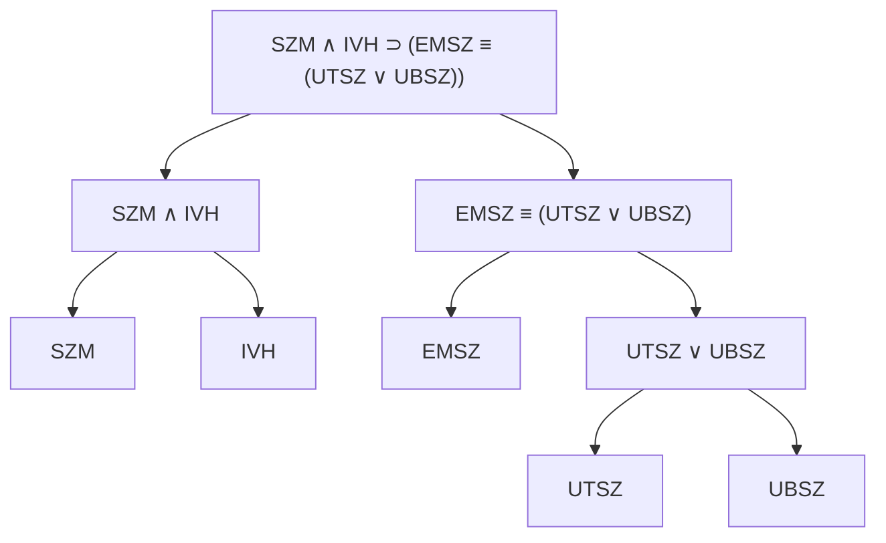
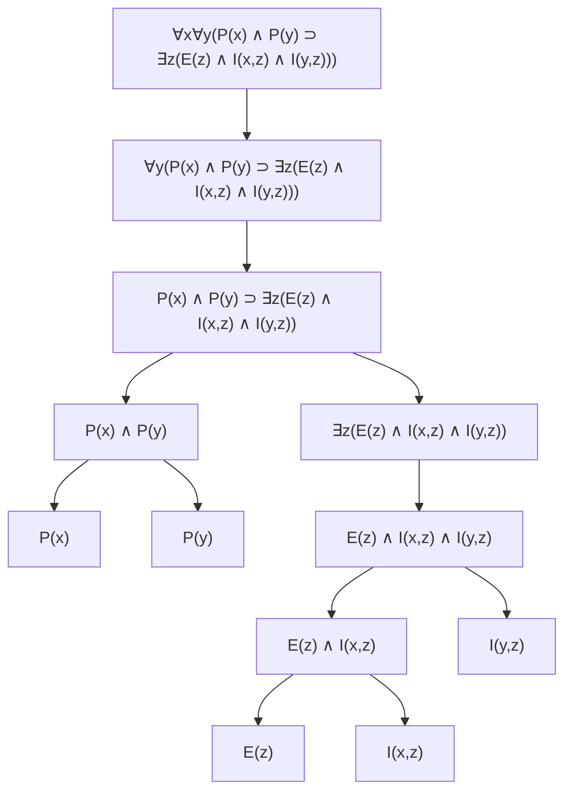

# 🧠 Logika – 6. gyakorlat (ZH előtt) megoldva

> [!abstract] Hogyan használd?
> 1. Olvasd el az **A. Gyorstalpalót** (5 perc): a fordítási szabályok az egész feladatsor 80%-át megoldják.
> 2. Minden feladatnál **először próbáld meg magad**, utána nyisd ki a lenyíló `Megoldás` dobozt.
> 3. A végén **gyakorló variációk** és egy **csalólap** van.
>
> A jelölések ugyanazok, mint a korábbi logikai jegyzetben: ¬ nem, ∧ és, ∨ vagy, ⊃ ha…akkor, ≡ akkor és csak akkor, ∀ minden, ∃ van olyan.

> [!warning] ZH-tipp
> A fordításos feladatoknál a **szó szerinti** fordítás a biztos. Ne „értelmezd át" a mondatot, hanem a kötőszavakból építsd fel a formulát (lásd az A. fejezet táblázatát).

---

# A. Gyorstalpaló – magyar mondat → formula

> [!tip] Recept (mindig ugyanez)
> 1. **Adj betűt** az alapállításoknak (a feladat általában megadja).
> 2. **Keresd meg a főkötőszót** (az, ami a mondatot két nagy részre bontja: „ha…akkor", „és", „akkor és csak akkor").
> 3. A részeket **külön fordítsd le**, aztán rakd össze.
> 4. **Írd vissza magyarra** ellenőrzésnek.

| Magyarul | Formula |
| --- | --- |
| nem, nincs | ¬A |
| és, de, pedig, is | A ∧ B |
| vagy | A ∨ B |
| ha A, akkor B | A ⊃ B |
| **csak akkor A, ha B** | **A ⊃ B** (az „A" az, ami után a „csak akkor" áll!) |
| A akkor és csak akkor, ha B; pontosan akkor | A ≡ B |
| nem fordulhat elő, hogy A és B | ¬(A ∧ B) |
| sem A, sem B | ¬A ∧ ¬B |
| A, **kivéve ha** B | ¬B ⊃ A (ha nem B, akkor A) |
| föltéve, hogy B | a feltételhez hozzáadsz egy „∧ B"-t |
| minden A B | ∀x(A(x) ⊃ B(x)) |
| van olyan A, ami B | ∃x(A(x) ∧ B(x)) |
| egyetlen A sem B | ¬∃x(A(x) ∧ B(x)) ⇔ ∀x(A(x) ⊃ ¬B(x)) |
| nem minden A B | ¬∀x(A(x) ⊃ B(x)) ⇔ ∃x(A(x) ∧ ¬B(x)) |

> [!warning] A három legnagyobb csapda
> 1. **„Csak akkor A, ha B"** = A ⊃ B. Nem fordítva! („Csak akkor megyünk kirándulni, ha jó az idő": K ⊃ J.)
> 2. **∀ mellé ⊃ való, ∃ mellé ∧.** Fordítva szinte mindig hibás.
> 3. **„Ha valaki …, akkor …"**: a „valaki" a feltételben **∃**-nek látszik, de ugyanaz, mint egy ∀ a teljes mondat elején (lásd a 6. példa e) részét).

---

# 1. 2.I.13. Feladat – Formula → magyar mondat

> [!question] Feladat
> E: „esik az eső", S: „strandolok", N: „napozok", O: „otthon maradok". Mit jelentenek természetes nyelven?
> - a) E ⊃ ¬(S ∨ N)
> - b) O ≡ E
> - c) S ⊃ ¬E
> - d) (E ∧ O) ∨ (¬E ∧ S)

## Levezetés

Olvasd fel a formulát **kívülről befelé**, a jeleket magyarra cserélve:

- **a)** E ⊃ ¬(S ∨ N): „Ha esik az eső, akkor **nem igaz, hogy strandolok vagy napozok**", vagyis (De Morgan: ¬(S ∨ N) ⇔ ¬S ∧ ¬N) „ha esik az eső, akkor **nem strandolok és nem napozok**".
- **b)** O ≡ E: „**Akkor és csak akkor maradok otthon, ha esik az eső.**"
- **c)** S ⊃ ¬E: „Ha strandolok, akkor **nem esik az eső**." (Ugyanaz, mint E ⊃ ¬S: „ha esik, nem strandolok".)
- **d)** (E ∧ O) ∨ (¬E ∧ S): „**Vagy** esik az eső és otthon maradok, **vagy** nem esik az eső és strandolok."

> [!success]- ✅ Megoldás
> - **a)** Ha esik az eső, akkor nem strandolok és nem napozok.
> - **b)** Akkor és csak akkor maradok otthon, ha esik az eső.
> - **c)** Ha strandolok, akkor nem esik az eső.
> - **d)** Vagy esik az eső és otthon maradok, vagy nem esik és strandolok.

> [!example] ⚡ Leggyorsabb módszer
> Jel → szó szerint: ¬ „nem", ∧ „és", ∨ „vagy", ⊃ „ha…akkor", ≡ „akkor és csak akkor". Az ¬(S ∨ N) olvasata **„nem (strandolok vagy napozok)"**, ez „**sem** nem strandolok, **sem** nem napozok".

> [!warning] Gyakori hiba
> ¬(S ∨ N) **nem** ugyanaz, mint ¬S ∨ ¬N. A De Morgan szerint ¬(S ∨ N) ⇔ ¬S **∧** ¬N („sem… sem…").

---

# 2. 2.I.14. Feladat (a–e) – Jó idő, kirándulás

> [!question] Feladat
> J: „jó az idő", K: „kirándulni megyünk". Írd fel formulával!
> - a) Nincs jó idő.
> - b) Ha jó az idő, kirándulni megyünk.
> - c) Nincs jó idő, és nem megyünk kirándulni.
> - d) Csak akkor megyünk kirándulni, ha jó az idő.
> - e) Nem fordulhat elő, hogy kirándulni megyünk, és nincs jó idő.

> [!success]- ✅ Megoldás
> | | Formula | Megjegyzés |
> | --- | --- | --- |
> | a) | **¬J** | |
> | b) | **J ⊃ K** | sima „ha…akkor" |
> | c) | **¬J ∧ ¬K** | két tagadás, „és" köti |
> | d) | **K ⊃ J** | **csak akkor K, ha J** → K az előtag |
> | e) | **¬(K ∧ ¬J)** | „nem fordulhat elő, hogy… és…" |

## Miért ez a d)?

„Csak akkor megyünk kirándulni, ha jó az idő." Kérdezd meg: **mi kell a kiránduláshoz?** A jó idő. Tehát **ha kirándulni megyünk, akkor biztosan jó az idő**: K ⊃ J. (A J ⊃ K azt mondaná, hogy jó időben **mindig** megyünk, ez más állítás: az a b) rész.)

> [!info] Meglepetés: d) és e) ugyanaz!
> ¬(K ∧ ¬J) ⇔ ¬K ∨ ¬¬J ⇔ ¬K ∨ J ⇔ **K ⊃ J**.
> Vagyis „nem fordulhat elő, hogy kirándulni megyünk és nincs jó idő" ugyanazt jelenti, mint „csak akkor megyünk, ha jó az idő". Ez egy gyakori ZH-kérdés („melyek ekvivalensek?").

> [!example] ⚡ Leggyorsabb módszer – „csak akkor" teszt
> „Csak akkor **A**, ha **B**" → **A ⊃ B**. Ellenőrzés: ha A igaz, B-nek **biztosan** igaznak kell lennie? Igen → A ⊃ B.

---

# 3. 2.I.14. Feladat (f–h) – Eső, szél, szivárvány

> [!question] Feladat
> E: esik az eső, J: jó az idő, F: fúj a szél, S: süt a nap, V: a városban vagyunk, Sz: szivárványt lehet látni.
> - f) Ha esik az eső vagy fúj a szél, akkor nincs jó idő.
> - g) Ha esik az eső, pedig süt a Nap, akkor szivárványt lehet látni, kivéve ha éppen a városban vagyunk.
> - h) Csak akkor lehet szivárványt látni, ha az eső is esik, és a Nap is süt, de nem a városban vagyunk.

## Levezetés

**f)** Az előtag: „esik az eső **vagy** fúj a szél" = (E ∨ F). Az utótag: „nincs jó idő" = ¬J.

$$(E\lor F)\supset\neg J$$

⚠️ A zárójel **kötelező**: E ∨ F ⊃ ¬J az erősorrend szerint (∨ erősebb a ⊃-nál) ugyanezt jelenti, de a zárójeles alak biztosabb.

**g)** „Ha esik az eső, **pedig** süt a Nap" (a „pedig" = és): E ∧ S. Az utótag: Sz. A „**kivéve ha a városban vagyunk**" azt jelenti: **a szivárvány-állítás csak akkor érvényes, ha NEM vagyunk a városban**, tehát ¬V is a feltételek közé kerül:

$$E\land S\land\neg V\supset Sz$$

**h)** „**Csak akkor** lehet szivárványt látni, **ha** (esik az eső, és süt a Nap, de nem a városban vagyunk)". Az „A" = „szivárványt lehet látni" (Sz), a „B" = E ∧ S ∧ ¬V. A „csak akkor A, ha B" = **A ⊃ B**:

$$Sz\supset(E\land S\land\neg V)$$

> [!success]- ✅ Megoldás
> - **f)** (E ∨ F) ⊃ ¬J
> - **g)** E ∧ S ∧ ¬V ⊃ Sz  (más alakban: E ∧ S ⊃ (¬V ⊃ Sz))
> - **h)** Sz ⊃ (E ∧ S ∧ ¬V)

> [!warning] Gyakori hibák
> - **g)**: a „kivéve ha V" **nem** azt jelenti, hogy ∧ V, hanem hogy a feltételhez **¬V** kell.
> - **h)**: **nem** (E ∧ S ∧ ¬V) ⊃ Sz! Az irány a „csak akkor" miatt fordított: a szivárvány az előtag.
> - **f)**: a „vagy" a feltételben van, ezért zárójelezni kell.

> [!example] ⚡ Leggyorsabb módszer
> Írd át a mondatot **sorrendbe**: „A, **kivéve ha** B" → „ha nem B, akkor A". „**Csak akkor** A, ha B" → „ha A, akkor B".

---

# 4. 2.I.14. Kiegészítés – Két átírás ekvivalenciája

> [!question] Feladat
> Lássuk be **ekvivalens átalakításokkal**, hogy a két formula ekvivalens:
> E ∧ S ∧ ¬V ⊃ Sz  és  E ∧ S ⊃ (¬V ⊃ Sz)

## Levezetés (lépésről lépésre)

**Bal oldal:**

| Lépés | Formula | Indok |
| --- | --- | --- |
| 1 | (E ∧ S ∧ ¬V) ⊃ Sz | kiindulás |
| 2 | ¬(E ∧ S ∧ ¬V) ∨ Sz | A ⊃ B ⇔ ¬A ∨ B |
| 3 | (¬E ∨ ¬S ∨ ¬¬V) ∨ Sz | De Morgan |
| 4 | ¬E ∨ ¬S ∨ V ∨ Sz | ¬¬V ⇔ V |

**Jobb oldal:**

| Lépés | Formula | Indok |
| --- | --- | --- |
| 1 | (E ∧ S) ⊃ (¬V ⊃ Sz) | kiindulás |
| 2 | ¬(E ∧ S) ∨ (¬V ⊃ Sz) | A ⊃ B ⇔ ¬A ∨ B |
| 3 | ¬(E ∧ S) ∨ (¬¬V ∨ Sz) | a belső ⊃ átírása |
| 4 | (¬E ∨ ¬S) ∨ (V ∨ Sz) | De Morgan, ¬¬V ⇔ V |
| 5 | ¬E ∨ ¬S ∨ V ∨ Sz | asszociativitás |

A két oldal ugyanarra az alakra jött ki: ¬E ∨ ¬S ∨ V ∨ Sz → **ekvivalensek**. ■

> [!success]- ✅ Rövid indoklás
> Ez az **áthelyezési törvény**: (A ∧ B) ⊃ C ⇔ A ⊃ (B ⊃ C), itt A := E ∧ S, B := ¬V, C := Sz.

> [!example] ⚡ Leggyorsabb módszer
> Ekvivalencia-bizonyításnál **mindig** hozd mindkét oldalt **⊃-mentes alakra** (A ⊃ B ⇔ ¬A ∨ B), aztán De Morgan. A végén ugyanazt kell kapnod.

> [!warning] Gyakori hiba
> A kettős tagadás eltüntetése (¬¬V ⇔ V) lépést ne hagyd ki: ott van a pont az indoklásnál.

---

# 5. 2.I.14. Feladat (i–k) – Vekker, busz, érkezés

> [!question] Feladat
> I: időben ébreszt a vekker, V: várakozás nélkül kapok buszt, M: megérkezem nyolc órára.
> - i) Ha időben felébreszt a vekker, akkor – föltéve, hogy várakozás nélkül kapok buszt is – nyolc órára megérkezem.
> - j) Ha nem ébreszt fel időben a vekker, nem kapok várakozás nélkül buszt sem.
> - k) Ha időben felébreszt a vekker, akkor buszt is várakozás nélkül kapok és meg is érkezek nyolc órára.

> [!success]- ✅ Megoldás
> | | Formula | Megjegyzés |
> | --- | --- | --- |
> | i) | **I ∧ V ⊃ M** (⇔ **I ⊃ (V ⊃ M)**) | a „föltéve, hogy V" a feltételhez ∧ V-t ad |
> | j) | **¬I ⊃ ¬V** | „sem" = nem |
> | k) | **I ⊃ (V ∧ M)** | az utótagban két dolog van, ∧ köti |

> [!info] Miért az i) két alakja ugyanaz?
> Áthelyezési törvény: (I ∧ V) ⊃ M ⇔ I ⊃ (V ⊃ M). A mondat szerkezete („ha I, akkor – föltéve V – M") mindkettőt támogatja.

> [!warning] Gyakori hiba
> **i) és k) nem ugyanaz:**
> - i): I ∧ V ⊃ M → a busz a **feltétel**.
> - k): I ⊃ (V ∧ M) → a busz a **következmény** (az ébresztés magával hozza a buszt is).

---

# 6. 2.I.14. Feladat (n–r) – Bűnügyi történet

> [!question] Feladat
> UTSZ: az ujjlenyomatok a tettestől származnak; UBSZ: ujjlenyomatok a bűntársától származnak; SZTH: szomszédok tanúvallomása helytálló; GYT: a gyanúsított a tettes; SZM: szemtanú megbízható; IVH: írásszakértő véleménye helytálló; EMSZ: előre megfontolt szándékkal követték el.
> - n) A talált ujjlenyomatok csak akkor származnak a tettestől, ha a szomszédok tanúvallomása helytálló.
> - o) Pontosan akkor származnak az ujjlenyomatok a tettestől, ha a gyanúsított a tettes.
> - p) Amennyiben a szomszédok tanúvallomása helytálló, úgy a gyanúsított a tettes.
> - q) Ha a szemtanú megbízható, és az írásszakértő véleménye helytálló, úgy a bűncselekményt akkor és csak akkor követték el előre megfontolt szándékkal, ha a talált ujjlenyomat a tettestől vagy esetleges bűntársától származik.
> - r) Ha a szemtanú megbízható, az írásszakértő véleménye helytálló, és a talált ujjlenyomat a tettestől származik, akkor a bűncselekményt előre megfontolt szándékkal követték el.

## Levezetés

- **n)** „**Csak akkor** UTSZ, ha SZTH" → UTSZ ⊃ SZTH.
- **o)** „**Pontosan akkor**" → ≡: UTSZ ≡ GYT.
- **p)** „Amennyiben A, úgy B" = „ha A, akkor B": SZTH ⊃ GYT.
- **q)** Főszerkezet: **„Ha (SZM és IVH), úgy (…)"**. A belsejében: „EMSZ **akkor és csak akkor, ha** (UTSZ **vagy** UBSZ)":

$$SZM\land IVH\supset\big(EMSZ\equiv(UTSZ\lor UBSZ)\big)$$

- **r)** Az előtagban három dolog van (SZM, IVH, UTSZ), az utótag EMSZ:

$$SZM\land IVH\land UTSZ\supset EMSZ$$

> [!success]- ✅ Megoldás
> | | Formula |
> | --- | --- |
> | n) | UTSZ ⊃ SZTH |
> | o) | UTSZ ≡ GYT |
> | p) | SZTH ⊃ GYT |
> | q) | SZM ∧ IVH ⊃ (EMSZ ≡ (UTSZ ∨ UBSZ)) |
> | r) | SZM ∧ IVH ∧ UTSZ ⊃ EMSZ |

> [!example] ⚡ Leggyorsabb módszer – a „két szint" a hosszú mondatnál
> Hosszú mondatnál **először a külső szerkezetet** keresd meg („ha … akkor …"), **aztán** a belső részt („akkor és csak akkor …"). Ez a q) esetén: külső ⊃, belül ≡, abban ∨.

> [!warning] Gyakori hibák
> - **n)** és **p)** más irányú: n) UTSZ ⊃ SZTH („csak akkor"), p) SZTH ⊃ GYT („amennyiben").
> - **q)**: a (EMSZ ≡ …) zárójele kötelező, különben a ⊃ és ≡ összekeveredik.

---

# 7. Szerkezeti fa

> [!question] Feladat
> Rajzold fel a  SZM ∧ IVH ⊃ (EMSZ ≡ (UTSZ ∨ UBSZ))  formula szerkezeti fáját.

## Levezetés

> [!tip] Recept
> 1. Keresd meg a **főjelet**: azt, ami az **utoljára** végrehajtott művelet (a leggyengébb jel, a legkülső). Erősorrend: ¬ > ∧ > ∨ > ⊃ > ≡.
> 2. Ez a gyökér, alá a **közvetlen részformulák** kerülnek.
> 3. Ismételd, amíg **atomi formulákhoz** nem érsz (ezek a levelek).

A formulában a **⊃** a leggyengébb jel a zárójelen kívül (a ∧ erősebb nála), tehát ez a főjel. Bal oldala: SZM ∧ IVH. Jobb oldala: (EMSZ ≡ (UTSZ ∨ UBSZ)), ennek főjele a ≡, a jobb gyereke pedig (UTSZ ∨ UBSZ).

> [!success]- ✅ Megoldás
> - Gyökér (főjel): **⊃**. Gyerekei: **SZM ∧ IVH** és **EMSZ ≡ (UTSZ ∨ UBSZ)**.
> - SZM ∧ IVH gyerekei: SZM, IVH (levelek).
> - EMSZ ≡ (…) gyerekei: EMSZ (levél) és UTSZ ∨ UBSZ.
> - UTSZ ∨ UBSZ gyerekei: UTSZ, UBSZ (levelek).
> - **5 levél:** SZM, IVH, EMSZ, UTSZ, UBSZ. **4 logikai jel:** ⊃, ∧, ≡, ∨.

> [!example] ⚡ Leggyorsabb módszer
> A fa **belső csúcsainak száma = a logikai jelek száma** (itt 4), a **leveleké = az atomi formulák száma** (itt 5). Ha megszámolod és a rajzodnál ez nem stimmel, hibáztál.

> [!warning] Gyakori hiba
> **Főjel keresése:** nem az első jel balról, hanem a **leggyengébb**. A ∧ a ⊃-nál erősebb, ezért **nem** a ∧ a főjel.

---

# 8. 1. példa – Elsőrendű formula értelmezése

> [!question] Feladat
> Mit jelent természetes nyelven a következő formula az A) és a B) interpretációban?
> $$\forall x\,\forall y\,\big(P(x)\land P(y)\supset\exists z\,(E(z)\land I(x,z)\land I(y,z))\big)$$
> **A)** univerzum: a sík részhalmazainak összessége; P(x): x pont; E(x): x egyenes; I(x,z): x illeszkedik a z-re.
> **B)** univerzum: egész számok; P(x): x természetes szám; E(x): x összetett szám (nem prímszám); I(x,y): x osztója y-nak.

> [!tip] Recept (elsőrendű formula felolvasása)
> 1. **Kívülről befelé** olvass: ∀x∀y = „bármely két x-re és y-ra".
> 2. A ⊃ előtagja a **feltétel** („ha x is, y is P"), az utótag a **következmény**.
> 3. Az ∃z = „van olyan z, hogy…".
> 4. A predikátumokat cseréld az interpretáció szerinti jelentésre.

## A) Geometriai értelmezés

- P(x) ∧ P(y): „x és y pont".
- ∃z(E(z) ∧ I(x,z) ∧ I(y,z)): „van olyan egyenes (z), amelyre x is, y is illeszkedik".

> **Bármely két pontra van olyan egyenes, amely mindkettőn átmegy.**
> Röviden: „A sík bármely két pontján átmegy egy egyenes."

(Az x = y eset is belefér: egy pontra is mindig van egyenes. A mondat a síkban **igaz**.)

## B) Számelméleti értelmezés

- P(x) ∧ P(y): „x és y természetes szám".
- ∃z(E(z) ∧ I(x,z) ∧ I(y,z)): „van olyan összetett szám (z), amelynek x is, y is osztója", vagyis a z az x és y **közös többszöröse**, és összetett.

> **Bármely két természetes számnak van közös összetett többszöröse.**

> [!success]- ✅ Megoldás
> - **A)** Bármely két pontra van olyan egyenes, amely mindkettőn átmegy. (Igaz.)
> - **B)** Bármely két természetes számnak van közös összetett többszöröse. (Igaz: pl. z = 4·x·y, ez mindkettővel osztható és összetett.)

> [!note] A B) igazságértéke (ha kérdezik)
> Pozitív x, y esetén **z = 4xy** jó (összetett, mert osztható 2-vel és 4-nél nagyobb vagy egyenlő). Ha a 0 is természetes szám, az x = 0 esetén csak z = 0 a többszörös, és ez a **megadott definíció szerint** („összetett = nem prímszám") összetett, tehát az állítás ekkor is igaz. Ha a ti definíciótok szerint a 0 nem összetett, akkor x = 0-ra az állítás hamis.

> [!example] ⚡ Leggyorsabb módszer
> Az ∃z mögötti rész a „**közös**" szóra utal: z-hez **mindkét** (x és y) kapcsolódik. A formula általános sémája: **„bármely két A-hoz van olyan B, amely mindkettőhöz kapcsolódik"**.

> [!warning] Gyakori hiba
> Az I(x,z) olvasata az **interpretáció szerint** változik: A)-ban „x illeszkedik z-re", B)-ben „**x osztója z-nek**" (az x az osztó, a z a többszörös, **nem** fordítva).

---

# 9. 1. Példa – kiegészítés: szerkezeti fa, váz, kötött és szabad változók

> [!question] Feladat
> Az $\forall x\forall y(P(x)\land P(y)\supset\exists z(E(z)\land I(x,z)\land I(y,z)))$ formulához:
> 1. rajzold fel a szerkezeti fát,
> 2. határozd meg a formula vázát,
> 3. jelöld a kötött és szabad változókat.

## 1. Szerkezeti fa

A főjel az első kvantor (∀x). A kvantor közvetlen részformulája a mögötte álló formula.

(A „E(z) ∧ I(x,z) ∧ I(y,z)" balról jobbra csoportosítva: ((E(z) ∧ I(x,z)) ∧ I(y,z)). Levelek: P(x), P(y), E(z), I(x,z), I(y,z).)

## 2. A formula váza

> [!warning] A „váz" szó jelentése
> A „váz" fogalmat kurzusonként kicsit másképp használják, ezért írom a két leggyakoribb értelmezést. **Nézd meg az előadásdián a pontos definíciót.**

**(a) Logikai váz:** a logikai jeleket (kvantorok, kötőjelek) megtartjuk, az **atomi formulák helyére üres helyet (□)** teszünk:

$$\forall x\,\forall y\,(\Box\land\Box\supset\exists z\,(\Box\land\Box\land\Box))$$

**(b) Ítéletlogikai váz:** a **legkülső kvantoros részformulákat és az atomi formulákat** egy-egy ítéletbetűvel helyettesítjük. Mivel a teljes formula egy ∀x kvantorral kezdődik, a váza **egyetlen betű**, pl. $A$. (Ezért itt a (b) értelmezésnek nincs sok haszna.)

## 3. Kötött és szabad változók

| Változó | Előfordulások | Státusz | Melyik kvantor köti? |
| --- | --- | --- | --- |
| x | P(**x**), I(**x**,z) | **kötött** | ∀x |
| y | P(**y**), I(**y**,z) | **kötött** | ∀y |
| z | E(**z**), I(x,**z**), I(y,**z**) | **kötött** | ∃z |

- **Szabad változó nincs:** FreeVar = ∅, BoundVar = {x, y, z}.
- A formula tehát **zárt** (mondat): van önmagában igazságértéke.
- Egyben **változóiban tiszta** (nincs olyan változó, ami szabadon és kötve is szerepelne, és mindegyiket egy kvantor köti).

> [!success]- ✅ Megoldás
> - **Fő logikai jel:** ∀x. **Összetettség** (logikai jelek száma): 7 (∀x, ∀y, ∧, ⊃, ∃z, ∧, ∧).
> - **Szabad változó:** nincs (zárt formula). **Kötött:** x (∀x), y (∀y), z (∃z).
> - **Váz:** ∀x∀y(□ ∧ □ ⊃ ∃z(□ ∧ □ ∧ □)).

> [!example] ⚡ Leggyorsabb módszer – kötött/szabad
> Minden változóhoz keresd meg: **van-e előtte egy ugyanolyan betűjű kvantor, amelynek a hatókörében áll?** Ha igen → kötött, ha nem → szabad. Ha **minden** változó kötött, a formula **zárt**.

> [!warning] Gyakori hiba
> A kvantor **hatóköre** csak a mögötte álló formula. Itt a ∃z csak az (E(z) ∧ I(x,z) ∧ I(y,z)) részre vonatkozik, **de** az x és y ezekben is kötött, mert a külső ∀x, ∀y hatóköre magában foglalja.

---

# 10. 6. példa (1) – Beszélgető nők

> [!question] Feladat
> Mit jelent természetes nyelven?
> $$\forall x\,\forall y\,\big(B(x,y)\land x\ne y\supset\exists z\,(Cs(z)\land x\ne z\land y\ne z)\big)$$
> Univerzum: nők halmaza; B(x,y): x és y beszélget; Cs(x): x csuklik; ≠: nem azonos.

## Levezetés

1. ∀x∀y: „bármely két nőre (x és y-ra)".
2. Előtag: B(x,y) ∧ x ≠ y: „**x és y beszélget, és különböző nők**".
3. Utótag: ∃z(Cs(z) ∧ x ≠ z ∧ y ≠ z): „van olyan nő (z), aki **csuklik**, és **nem azonos** sem x-szel, sem y-nal", vagyis egy **harmadik nő**, aki csuklik.

> [!success]- ✅ Megoldás
> **Ha két különböző nő beszélget egymással, akkor van egy harmadik nő (tőlük különböző), aki csuklik.**

> [!example] ⚡ Leggyorsabb módszer
> A „x ≠ z ∧ y ≠ z" mindig azt jelenti: **z egy harmadik, tőlük különböző elem**. Ezt szinte mindig így fordítod: „egy harmadik…".

> [!warning] Gyakori hiba
> Ne olvasd úgy, hogy „x vagy y csuklik". A csuklós személy z, és **különbözik** x-től és y-tól is.

---

# 11. 6. példa (2) – Időpillanat és bolondítás

> [!question] Feladat
> Mit jelent természetes nyelven?
> $$\exists t\,\big(T(t)\land\forall x\,(E(x)\supset B(t,x))\big)$$
> Univerzum: időpillanatok és emberek **diszjunkt halmazának uniója**; T(x): x egy időpillanat; E(x): x egy ember; B(x,y): x időpillanatban y-t bolonddá lehet tenni.

## Levezetés

1. ∃t(T(t) ∧ …): „**van olyan időpillanat (t)**, hogy …".
2. ∀x(E(x) ⊃ B(t,x)): „**minden emberre** igaz, hogy a t időpillanatban bolonddá lehet tenni".

> [!success]- ✅ Megoldás
> **Van olyan időpillanat, amikor mindenkit bolonddá lehet tenni.**

> [!info] A kvantorok sorrendje számít! Hasonlítsd össze:
> | Formula | Jelentés |
> | --- | --- |
> | ∃t(T(t) ∧ ∀x(E(x) ⊃ B(t,x))) | **Van olyan pillanat, amikor mindenkit** be lehet csapni (erős állítás) |
> | ∀x(E(x) ⊃ ∃t(T(t) ∧ B(t,x))) | **Mindenkit be lehet csapni valamikor** (gyengébb: mindenkire más pillanat is lehet) |

> [!example] ⚡ Leggyorsabb módszer
> **Univerzum két típusú elemmel:** a T(t) és E(x) predikátumok mondják meg, ki micsoda. Az ∃-hoz mindig ∧ kapcsolódik (T(t) ∧ …), a ∀-hoz ⊃ (E(x) ⊃ …).

> [!warning] Gyakori hiba
> Összekeverni a két fenti mondatot. Az első **ugyanahhoz a t-hez** kéri a minden x-et.

---

# 12. 6. példa (3) – Formalizálás (a–e)

> [!question] Feladat
> Formalizáld az állításokat!
> - a) Nem minden madár tud repülni. (univerzum₁: állatok, univerzum₂: madarak)
> - b) Egyetlen politikus sem tévedhetetlen. (univerzum₁: emberek, univerzum₂: politikusok)
> - c) Mindenki, akiben van kitartás, megtanulhatja a logikát. (univerzum: emberek)
> - d) A csúszópénzt akkor és csak akkor fizetik ki, ha az áru megérkezik. (univerzum: emberek)
> - e) Ha valaki meg tudja csinálni, akkor Péter is meg tudja csinálni! (univerzum: emberek)

> [!info] Mit jelent a két univerzum?
> A feladatot **kétféleképp** kell megoldani:
> - **Univerzum₁ (nagy):** minden állat/ember tartozik bele, ezért a „madár"/„politikus" tulajdonságot **predikátumként** kell megadni (M(x), Pl(x)), és ∀-hoz ⊃, ∃-hoz ∧ kell.
> - **Univerzum₂ (szűk):** már csak madarak/politikusok vannak benne, ezért a „madár" jelzőt **elhagyhatod**.

## a) Nem minden madár tud repülni

R(x): x tud repülni; M(x): x madár.

- **Univerzum₁ (állatok):** ¬∀x(M(x) ⊃ R(x))  ⇔  ∃x(M(x) ∧ ¬R(x)) („van olyan madár, ami nem tud repülni").
- **Univerzum₂ (madarak):** ¬∀x R(x)  ⇔  ∃x ¬R(x).

## b) Egyetlen politikus sem tévedhetetlen

Pl(x): x politikus; T(x): x tévedhetetlen.

- **Univerzum₁ (emberek):** ¬∃x(Pl(x) ∧ T(x))  ⇔  ∀x(Pl(x) ⊃ ¬T(x)).
- **Univerzum₂ (politikusok):** ¬∃x T(x)  ⇔  ∀x ¬T(x).

## c) Mindenki, akiben van kitartás, megtanulhatja a logikát

K(x): x-ben van kitartás; L(x): x megtanulhatja a logikát.

$$\forall x\,(K(x)\supset L(x))$$

## d) A csúszópénzt akkor és csak akkor fizetik ki, ha az áru megérkezik

Itt **nincs kvantor**, mert a mondat két egyszerű állítást köt össze. Cs: „kifizetik a csúszópénzt"; Á: „az áru megérkezik".

$$Cs\equiv\acute A$$

(A „univerzum: emberek" itt nem játszik szerepet; nulladrendű, állításjeles formalizálás elég. Ha elsőrendben kell: legyenek 0-argumentumú predikátumok.)

## e) Ha valaki meg tudja csinálni, akkor Péter is meg tudja csinálni

C(x): x meg tudja csinálni; p: Péter.

$$\exists x\,C(x)\supset C(p)\qquad(\Leftrightarrow\ \forall x\,(C(x)\supset C(p)))$$

> [!success]- ✅ Megoldás
> | | Univerzum₁ | Univerzum₂ |
> | --- | --- | --- |
> | a) | ¬∀x(M(x) ⊃ R(x)) | ¬∀x R(x) |
> | b) | ¬∃x(Pl(x) ∧ T(x)) | ¬∃x T(x) |
> | c) | ∀x(K(x) ⊃ L(x)) | |
> | d) | Cs ≡ Á | |
> | e) | ∃xC(x) ⊃ C(p) (⇔ ∀x(C(x) ⊃ C(p))) | |

> [!info] Miért ekvivalens az e) két alakja?
> Kvantor-mozgatás (a ⊃ bal oldalán a kvantor **átfordul**): ∃xB ⊃ A ⇔ ∀x(B ⊃ A), ha x ∉ FreeVar(A). Itt A = C(p), amiben nincs szabad x. Szóval a „valaki" a feltételben **∃**, de ha a kvantort kivisszük, **∀** lesz belőle.

> [!example] ⚡ Leggyorsabb módszer
> - „**Nem minden** A B" → **¬∀**.
> - „**Egyetlen A sem** B" → **¬∃** (A ∧ B).
> - „**Mindenki, akiben/aki …**" → **∀x(… ⊃ …)**.
> - „**Ha valaki …, akkor**" → ∃ a feltételben (vagy ∀ kívül).

> [!warning] Gyakori hibák
> - **a)** ¬∀x(M(x) ∧ R(x)) → rossz: ∀ mellé ⊃ kell. Az ¬∀x(M(x) ∧ R(x)) azt mondaná, hogy „nem igaz, hogy minden állat madár és repül".
> - **b)** ∃x(Pl(x) ⊃ ¬T(x)) → rossz, szinte mindig igaz.
> - **e)** ∀x(C(x)) ⊃ C(p) → rossz: az „valaki" nem ∀ a feltételben.

---

# 13. 4.1 gyakorlat – Nem logikai törvények

> [!question] Feladat
> **(I)** Igazságtáblával igazold, hogy nem logikai törvény: (P ⊃ Q) ⊃ (Q ⊃ P)
> **(II)** Bizonyítsd be, hogy az alábbiak nem logikai törvények (adj meg olyan interpretációt, amelyben hamisak):
> 1. ∃xP(x) ⊃ ∀xP(x)
> 2. ∀x∃yP(x,y) ⊃ ∃y∀xP(x,y)
> 3. ∃xP(x) ∧ ∃xQ(x) ⊃ ∃x(P(x) ∧ Q(x))

## (I) Igazságtábla

| P | Q | P ⊃ Q | Q ⊃ P | (P ⊃ Q) ⊃ (Q ⊃ P) |
| --- | --- | --- | --- | --- |
| 0 | 0 | 1 | 1 | 1 |
| 0 | 1 | 1 | 0 | **0** |
| 1 | 0 | 0 | 1 | 1 |
| 1 | 1 | 1 | 1 | 1 |

A 2. sorban (P = 0, Q = 1) az eredmény **0** → a formula **nem érvényes**, vagyis nem logikai törvény. (Van 1-es sor is, tehát kielégíthető.)

## (II) Cáfoló interpretációk

> [!tip] Recept
> Egy **A ⊃ B** akkor hamis, ha **A igaz, B hamis**. Építsd az interpretációt úgy, hogy az **előtag igaz**, az **utótag hamis** legyen. Kis univerzum (2 elem) elég.

**1. ∃xP(x) ⊃ ∀xP(x)**
- U = {1, 2}, ρ(P) = {1}.
- ∃xP(x): P(1) igaz → **igaz**. ∀xP(x): P(2) hamis → **hamis**.
- Igaz ⊃ hamis = **hamis** ✓.

**2. ∀x∃yP(x,y) ⊃ ∃y∀xP(x,y)**
- U = {1, 2}, ρ(P) = {(1,2), (2,1)}.
- ∀x∃yP(x,y): x = 1-re y = 2 jó; x = 2-re y = 1 jó → **igaz**.
- ∃y∀xP(x,y): y = 1-re x = 1-nél P(1,1) nincs a halmazban; y = 2-re x = 2-nél P(2,2) nincs → **hamis**.
- Igaz ⊃ hamis = **hamis** ✓.

**3. ∃xP(x) ∧ ∃xQ(x) ⊃ ∃x(P(x) ∧ Q(x))**
- U = {1, 2}, ρ(P) = {1}, ρ(Q) = {2}.
- ∃xP(x): igaz (x=1). ∃xQ(x): igaz (x=2). Az előtag **igaz**.
- ∃x(P(x) ∧ Q(x)): nincs olyan elem, ami mindkettőben van → **hamis**.
- Igaz ⊃ hamis = **hamis** ✓.

> [!success]- ✅ Megoldás
> | | Cáfoló interpretáció |
> | --- | --- |
> | (I) | P = 0, Q = 1 mellett az érték 0 |
> | 1. | U = {1,2}, P = {1} |
> | 2. | U = {1,2}, P = {(1,2),(2,1)} |
> | 3. | U = {1,2}, P = {1}, Q = {2} |

> [!example] ⚡ Leggyorsabb módszer
> **Három lépés:** (1) írd fel, mit kell hogy teljesüljön: előtag igaz, utótag hamis; (2) válassz 2 elemű univerzumot; (3) osszd szét a predikátumokat úgy, hogy „**van** valami", de „**nem minden**" (1.), „**van** x minden y-hoz, de **nincs** y mindenkinek" (2.), vagy „**két különböző** elem" (3.).

> [!warning] Gyakori hibák
> - Az interpretáció legyen **teljes**: adj meg univerzumot **és** minden predikátum jelentését.
> - Ne kapj olyat, amelyben a formula **igaz**: ellenőrizd a kvantorokat **kívülről befelé** egyenként.
> - A 2. formulánál az **egyelemű univerzum nem jó** (ott a két oldal egyenértékű). Legalább 2 elem kell.

---

# 14. 🎯 Gyakorló variációk

> [!question]- Variáció 1 – csak akkor
> „Csak akkor kapok ötöst, ha tanulok." (Ö: ötöst kapok, T: tanulok)
> > [!success]- Megoldás
> > **Ö ⊃ T.**

> [!question]- Variáció 2 – kivéve ha
> „Ha esik, otthon maradok, kivéve ha nem fúj a szél." (E, O, F)
> > [!success]- Megoldás
> > A „kivéve ha ¬F" a feltételhez **F-et** adja: **E ∧ F ⊃ O**. (A kivétel: ha nem fúj a szél, nincs állítás.)

> [!question]- Variáció 3 – egyetlen sem
> „Egyetlen madár sem emlős." M(x): madár, E(x): emlős.
> > [!success]- Megoldás
> > **¬∃x(M(x) ∧ E(x))**, ill. ∀x(M(x) ⊃ ¬E(x)).

> [!question]- Variáció 4 – valaki a feltételben
> „Ha valaki ismeri Pétert, akkor Éva is ismeri." I(x,y): x ismeri y-t; p: Péter, é: Éva.
> > [!success]- Megoldás
> > **∃xI(x,p) ⊃ I(é,p)** (⇔ ∀x(I(x,p) ⊃ I(é,p))).

> [!question]- Variáció 5 – értelmezés
> Univerzum: időpillanatok és emberek. Mit jelent: ∀x(E(x) ⊃ ∃t(T(t) ∧ B(t,x)))?
> > [!success]- Megoldás
> > **Mindenkit be lehet csapni valamikor** (mindenkire van olyan időpillanat, amikor őt bolonddá lehet tenni).

> [!question]- Variáció 6 – igazságtábla
> Törvény-e (P ∨ Q) ⊃ (P ∧ Q)?
> > [!success]- Megoldás
> > **Nem.** P = 1, Q = 0: P ∨ Q = 1, P ∧ Q = 0 → 1 ⊃ 0 = 0.

> [!question]- Variáció 7 – cáfoló interpretáció
> Mutasd meg, hogy nem törvény: ∀x(P(x) ∨ Q(x)) ⊃ (∀xP(x) ∨ ∀xQ(x)).
> > [!success]- Megoldás
> > U = {1,2}, P = {1}, Q = {2}. ∀x(P ∨ Q): x=1: P igaz; x=2: Q igaz → **igaz**. ∀xP: hamis (P(2)), ∀xQ: hamis (Q(1)) → a vagy **hamis**. Igaz ⊃ hamis = hamis.

> [!question]- Variáció 8 – ekvivalencia
> Igazold: P ∧ Q ⊃ R ⇔ P ⊃ (Q ⊃ R).
> > [!success]- Megoldás
> > Bal: ¬(P ∧ Q) ∨ R ⇔ ¬P ∨ ¬Q ∨ R. Jobb: ¬P ∨ (¬Q ∨ R) ⇔ ¬P ∨ ¬Q ∨ R. Ugyanaz. ■

> [!question]- Variáció 9 – szabad/kötött
> ∀xP(x) ⊃ Q(x,y). FreeVar? Zárt-e?
> > [!success]- Megoldás
> > Az első x kötött (∀x csak a P(x)-re vonatkozik). A Q(x,y)-ban x és y is szabad. **FreeVar = {x, y}**, a formula **nyitott**.

---

# 📌 Csalólap

| Téma | Szabály |
| --- | --- |
| csak akkor A, ha B | **A ⊃ B** |
| A, kivéve ha B | ¬B ⊃ A (a feltételhez ¬B) |
| föltéve, hogy B | a feltételhez ∧ B |
| pontosan akkor, akkor és csak akkor | ≡ |
| nem fordulhat elő, hogy A és B | ¬(A ∧ B) ⇔ A ⊃ ¬B |
| sem A, sem B | ¬A ∧ ¬B ⇔ ¬(A ∨ B) |
| minden A B | ∀x(A ⊃ B) |
| van A, ami B | ∃x(A ∧ B) |
| nem minden A B | ¬∀x(A ⊃ B) ⇔ ∃x(A ∧ ¬B) |
| egyetlen A sem B | ¬∃x(A ∧ B) ⇔ ∀x(A ⊃ ¬B) |
| ha valaki A, akkor B (B nem függ x-től) | ∃xA ⊃ B ⇔ ∀x(A ⊃ B) |
| „harmadik / más" | x ≠ z ∧ y ≠ z |
| főjel a szerkezeti fában | a leggyengébb (¬ > ∧ > ∨ > ⊃ > ≡) |
| A ⊃ B hamis | csak ha A = 1 és B = 0 |
| cáfoló interpretáció | előtag igaz, utótag hamis, 2 elemű univerzum |
| ekvivalencia bizonyítása | ⊃ → ¬∨, De Morgan, ¬¬ elhagyása, utána összehasonlítás |
| kötött változó | van ugyanolyan betűjű kvantor, amelynek hatókörében áll |
