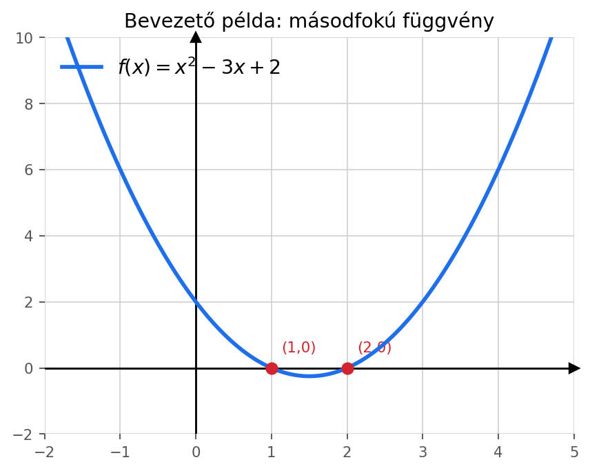
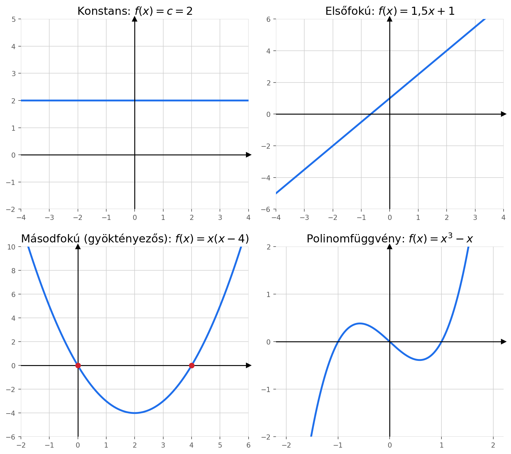
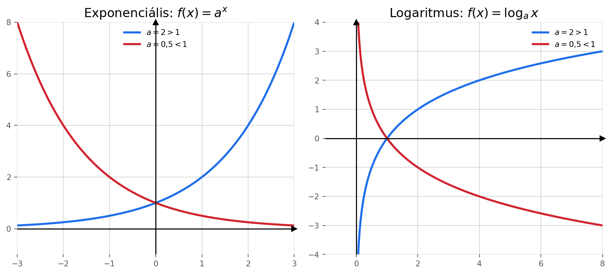
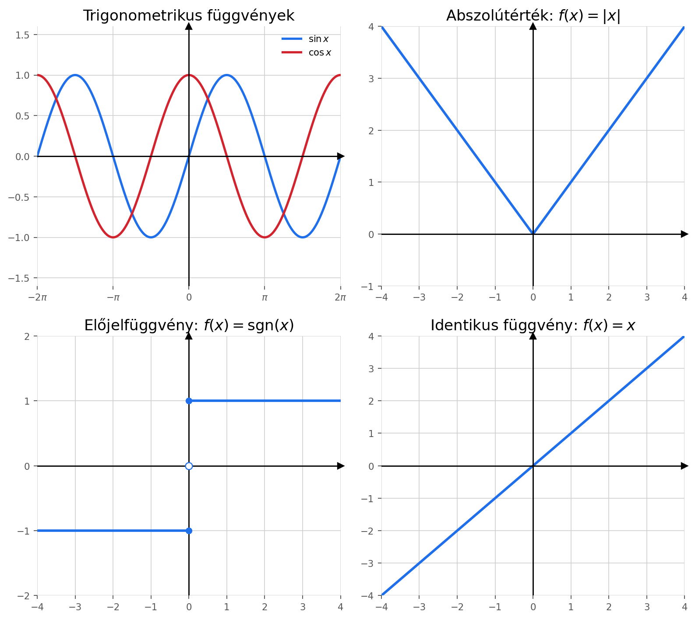
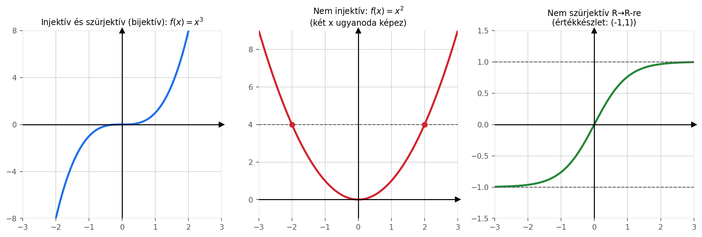

# Diszkrét matematika — Elmélet (1. előadás)
*Aradi Bernadett, 2026 ősz — bevezetés: halmazok és függvények*

> [!info] Hogyan használd ezt a jegyzetet Obsidianban?
> - A matematikai képleteket Obsidian **beépítve** (plugin nélkül) meg tudja jeleníteni, ha be van kapcsolva a `Settings → Editor → Show math` (MathJax alapú). `$...$` = inline képlet, `$$...$$` = külön sorban.
> - Az ábrák sima PNG-k, ezeket az `assets` mappába tettem melléjük — ha átmásolod a vault-odba, vidd magaddal az `assets` mappát is, különben törött linkeket fogsz látni.
> - A jegyzet végén van egy rész arról, hogyan tudsz **interaktív, GeoGebra-szerű** grafikonokat is beágyazni Obsidianba pluginok segítségével, ha a statikus képek nem elegek.

---

## 1. Halmazok — az alapoktól

### 1.1 Mi az a halmaz?

A **halmaz** és a **halmaz eleme** (jele: $x \in H$, tagadása: $x \notin H$) **alapfogalmak** — ezeket nem definiáljuk más, egyszerűbb fogalmakkal, hanem elfogadjuk, hogy tudjuk, mit jelentenek (ugyanúgy, ahogy a geometriában a "pont" és az "egyenes" is alapfogalom).

**Halmazt kétféleképpen adhatunk meg:**

1. **Felsorolással** — ha kevés eleme van, egyszerűen kiírjuk őket kapcsos zárójelben:
   $$\{1, 2, 3\}$$
2. **Tulajdonsággal (megadó tulajdonság)** — ha egy már ismert $H$ halmazból szeretnénk kiválasztani azokat az elemeket, amik teljesítenek egy $T$ tulajdonságot:
   $$\{x \in H \mid T(x)\}$$
   Például:
   $$\{x \in \mathbb{N} \mid 1 \le x \le 5\} = \{1,2,3,4,5\}$$
   *(Olvasd így: "azon $x$ természetes számok halmaza, amelyekre igaz, hogy $1 \le x \le 5$".)*

> [!tip] Hülyebiztos tipp
> Ha egy feladatban $\{x \in H \mid T(x)\}$ formát látsz, mindig csináld meg gondolatban ugyanazt: vedd sorra $H$ elemeit, és pipáld ki, melyikre igaz $T(x)$. Azok lesznek benne az új halmazban.

### 1.2 Üres halmaz, részhalmaz, egyenlőség, diszjunktság

- **Üres halmaz**: az a halmaz, aminek **nincs egyetlen eleme sem**. Jele: $\emptyset$ vagy $\{\ \}$.
  - ⚠️ Gyakori hiba: $\{\emptyset\}$ **nem** üres halmaz! Ez egy olyan halmaz, aminek **egy** eleme van, az az elem pedig maga az üres halmaz. Az $\emptyset$ és $\{\emptyset\}$ két különböző dolog.

- **Részhalmaz** ($A \subset B$): $A$ minden eleme egyben $B$-nek is eleme.
  - Hülyebiztos ellenőrzés: vegyél *bármelyik* elemet $A$-ból — ha az mindig benne van $B$-ben is, akkor $A \subset B$. Ha akár **egyetlen egy** ellenpéldát találsz (van olyan $A$-beli elem, ami nincs benne $B$-ben), akkor **nem** részhalmaz.

- **Két halmaz egyenlő** ($A = B$), ha pontosan ugyanazok az elemeik. Ezzel egyenértékű megfogalmazás:
  $$A = B \iff A \subset B \text{ és } B \subset A$$
  Ez a **kettős tartalmazás** módszere: ha be akarod bizonyítani, hogy két halmaz egyenlő, elég megmutatni, hogy mindkettő részhalmaza a másiknak.

- **Diszjunkt** halmazok: nincs közös elemük (a metszetük üres).

### 1.3 Számosság és hatványhalmaz

- **Számosság** ($\#A$ vagy $|A|$): egy véges halmaz elemeinek a száma.
- **Hatványhalmaz** ($\mathcal{P}(A)$ vagy $2^A$): egy halmaz **összes lehetséges részhalmazának** a halmaza (beleértve az üres halmazt és magát $A$-t is!).

**Példa** — legyen $A = \{0,1,2,3\}$ (tehát $\#A = 4$). Ekkor:
$$\mathcal{P}(A) = \big\{\emptyset,\{0\},\{1\},\{2\},\{3\},\{0,1\},\{0,2\},\{0,3\},\{1,2\},\{1,3\},\{2,3\},$$
$$\{0,1,2\},\{0,1,3\},\{0,2,3\},\{1,2,3\}, A\big\}$$

> [!important] Tétel
> Ha $A$ egy $n$ elemű halmaz, akkor a hatványhalmaza $2^n$ elemű:
> $$\#(\mathcal{P}(A)) = 2^{\#A}$$

**Miért $2^n$?** Minden egyes elemről külön-külön el kell döntened: *benne van-e a részhalmazban vagy sem* — ez 2 lehetőség elemenként, és $n$ elem van, tehát $\underbrace{2 \cdot 2 \cdots 2}_{n} = 2^n$ lehetséges kombináció (a szorzási elv miatt, lásd Kombinatorika fejezet).

*Ellenőrzés a fenti példán:* $\#A = 4 \Rightarrow \#(\mathcal{P}(A)) = 2^4 = 16$. Számold meg fent — pontosan 16 halmaz van felsorolva. ✅

### 1.4 Halmazműveletek

**Egyváltozós művelet:**

| Művelet | Jelölés | Jelentés |
|---|---|---|
| Komplementer | $\overline{A}$ | Azon elemek, amik egy rögzített **alaphalmazban** benne vannak, de $A$-ban nem. A komplementert **mindig egy alaphalmazra vonatkoztatjuk** — enélkül nincs értelme! |

**Többváltozós műveletek:**

| Művelet | Jelölés | Definíció | Hülyebiztos olvasat |
|---|---|---|---|
| Unió (egyesítés) | $A \cup B$ | elemek, amik **legalább az egyiknek** elemei | "vagy A-ban, vagy B-ben (vagy mindkettőben)" |
| Metszet | $A \cap B$ | elemek, amik **mindkettőnek** elemei | "A-ban ÉS B-ben is" |
| Különbség | $A \setminus B$ | elemek, amik $A$-nak elemei, de $B$-nek **nem** | "A-ban van, de B-ben nincs" |
| Szimmetrikus differencia | $A \triangle B$ | elemek, amik **pontosan az egyiknek** az elemei | "kizáró vagy": vagy A-ban, vagy B-ben, de nem mindkettőben |
| Descartes-szorzat | $A \times B$ | rendezett párok: $\{(a,b) \mid a \in A, b \in B\}$ | minden A-beli elemet párosítasz minden B-belivel |

**Fontos azonosság a szimmetrikus differenciára:**
$$A \triangle B = (A \cup B) \setminus (A \cap B) = (A \setminus B) \cup (B \setminus A)$$

**Kidolgozott példa (szimmetrikus differencia):** legyen $A = \{0,1,2,3,4\}$, $B = \{2,4,6,8,10\}$.
- $A \cap B = \{2, 4\}$ (közösek)
- $A \setminus B = \{0, 1, 3\}$ (csak A-ban vannak)
- $B \setminus A = \{6, 8, 10\}$ (csak B-ben vannak)
- $A \triangle B = \{0,1,3\} \cup \{6,8,10\} = \{0,1,3,6,8,10\}$

**Kidolgozott példa (Descartes-szorzat):** legyen $A = \{0,1,2\}$, $B = \{1,2\}$.
$$A \times B = \{(0,1),(0,2),(1,1),(1,2),(2,1),(2,2)\}$$
⚠️ Fontos: $A \times B$ **nem ugyanaz**, mint $B \times A$! A sorrend számít, mert rendezett párokról van szó.

> [!important] Tétel — de Morgan-azonosságok
> Bármely $A, B$ halmazokra:
> $$\overline{A \cup B} = \overline{A} \cap \overline{B} \qquad \text{és} \qquad \overline{A \cap B} = \overline{A} \cup \overline{B}$$
> Szavakkal: *"nem (vagy A, vagy B)" = "nem A ÉS nem B"*, illetve *"nem (A és B)" = "nem A VAGY nem B"*.
> Ez tetszőlegesen sok halmazra is igaz, nem csak kettőre.
>
> **Hülyebiztos memóriakapaszkodó:** komplementerképzéskor az unió metszetté, a metszet unióvá "fordul át" — mintha a vonás "szétnyitná" a műveletet.

### 1.5 Jelölések, amiket kötelező ismerni

**Számhalmazok** (egymásba ágyazva: $\mathbb{N} \subset \mathbb{Z} \subset \mathbb{Q} \subset \mathbb{R} \subset \mathbb{C}$):

| Jel | Név | Példa elemek |
|---|---|---|
| $\mathbb{N}$ | természetes számok | $1, 2, 3, \dots$ |
| $\mathbb{Z}$ | egész számok | $\dots,-2,-1,0,1,2,\dots$ |
| $\mathbb{Q}$ | racionális számok | $\tfrac{1}{2}, -3, 0{,}75$ |
| $\mathbb{R}$ | valós számok | $\pi, \sqrt{2}, -1{,}5$ |
| $\mathbb{C}$ | komplex számok | $2+3i$ |

**Kvantorok:**

| Jel | Jelentés |
|---|---|
| $\exists$ | létezik, van olyan (**egzisztenciális** kvantor) |
| $\nexists$ | nem létezik |
| $\forall$ | minden, bármely (**univerzális** kvantor) |

**Példák a kvantorok olvasására:**
- $\exists n \in \mathbb{N} : 2n = 6$ → *"létezik olyan $n$ természetes szám, amire $2n=6$"* (igaz, $n=3$).
- $\nexists n \in \mathbb{N} : 2n = 7$ → *"nincs olyan $n$ természetes szám, amire $2n=7$"* (igaz, hiszen $2n$ mindig páros).
- $\forall m \in \mathbb{N} : m \in \mathbb{Z}$ → *"minden természetes szám egész szám is"* (igaz).
- Viszont **nem** igaz, hogy $\forall m \in \mathbb{Z} : m \in \mathbb{N}$, mert pl. $-1 \in \mathbb{Z}$, de $-1 \notin \mathbb{N}$.

> [!tip] A `:=` jelölés
> A `:=` azt jelenti: **"értékadás"**, azaz *"legyen egyenlő ezzel"* — ezt használjuk, amikor **definiálunk** valamit, nem pedig amikor egy már meglévő egyenlőséget állítunk. Pl. $f(x) := x^2$ azt jelenti: *"definíció szerint legyen $f(x)$ egyenlő $x^2$-tel"*.

---

## 2. Függvények

### 2.1 A függvény fogalma

A **függvény** egy **egyértelmű hozzárendelés**: minden bemenethez ($x$) **pontosan egy** kimenetet ($f(x)$) rendel.

$$f : D \to R, \qquad x \mapsto f(x)$$

- $D$ = **értelmezési tartomány** (ahonnan az $x$ értékeket vesszük)
- $R$ = **képtér** (ahová képezünk — ide "eshetnek" az $f(x)$ értékek)

**Nagyon fontos szemléleti trükk:** egy függvény felfogható úgy is, mint a $D \times R$ Descartes-szorzat egy **speciális részhalmaza** — azon $(x,y)$ rendezett párok halmaza, ahol $y = f(x)$. Ez pontosan a függvény **grafikonja**!

A "speciális" azt jelenti: ha $(x, y_1) \in f$ és $(x, y_2) \in f$ (tehát ugyanahhoz az $x$-hez két pár is tartozna), akkor **kötelezően** $y_1 = y_2$ kell legyen — ez maga az egyértelműség követelménye.

**Példa:** $f: \mathbb{R} \to \mathbb{R}$, $x \mapsto x^2 - 3x + 2$. Itt $D = R = \mathbb{R}$, a Descartes-szorzat $\mathbb{R} \times \mathbb{R}$, a függvény grafikonja pedig ennek egy részhalmaza (egy parabola alakú ponthalmaz):


*A piros pontok a gyökök, ahol $f(x) = 0$ (itt $x=1$ és $x=2$).*

### 2.2 Mikor NEM függvény valami?

Ez az egyik leggyakoribb hibaforrás, ezért külön kiemelve, **hülyebiztos** módon:

Egy hozzárendelés **akkor és csak akkor** függvény, ha **minden** $x$-hez **pontosan egy** $f(x)$ tartozik — se nulla, se kettő vagy több.

| Hozzárendelés | Függvény-e? | Miért? |
|---|---|---|
| $x \in \mathbb{R}^+,\ x \mapsto f(x) := $ "olyan szám, aminek a négyzete $x$" | ❌ **Nem** | Két ilyen szám is van (pl. $x=4$ esetén $2$ és $-2$ is négyzetgyöke — melyiket válasszuk? Nincs egyértelmű válasz.) |
| $n \in \mathbb{N},\ n \mapsto f(n) := $ "olyan páratlan szám, ami osztója $n$-nek" | ❌ **Nem** | $n=15$-nek több páratlan osztója is van (1, 3, 5, 15) — megint nem egyértelmű. |
| $n \in \mathbb{N},\ n \mapsto f(n) := n$ **legnagyobb** páratlan osztója | ✅ **Igen** | A "legnagyobb" szó **egyértelművé teszi** a választást — minden $n$-hez pontosan egy ilyen szám van. |

> [!tip] Hülyebiztos teszt egy hozzárendelésre
> Tedd fel a kérdést: *"Ha megadok egy konkrét $x$ értéket, egyértelműen ki tudom-e számolni/kiválasztani a hozzá tartozó $f(x)$-et, vagy több jelölt is versenyben van, és nincs szabály, ami eldönti, melyiket válasszam?"* Ha több jelölt van döntés nélkül → **nem függvény**.

### 2.3 Elemi függvények — áttekintés ábrákkal

| Típus | Képlet | Megkötés |
|---|---|---|
| konstans | $f(x) = c$ | — |
| elsőfokú | $f(x) = mx+b$ | $m \ne 0$ |
| másodfokú | $f(x) = ax^2+bx+c$ | $a \ne 0$ |
| polinomfüggvény | $f(x) = a_nx^n + \dots + a_1x+a_0$ | — |
| exponenciális | $f(x) = a^x$ | $a>0,\ a\ne 1$ |
| logaritmus | $f(x) = \log_a x$ | $a>0,\ a\ne 1$ |
| trigonometrikus | $\sin x, \cos x, \dots$ | — |
| abszolútérték | $f(x) = \lvert x \rvert$ | — |
| előjelfüggvény | $f(x) = \operatorname{sgn}(x)$ | — |
| identikus | $f(x) = x$ | — |

**Konstans, elsőfokú, másodfokú (gyöktényezős alakban), polinom:**



A másodfokú függvény **gyöktényezős alakja**:
$$f(x) = a\left(x - \frac{-b+\sqrt{b^2-4ac}}{2a}\right)\left(x - \frac{-b-\sqrt{b^2-4ac}}{2a}\right)$$
azaz $f(x) = a(x-x_1)(x-x_2)$, ahol $x_1, x_2$ a másodfokú egyenlet gyökei (megoldásai). A fenti ábrán ($f(x)=x(x-4)$) a piros pontok pontosan ezek a gyökök: $x_1=0$, $x_2=4$.

**Exponenciális és logaritmus** (figyeld meg: ezek egymás **inverzei**, ezért "tükörképei" az $y=x$ egyenesre):



- Ha $a>1$: az exponenciális **szigorúan nő**, a logaritmus is **nő**.
- Ha $0<a<1$: az exponenciális **csökken**, a logaritmus is **csökken**.
- Az exponenciális **soha nem lehet 0 vagy negatív** — ezért a logaritmus értelmezési tartománya csak a **pozitív** számok halmaza ($x>0$).

**Trigonometrikus, abszolútérték, előjel, identikus:**



- Az **abszolútérték-függvény** ($\lvert x \rvert$): "levágja" az előjelet, mindig nem-negatív értéket ad.
- Az **előjelfüggvény** ($\operatorname{sgn}(x)$): $+1$, ha $x>0$; $-1$, ha $x<0$; $0$, ha $x=0$. A karikás pont az ábrán azt jelzi, hogy az az érték **nincs** ott felvéve (a függvény "ugrik").
- Az **identikus függvény**: mindent önmagára képez, $f(x)=x$ — ez az egyenes vonal, ami a $45°$-os szöget zárja be a tengelyekkel.

---

## 3. Függvények tulajdonságai: injektív, szürjektív, bijektív

Ez az egyik leggyakrabban félreértett téma, ezért nagyon részletesen, apró lépésekben:

### 3.1 Injektivitás

> [!important] Definíció
> Az $f: D \to R$ függvény **injektív**, ha $f(a)=f(b)$-ből **mindig** következik, hogy $a=b$.

**Magyarul:** *"különböző bemenetekhez különböző kimenetek tartoznak"* — soha nem futhat be két különböző $x$ **ugyanabba** az $f(x)$ értékbe.

**Hülyebiztos ellenőrzési módszer — a "vízszintes egyenes teszt":** húzz egy tetszőleges **vízszintes** egyenest a grafikonon. Ha ez az egyenes **soha nem metszi a grafikont kétszer** (bárhol is húzod), akkor a függvény injektív. Ha találsz **akár egyetlen** olyan vízszintes vonalat, ami kétszer metszi a görbét, **nem injektív**.

### 3.2 Szürjektivitás

> [!important] Definíció
> Az $f: D \to R$ függvény **szürjektív**, ha az $R$ halmaz **minden** $y$ eleméhez létezik olyan $x \in D$, amire $f(x)=y$.

**Magyarul:** *"a képtér minden pontját 'eltalálja' valamelyik bemenet"* — nincs a képtérben "kihagyott" elem. Más szóval: **képtér = értékkészlet** (minden, amit a képtérnek deklarálunk, tényleg fel is van véve valahol).

⚠️ **Nagyon fontos csapda:** a szürjektivitás **nem csak a függvény képletétől** függ, hanem attól is, **mit deklarálunk képtérnek**! Ugyanaz a képlet lehet szürjektív az egyik deklarált képtérre, és nem szürjektív egy másikra.

**Példa:** $f(x) = x^2$.
- Ha $f: \mathbb{R} \to \mathbb{R}$ (a képteret **egésznek** deklaráljuk $\mathbb{R}$-nek): **nem szürjektív**, mert a negatív számok (pl. $-1$) sosem érhetők el ($x^2$ soha nem negatív).
- Ha viszont $f: \mathbb{R} \to \mathbb{R}_0^+$ (a képteret csak a nem-negatív valósoknak deklaráljuk): **szürjektív**, mert minden nem-negatív számnak van négyzetgyöke.

### 3.3 Bijektivitás

> [!important] Definíció
> Az $f$ függvény **bijektív**, ha **injektív ÉS szürjektív egyszerre**.

A bijektív függvényt **kölcsönösen egyértelmű** hozzárendelésnek is nevezzük: minden $D$-beli elemhez pontosan egy $R$-beli tartozik, és fordítva, minden $R$-beli elemhez pontosan egy $D$-beli. Ez az a tulajdonság, ami miatt egy bijektív függvénynek **létezik inverze**.

### 3.4 Szemléltető ábra



- **Bal oldal** ($f(x)=x^3$, $\mathbb{R}\to\mathbb{R}$): **bijektív** — szigorúan növő (tehát injektív), és minden valós számot elér (szürjektív).
- **Középső** ($f(x)=x^2$): **nem injektív** — a piros pontok mutatják, hogy $x=-2$ és $x=2$ **ugyanoda** ($y=4$) képez. A vízszintes szaggatott vonal két helyen metszi a görbét → bukik az injektivitás.
- **Jobb oldal** ($f(x)=\tanh x$, mint szemléltető példa "korlátos" függvényre): ha a képteret $\mathbb{R}$-nek deklaráljuk, **nem szürjektív**, mert az értékkészlete csak a $(-1,1)$ nyílt intervallum — az 1 és -1 közötti tartományon kívüli értékeket (pl. $y=2$) soha nem éri el.

### 3.5 Összefoglaló táblázat a döntéshez

| Kérdés, amit fel kell tenned | Ha igen | Ha nem |
|---|---|---|
| Létezik-e két **különböző** $x_1 \ne x_2$, amire $f(x_1)=f(x_2)$? | **nem injektív** | injektív |
| Van-e a deklarált képtérnek olyan eleme, amit **semelyik** $x$ nem ér el? | **nem szürjektív** | szürjektív |
| Injektív **és** szürjektív is egyszerre? | **bijektív** | nem bijektív |

---

## 4. Gyors önellenőrző kérdések

> [!question]- Mennyi $\#(\mathcal{P}(A))$, ha $A$ egy 5 elemű halmaz?
> $2^5 = 32$.

> [!question]- Igaz vagy hamis: $\emptyset \in \{1,2,3\}$?
> **Hamis.** Az $\{1,2,3\}$ halmaznak három eleme van (1, 2, 3), az üres halmaz nincs köztük felsorolva.

> [!question]- Az $f(x) = mx+b$ ($m\ne0$) elsőfokú függvény injektív-e, szürjektív-e $\mathbb{R}\to\mathbb{R}$-en?
> Igen mindkettő, tehát **bijektív** — egy nem vízszintes egyenes minden vízszintes vonalat pontosan egyszer metsz, és minden $y$ értéket felvesz.

> [!question]- Mi a különbség $A\setminus B$ és $A\triangle B$ között?
> $A\setminus B$ csak az $A$-ban, de nem $B$-ben lévő elemeket tartalmazza (egyirányú). $A\triangle B$ mindkét irányban a "csak az egyikben lévő" elemeket tartalmazza: $A\triangle B = (A\setminus B)\cup(B\setminus A)$.

---

## Függelék: Interaktív, GeoGebra-szerű grafikonok Obsidianban (opcionális)

A fenti ábrák statikus képek (mindig működnek, semmilyen plugin nem kell hozzájuk). Ha szeretnél **interaktív**, nagyítható/mozgatható grafikonokat közvetlenül a jegyzetben, két jó irány van:

1. **Desmos Graph plugin** (közösségi plugin, Community Plugins → keresd rá: "Desmos Graph"). Telepítés után egy ilyen kódblokkal be tudsz ágyazni egy élő, interaktív Desmos-grafikont:

   ```desmos-graph
   left=-10; right=10; top=10; bottom=-10
   ---
   y = x^2 - 3x + 2
   ```

2. **GeoGebra beágyazás HTML-lel**: az Obsidian engedélyezi nyers HTML `<iframe>` beágyazását a jegyzetbe, így egy GeoGebra Classic applet is elhelyezhető:

   ```html
   <iframe scrolling="no" title="Másodfokú függvény" src="https://www.geogebra.org/material/iframe/id/xxxxx/width/700/height/500/border/888888" width="700" height="500" style="border:0px;"> </iframe>
   ```
   (Az `id/xxxxx` helyére egy saját, publikusan mentett GeoGebra-applet azonosítója kerül a geogebra.org-ról.)

Mindkét megoldáshoz internetkapcsolat kell megnyitáskor, és plugin/engedély-beállítás szükséges — ezért ajánlott elsődlegesen a fenti beágyazott statikus ábrákra hagyatkozni, ezek offline is mindig megjelennek.
