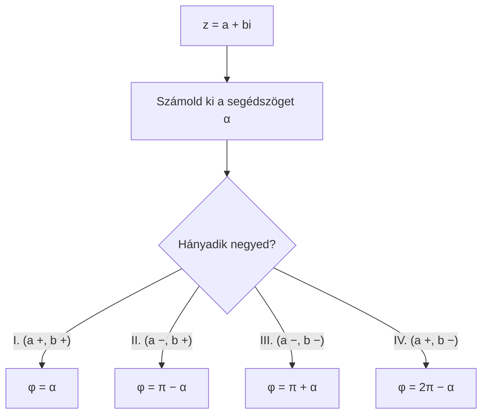

# 🧮 Komplex számok – ZH felkészülés

> [!abstract] Hogyan használd?
> 1. Olvasd el a **gyorstalpalót** – minden trükk benne van, ami a 8 feladathoz kell.
> 2. Minden feladatnál **először számold ki magad**, utána nyisd ki a lenyíló `Megoldás` dobozt.
> 3. A végén **gyakorló variációk** vannak más számokkal – ezek jöhetnek a ZH-n.
>
> A válasz-opciók előtt sima ☐ jel van (nem kattintható), hogy a Tasks plugin ne zavarjon be.

> [!warning] ZH-tipp
> A „**Select one or more**" feladatoknál (itt a 4.) **minden** jó opciót be kell jelölni, különben csak részpont jár.

---

# ⚡ Gyorstalpaló – amit tudnod kell

> [!tip] 1. Alapok
> $z=a+bi$, ahol $a$ = **valós rész**, $b$ = **képzetes rész**, és a legfontosabb szabály:
> $$i^2=-1$$
> **Konjugált:** $\overline{z}=a-bi$ (csak a képzetes rész előjele fordul meg).
> **Abszolút érték:** $\lvert z\rvert=\sqrt{a^2+b^2}$ (Pitagorasz-tétel: a szám távolsága az origótól).

> [!tip] 2. Összeadás, kivonás
> Valós rész a valóssal, képzetes a képzetessel:
> $$(a+bi)+(c+di)=(a+c)+(b+d)i$$

> [!tip] 3. Szorzás (algebrai alakban)
> Szorozz „mindent mindennel" (mint a zárójeleknél), aztán **$i^2$ helyére írj $-1$-et**:
> $$(a+bi)(c+di)=(ac-bd)+(ad+bc)i$$

> [!tip] 4. Osztás
> **Bővíts a nevező konjugáltjával**, így a nevező valós lesz:
> $$\frac{z}{v}=\frac{z\cdot\overline{v}}{v\cdot\overline{v}}=\frac{z\cdot\overline{v}}{\lvert v\rvert^2}$$

> [!tip] 5. Irányszög (argumentum)
> 1. Számold ki a **segédszöget**: $\alpha=\arctan\dfrac{\lvert b\rvert}{\lvert a\rvert}$ (jegyezd meg: $\tan=1\to\frac\pi4$, $\tan=\sqrt3\to\frac\pi3$, $\tan=\frac1{\sqrt3}\to\frac\pi6$).
> 2. Nézd meg, **hányadik síknegyedben** van a szám, és javítsd a szöget:
>
> | Negyed | $a$ | $b$ | Irányszög |
> | --- | --- | --- | --- |
> | I. | $+$ | $+$ | $\alpha$ |
> | II. | $-$ | $+$ | $\pi-\alpha$ |
> | III. | $-$ | $-$ | $\pi+\alpha$ |
> | IV. | $+$ | $-$ | $2\pi-\alpha$ |

> [!tip] 6. Trigonometrikus alak: szorzás, osztás
> $z=r(\cos\varphi+i\sin\varphi)$.
> - **Szorzás:** a **hosszok szorzódnak**, a **szögek összeadódnak**.
> - **Osztás:** a hosszok osztódnak, a szögek **kivonódnak**.
> - Ha a szög $2\pi$-nél nagyobb lesz, **vonj ki $2\pi$-t**, amíg $0$ és $2\pi$ közé esik.

> [!tip] 7. $n$-edik gyökök
> $z=r(\cos\varphi+i\sin\varphi)$ **$n$-edik gyökei** ($n$ db van):
> $$\sqrt[n]{r}\left(\cos\frac{\varphi+2k\pi}{n}+i\sin\frac{\varphi+2k\pi}{n}\right),\qquad k=0,1,\dots,n-1$$
> - A hosszuk mind $\sqrt[n]{r}$.
> - A szögek egymástól $\dfrac{2\pi}{n}$ távolságra vannak.
>
> **Gyors ellenőrzés egy adott számra:** emeld $n$-edik hatványra → a hossz legyen $r$, a **szög $n$-szerese** pedig adja vissza $\varphi$-t ($2\pi$ többszöröséig).

> [!tip] 8. Fontos szögek (csalólap)
> | Szög | $\cos$ | $\sin$ |
> | --- | --- | --- |
> | $0$ | $1$ | $0$ |
> | $\frac\pi6$ | $\frac{\sqrt3}2$ | $\frac12$ |
> | $\frac\pi4$ | $\frac{\sqrt2}2$ | $\frac{\sqrt2}2$ |
> | $\frac\pi3$ | $\frac12$ | $\frac{\sqrt3}2$ |
> | $\frac\pi2$ | $0$ | $1$ |

---

# 1️⃣ Feladat – Osztás

> [!question] Feladat
> Mivel egyenlő $\dfrac{z}{v}$, ha $z=10+6i$ és $v=-8+8i$?
> - ☐ a) $-\frac{27}{127}-\frac{120}{127}i$
> - ☐ b) $-\frac15-\frac{136}{125}i$
> - ☐ c) $-\frac8{25}-\frac{138}{125}i$
> - ☐ d) $-\frac14-i$
> - ☐ e) $-\frac{29}{127}-\frac{118}{127}i$
> - ☐ f) $-\frac{39}{131}-\frac{129}{131}i$
> - ☐ g) $-\frac{41}{128}-\frac{31}{32}i$
> - ☐ h) $-\frac{36}{131}-\frac{130}{131}i$

## Levezetés

**Cél:** a nevezőből el kell tüntetni az $i$-t. Ehhez bővítünk a nevező **konjugáltjával**.

**1. lépés – a nevező konjugáltja:**
$$v=-8+8i\;\Rightarrow\;\overline{v}=-8-8i$$

**2. lépés – a számláló** ($z\cdot\overline{v}$), mindent mindennel:
$$(10+6i)(-8-8i)=-80-80i-48i-48i^2$$
$$=-80-128i+48=-32-128i$$
(Az $-48i^2=-48\cdot(-1)=+48$.)

**3. lépés – a nevező** ($\lvert v\rvert^2$, nincs benne $i$):
$$\lvert v\rvert^2=(-8)^2+8^2=64+64=128$$

**4. lépés – osztás:**
$$\frac{-32-128i}{128}=-\frac{32}{128}-\frac{128}{128}i=-\frac14-i$$

**Ellenőrzés visszaszorzással** (a hányados $\cdot\,v$ adja vissza $z$-t):
$$\left(-\tfrac14-i\right)(-8+8i)=2-2i+8i-8i^2=2+6i+8=10+6i\;✅$$

> [!success]- ✅ Megoldás
> **d) $-\frac14-i$**

> [!example] ⚡ Leggyorsabb módszer
> A **nevező ($\lvert v\rvert^2$) a nevező két számának négyzetösszege**: $64+64=128$. Mivel a számláló mindkét része osztható $128$-cal vagy $32$-vel, gyorsan szépül. Ha a nevező nem lenne szép, a **visszaszorzás** a leggyorsabb ellenőrzés a válaszopciók között.

> [!warning] Gyakori hibák
> - A **nevező** konjugáltját kell képezni ($\overline{v}$), nem a számlálóét.
> - $-48i^2=+48$, **nem** $-48$. Itt szokás elrontani az előjelet.
> - A nevező $\lvert v\rvert^2=a^2+b^2$ ($128$), **nem** $\lvert v\rvert$ (gyök!).

---

# 2️⃣ Feladat – Abszolút érték

> [!question] Feladat
> Adja meg a $z=2-2i$ komplex szám abszolút értékét!
> - ☐ a) $2$
> - ☐ b) $2\sqrt2$
> - ☐ c) $4$
> - ☐ d) $1$
> - ☐ e) $0$

## Levezetés

Az abszolút érték a szám **távolsága az origótól**, Pitagorasz-tétellel:
$$\lvert z\rvert=\sqrt{2^2+(-2)^2}=\sqrt{4+4}=\sqrt8=\sqrt{4\cdot2}=2\sqrt2$$

> [!success]- ✅ Megoldás
> **b) $2\sqrt2$**

> [!example] ⚡ Leggyorsabb módszer
> $\lvert a+bi\rvert=\sqrt{a^2+b^2}$. **A mínusz jel nem számít**, mert négyzetre emelsz. Ha a számot nem tudod szépen gyökvonni, bontsd: $\sqrt8=\sqrt4\cdot\sqrt2=2\sqrt2$.

> [!warning] Gyakori hiba
> Ne írd, hogy $\lvert z\rvert=2+2=4$ vagy $2-2=0$. **Négyzetösszeg, gyökvonás**.

---

# 3️⃣ Feladat – Szorzás trigonometrikus alakban

> [!question] Feladat
> Mivel egyenlő $z=z_1z_2$, ha
> $z_1=2\left(\cos\frac{5\pi}4+i\sin\frac{5\pi}4\right)$ és $z_2=3(\cos\pi+i\sin\pi)$?
> - ☐ a) $6\left(\cos\frac{5\pi}8+i\sin\frac{5\pi}8\right)$
> - ☐ b) $6\left(\cos\frac\pi4+i\sin\frac\pi4\right)$
> - ☐ c) $6\left(\cos\frac{7\pi}4+i\sin\frac{7\pi}4\right)$
> - ☐ d) $6\left(\cos\frac{2\pi}3+i\sin\frac{2\pi}3\right)$
> - ☐ e) $6\left(\cos\frac\pi6+i\sin\frac\pi6\right)$
> - ☐ f) $6\left(\cos\frac{3\pi}2+i\sin\frac{3\pi}2\right)$

## Levezetés

Trigonometrikus alakban: **hosszok szorzása, szögek összeadása**.

**1. lépés – hossz:**
$$2\cdot3=6$$

**2. lépés – szög:**
$$\frac{5\pi}4+\pi=\frac{5\pi}4+\frac{4\pi}4=\frac{9\pi}4$$

**3. lépés – a szög legyen $0$ és $2\pi$ között.** A $\frac{9\pi}{4}$ nagyobb, mint $2\pi=\frac{8\pi}4$, tehát vonjunk ki egy teljes fordulatot:
$$\frac{9\pi}4-2\pi=\frac{9\pi}4-\frac{8\pi}4=\frac\pi4$$

$$z=6\left(\cos\frac\pi4+i\sin\frac\pi4\right)$$

> [!success]- ✅ Megoldás
> **b)**

> [!example] ⚡ Leggyorsabb módszer
> **Hossz: szorzás. Szög: összeadás. Ha túl nagy, vonj ki $2\pi$-t.** Nem kell algebrai alakra váltani! A $2\pi$ mindig $\frac{8\pi}4$, $\frac{6\pi}3$, $\frac{12\pi}6$ stb., írd át a közös nevezőre.

> [!warning] Gyakori hiba
> A szögeket **összeadod**, nem szorzod. Az $\frac{9\pi}{4}$ ugyanaz a szög, mint $\frac\pi4$, de a válaszopciók között csak a redukált szerepel.

---

# 4️⃣ Feladat – 3. gyökök

> [!question] Feladat
> Az alábbi számok közül melyek a $z=8\left(\cos\frac{2\pi}3+i\sin\frac{2\pi}3\right)$ komplex szám **3. gyökei**? (Több is lehet; az opciókat fentről lefelé számoztam.)
> - ☐ 1) $2\left(\cos\frac{2\pi}9+i\sin\frac{2\pi}9\right)$
> - ☐ 2) $2\left(\cos\frac{14\pi}9+i\sin\frac{14\pi}9\right)$
> - ☐ 3) $2\left(\cos\frac{7\pi}9+i\sin\frac{7\pi}9\right)$
> - ☐ 4) $8\left(\cos\frac{2\pi}9+i\sin\frac{2\pi}9\right)$
> - ☐ 5) $\cos\left(\frac89\pi\right)+i\sin\left(\frac89\pi\right)$

## Levezetés – az összes gyök kiszámolása

$r=8$, $\varphi=\frac{2\pi}3$, $n=3$.

**Hossz:** $\sqrt[3]8=2$ (mind a 3 gyökre).

**Szögek:** $\dfrac{\frac{2\pi}3+2k\pi}{3}=\dfrac{2\pi}9+\dfrac{2k\pi}3$

| $k$ | Szög |
| --- | --- |
| $0$ | $\frac{2\pi}9$ |
| $1$ | $\frac{2\pi}9+\frac{6\pi}9=\frac{8\pi}9$ |
| $2$ | $\frac{2\pi}9+\frac{12\pi}9=\frac{14\pi}9$ |

A három gyök tehát:
$$2\left(\cos\tfrac{2\pi}9+i\sin\tfrac{2\pi}9\right),\quad2\left(\cos\tfrac{8\pi}9+i\sin\tfrac{8\pi}9\right),\quad2\left(\cos\tfrac{14\pi}9+i\sin\tfrac{14\pi}9\right)$$

## Opciónként

| Opció | Hossz | Szög | Jó? |
| --- | --- | --- | --- |
| 1) | $2$ ✅ | $\frac{2\pi}9$ ✅ | ✅ |
| 2) | $2$ ✅ | $\frac{14\pi}9$ ✅ | ✅ |
| 3) | $2$ ✅ | $\frac{7\pi}9$ ❌ (hiányzik a listából) | ❌ |
| 4) | $8$ ❌ | $\frac{2\pi}9$ | ❌ |
| 5) | $1$ ❌ | $\frac{8\pi}9$ | ❌ |

> [!success]- ✅ Megoldás
> **1) és 2)**

> [!example] ⚡ Leggyorsabb módszer – ellenőrzés visszaszorzással
> Nem kell mind a 3 gyököt kiszámolni, **minden opciót két dologgal tesztelj**:
> 1. **A hossz köbe** legyen $8$ → a hossz $2$ (kiesik a 4. és az 5.).
> 2. **A szög háromszorosa** legyen $\frac{2\pi}3$ ($2\pi$ többszöröséig):
>
> | Szög | $3\cdot$szög | Redukálva | Jó? |
> | --- | --- | --- | --- |
> | $\frac{2\pi}9$ | $\frac{2\pi}3$ | $\frac{2\pi}3$ | ✅ |
> | $\frac{14\pi}9$ | $\frac{14\pi}3=4\pi+\frac{2\pi}3$ | $\frac{2\pi}3$ | ✅ |
> | $\frac{7\pi}9$ | $\frac{7\pi}3=2\pi+\frac\pi3$ | $\frac\pi3$ | ❌ |

> [!warning] Gyakori hibák
> - **Mindkét feltételt** ellenőrizd: a 4. és 5. opció szöge jó/közeli, de a **hossza rossz**.
> - Ne feledd: a 3. gyök **3 darab**, a szögek $\frac{2\pi}3$-ra egymástól.

---

# 5️⃣ Feladat – Összeadás

> [!question] Feladat
> Mivel egyenlő $z+v$, ha $z=10+3i$ és $v=1+5i$?
> - ☐ a) $9+9i$
> - ☐ b) $-4-7i$
> - ☐ c) $11+8i$
> - ☐ d) $1+i$
> - ☐ e) $-6-8i$
> - ☐ f) $10-4i$
> - ☐ g) $-8+6i$
> - ☐ h) $-1-i$

## Levezetés

Valós rész a valóssal, képzetes a képzetessel:
$$(10+3i)+(1+5i)=(10+1)+(3+5)i=11+8i$$

> [!success]- ✅ Megoldás
> **c) $11+8i$**

> [!example] ⚡ Leggyorsabb módszer
> Két oszlop: **valós + valós**, **képzetes + képzetes**. Ez a legkönnyebb feladat, itt a legtöbb pontot lehet hozni.

> [!warning] Gyakori hiba
> A kivonásnál ($z-v$) a **$v$ mindkét tagjára** vonatkozik a mínusz: $z-v=(10-1)+(3-5)i=9-2i$.

---

# 6️⃣ Feladat – Szorzás algebrai alakban

> [!question] Feladat
> Ha $z=9+7i$ és $v=-4+i$, akkor a $z\cdot v$ komplex szám
> - valós része:
> - képzetes része:

## Levezetés

Szorozz **mindent mindennel**:
$$(9+7i)(-4+i)=9\cdot(-4)+9\cdot i+7i\cdot(-4)+7i\cdot i$$
$$=-36+9i-28i+7i^2$$

Most **$i^2=-1$**:
$$=-36+9i-28i-7$$

Összevonás:
- valós rész: $-36-7=-43$
- képzetes rész: $9-28=-19$

$$z\cdot v=-43-19i$$

**Ellenőrzés hosszakkal** ($\lvert zv\rvert^2=\lvert z\rvert^2\cdot\lvert v\rvert^2$):
$$\lvert z\rvert^2=81+49=130,\quad\lvert v\rvert^2=16+1=17\;\Rightarrow\;130\cdot17=2210$$
$$(-43)^2+(-19)^2=1849+361=2210\;✅$$

> [!success]- ✅ Megoldás
> Valós rész: **−43**, képzetes rész: **−19**

> [!example] ⚡ Leggyorsabb módszer – a képlet
> $$(a+bi)(c+di)=\underbrace{(ac-bd)}_{\text{valós}}+\underbrace{(ad+bc)}_{\text{képzetes}}i$$
> Itt: $a=9,\;b=7,\;c=-4,\;d=1$:
> - valós: $9\cdot(-4)-7\cdot1=-36-7=-43$
> - képzetes: $9\cdot1+7\cdot(-4)=9-28=-19$

> [!warning] Gyakori hiba
> A **$bd$ tag előjele**: $7i\cdot i=7i^2=\mathbf{-7}$, ezért **kivonódik** a valós részből ($-36-7$), nem adódik hozzá.

---

# 7️⃣ Feladat – Irányszög

> [!question] Feladat
> Mennyi a $z=-1-\sqrt3\,i$ komplex szám irányszöge?
> - ☐ a) $\frac{7\pi}4$
> - ☐ b) $\frac\pi3$
> - ☐ c) $\frac\pi4$
> - ☐ d) $\frac{2\pi}3$
> - ☐ e) $\frac{5\pi}6$
> - ☐ f) $\frac{3\pi}8$
> - ☐ g) $\frac\pi2$
> - ☐ h) $\frac{4\pi}3$

## Levezetés

**1. lépés – hol van a szám?** $a=-1$ (negatív), $b=-\sqrt3$ (negatív) → **III. negyed**.

**2. lépés – segédszög:**
$$\tan\alpha=\frac{\lvert b\rvert}{\lvert a\rvert}=\frac{\sqrt3}{1}=\sqrt3\;\Rightarrow\;\alpha=\frac\pi3$$

**3. lépés – III. negyedben:** $\varphi=\pi+\alpha$
$$\varphi=\pi+\frac\pi3=\frac{3\pi}3+\frac\pi3=\frac{4\pi}3$$

**Ellenőrzés:** $\cos\frac{4\pi}3=-\frac12$ és $\sin\frac{4\pi}3=-\frac{\sqrt3}2$. Mivel $\lvert z\rvert=\sqrt{1+3}=2$, kapjuk: $2\cdot(-\frac12)=-1$ ✅ és $2\cdot(-\frac{\sqrt3}2)=-\sqrt3$ ✅

> [!success]- ✅ Megoldás
> **h) $\frac{4\pi}3$**

> [!example] ⚡ Leggyorsabb módszer
> 1. **Melyik negyed?** (ez a legtöbb opciót kizárja: a III. negyed szöge $\pi$ és $\frac{3\pi}2$ között van, azaz $180°$ és $270°$ között.)
> 2. A $\frac{7\pi}4$ IV. negyedbeli, a $\frac\pi3$, $\frac\pi4$, $\frac{3\pi}8$ I. negyedbeli, a $\frac{2\pi}3$ és $\frac{5\pi}6$ II. negyedbeli, a $\frac\pi2$ a $+i$ tengelyen van → **csak a $\frac{4\pi}3$ marad.**

> [!warning] Gyakori hiba
> Ne csak a segédszöget ($\frac\pi3$) add meg, hanem javítsd **a negyed szerint** ($\pi+\frac\pi3$). A $\frac\pi3$ opció a csapda.

---

# 8️⃣ Feladat – Konjugált és szorzás

> [!question] Feladat
> Mivel egyenlő $\overline{z}\cdot v$, ha $z=-10+8i$ és $v=2+7i$?
> - ☐ a) $46-80i$
> - ☐ b) $31-82i$
> - ☐ c) $37-93i$
> - ☐ d) $36-86i$
> - ☐ e) $43-87i$
> - ☐ f) $32-81i$
> - ☐ g) $42-91i$
> - ☐ h) $35-89i$

## Levezetés

**1. lépés – konjugált** (a képzetes rész előjele megfordul):
$$z=-10+8i\;\Rightarrow\;\overline{z}=-10-8i$$

**2. lépés – szorzás:**
$$(-10-8i)(2+7i)=-10\cdot2-10\cdot7i-8i\cdot2-8i\cdot7i$$
$$=-20-70i-16i-56i^2$$

**3. lépés – $i^2=-1$:**
$$=-20-70i-16i+56$$

**4. lépés – összevonás:**
- valós: $-20+56=36$
- képzetes: $-70-16=-86$

$$\overline{z}\cdot v=36-86i$$

**Ellenőrzés hosszakkal:** $\lvert\overline{z}\rvert^2\cdot\lvert v\rvert^2=164\cdot53=8692$ és $36^2+86^2=1296+7396=8692$ ✅

> [!success]- ✅ Megoldás
> **d) $36-86i$**

> [!example] ⚡ Leggyorsabb módszer
> Képlet: $(a+bi)(c+di)=(ac-bd)+(ad+bc)i$, itt $a=-10,\;b=-8,\;c=2,\;d=7$:
> - valós: $ac-bd=-20-(-56)=-20+56=36$
> - képzetes: $ad+bc=-70+(-16)=-86$

> [!warning] Gyakori hibák
> - A **konjugált $z$-é**, nem $v$-é. Ha $\overline{v}$-t képeznéd, rossz opció jönne ki.
> - $-8i\cdot7i=-56i^2=+56$ (kétszer megfordul az előjel).

---

# 🎯 Gyakorló variációk

> [!question]- Variáció 1 – szorzás
> $(3+4i)(1-2i)=\;?$
> > [!success]- Megoldás
> > $3-6i+4i-8i^2=3-2i+8=\mathbf{11-2i}$.

> [!question]- Variáció 2 – osztás
> $\dfrac{2+i}{1-i}=\;?$
> > [!success]- Megoldás
> > Bővítés $(1+i)$-vel: $\dfrac{(2+i)(1+i)}{2}=\dfrac{2+2i+i+i^2}{2}=\dfrac{1+3i}{2}=\mathbf{\tfrac12+\tfrac32i}$.

> [!question]- Variáció 3 – abszolút érték
> $\lvert3-4i\rvert=\;?$
> > [!success]- Megoldás
> > $\sqrt{9+16}=\sqrt{25}=\mathbf5$.

> [!question]- Variáció 4 – irányszögek
> Irányszög: (a) $-1+i$, (b) $1-i$, (c) $-\sqrt3-i$
> > [!success]- Megoldás
> > (a) II. negyed, $\alpha=\frac\pi4$ → $\pi-\frac\pi4=\mathbf{\frac{3\pi}4}$.
> > (b) IV. negyed, $\alpha=\frac\pi4$ → $2\pi-\frac\pi4=\mathbf{\frac{7\pi}4}$.
> > (c) III. negyed, $\tan\alpha=\frac1{\sqrt3}$ → $\alpha=\frac\pi6$ → $\pi+\frac\pi6=\mathbf{\frac{7\pi}6}$.

> [!question]- Variáció 5 – trigonometrikus szorzás
> $2\left(\cos\frac\pi3+i\sin\frac\pi3\right)\cdot4\left(\cos\frac{5\pi}6+i\sin\frac{5\pi}6\right)=\;?$
> > [!success]- Megoldás
> > Hossz: $8$. Szög: $\frac{2\pi}6+\frac{5\pi}6=\frac{7\pi}6$ → $\mathbf{8\left(\cos\frac{7\pi}6+i\sin\frac{7\pi}6\right)}$.

> [!question]- Variáció 6 – trigonometrikus osztás
> $\dfrac{6(\cos\pi+i\sin\pi)}{3\left(\cos\frac\pi2+i\sin\frac\pi2\right)}=\;?$
> > [!success]- Megoldás
> > Hossz: $6:3=2$. Szög: $\pi-\frac\pi2=\frac\pi2$ → $2\left(\cos\frac\pi2+i\sin\frac\pi2\right)=\mathbf{2i}$.

> [!question]- Variáció 7 – 3. gyökök
> Mik a $z=8$ (azaz $8(\cos0+i\sin0)$) 3. gyökei?
> > [!success]- Megoldás
> > Hossz: $\sqrt[3]8=2$. Szögek: $0,\;\frac{2\pi}3,\;\frac{4\pi}3$. Tehát $2$, $2\left(\cos\frac{2\pi}3+i\sin\frac{2\pi}3\right)$, $2\left(\cos\frac{4\pi}3+i\sin\frac{4\pi}3\right)$.

> [!question]- Variáció 8 – 4. gyökök
> Mik a $z=16(\cos\pi+i\sin\pi)$ 4. gyökeinek szögei és hossza?
> > [!success]- Megoldás
> > Hossz: $\sqrt[4]{16}=2$. Szögek: $\frac{\pi+2k\pi}4$: $\frac\pi4,\;\frac{3\pi}4,\;\frac{5\pi}4,\;\frac{7\pi}4$.

> [!question]- Variáció 9 – konjugált
> $\overline{z}+v=\;?$, ha $z=3+2i$, $v=1-i$.
> > [!success]- Megoldás
> > $\overline{z}=3-2i$ → $(3-2i)+(1-i)=\mathbf{4-3i}$.

---

# 📌 Csalólap (nyomtatásra)

| Téma | Amit tudni kell |
| --- | --- |
| $i^2$ | $-1$ |
| Konjugált | $\overline{a+bi}=a-bi$ |
| Abszolút érték | $\sqrt{a^2+b^2}$ |
| Összeadás | valós + valós, képzetes + képzetes |
| Szorzás (algebrai) | $(ac-bd)+(ad+bc)i$ |
| Osztás | bővíts a nevező konjugáltjával; nevező $=c^2+d^2$ |
| Irányszög | segédszög $\arctan\frac{\lvert b\rvert}{\lvert a\rvert}$, majd negyed szerint javítás |
| Trig. szorzás | hossz szorzás, szög összeadás ($>2\pi$ → vonj ki $2\pi$-t) |
| Trig. osztás | hossz osztás, szög kivonás |
| $n$-edik gyök | hossz: $\sqrt[n]r$; szög: $\frac{\varphi+2k\pi}n$, $k=0,\dots,n-1$ |
| Gyökök ellenőrzése | hossz$^n=r$ **és** szög$\cdot n\equiv\varphi$ |
