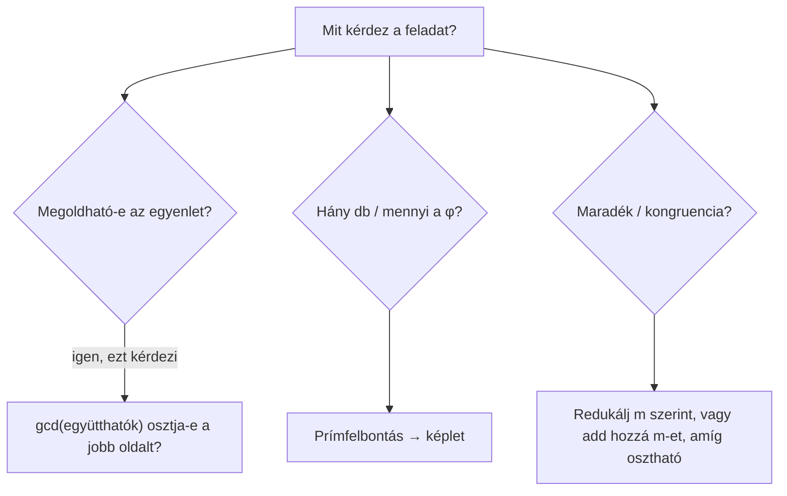

# 🔢 Oszthatóság, kongruenciák, φ-függvény – ZH felkészülés

> [!abstract] Hogyan használd?
> 1. Olvasd el a **gyorstalpalót** – itt van minden trükk, ami a 8 feladathoz kell.
> 2. Minden feladatnál **először próbáld meg magad**, utána nyisd ki a lenyíló `Megoldás` dobozt.
> 3. A végén **gyakorló variációk** vannak más számokkal – ezek jöhetnek a ZH-n.
>
> A válasz-opciók előtt sima ☐ jel van (nem kattintható), hogy a Tasks plugin ne zavarjon be.

> [!warning] ZH-tipp
> A „**Select one or more**" feladatoknál **minden** jó opciót be kell jelölni, különben csak részpont jár.

---

# ⚡ Gyorstalpaló – a 8 trükk

> [!tip] 1. Prímfelbontás – mindennek az alapja
> Bontsd a számot prímek szorzatára: $60=2^2\cdot3\cdot5$. A legtöbb feladat ebből egy lépésben kijön.
> **Gyors módszer:** oszd 2-vel, amíg lehet, aztán 3-mal, 5-tel, 7-tel...

> [!tip] 2. Euler-féle $\varphi$ függvény
> $\varphi(n)$ = hány szám van $1$ és $n$ között, ami **relatív prím** $n$-hez.
> $$\varphi(n)=n\cdot\left(1-\tfrac1{p_1}\right)\left(1-\tfrac1{p_2}\right)\cdots$$
> (minden **különböző** prímre egy tényező, a kitevő nem számít a szorzóban).

> [!tip] 3. Osztók száma
> Ha $n=p_1^{a_1}\cdot p_2^{a_2}\cdots$, akkor az osztók száma:
> $$(a_1+1)(a_2+1)\cdots$$
> „**Minden kitevőhöz adj hozzá 1-et, aztán szorozd össze.**"

> [!tip] 4. Oszthatósági szabályok
> | Osztó | Szabály |
> | --- | --- |
> | $2$ | az utolsó számjegy páros |
> | $3$ és $9$ | a **számjegyek összege** osztható 3-mal / 9-cel |
> | $5$ | az utolsó számjegy 0 vagy 5 |
> | $4$ | az utolsó 2 számjegyből álló szám osztható 4-gyel |

> [!tip] 5. Legnagyobb közös osztó és legkisebb közös többszörös
> - **lnko:** euklideszi algoritmus (oszd el a nagyobbat a kisebbel, a maradékkal folytasd, míg 0 nem lesz).
> - $\text{lcm}(a,b)=\dfrac{a\cdot b}{\gcd(a,b)}$

> [!tip] 6. Kongruencia: $a\equiv r\pmod m$
> Azt jelenti: $a$-nak **$m$-mel osztva $r$ a maradéka**, vagyis $a=r+m\cdot k$ (valami egész $k$-ra).
> Negatív számoknál **adj hozzá $m$ többszörösét**, amíg $0$ és $m-1$ közé nem esik.

> [!tip] 7. Lineáris kongruencia: $ax\equiv b\pmod m$
> **Leggyorsabb módszer:** a jobb oldalhoz adj hozzá $m$-et újra és újra, amíg osztható nem lesz $a$-val. Akkor oszd el.
> **Megoldható-e?** Pontosan akkor, ha $\gcd(a,m)$ **osztja** $b$-t.

> [!tip] 8. Diofantikus egyenlet: $ax+by=c$
> Egész megoldás **akkor van**, ha $\gcd(a,b)$ **osztja** $c$-t. Ez az egész trükk, a megoldást nem is kell kiszámolni.

---

# 1️⃣ Feladat – $\varphi(60)$

> [!question] Feladat
> Adja meg $\varphi(60)$ értékét, ahol $\varphi$ az Euler-féle $\varphi$-függvény.

> [!info] Mit jelent a $\varphi(n)$?
> $\varphi(n)$ megmondja, hogy az $1,2,\dots,n$ számok közül **hány relatív prím** $n$-hez (vagyis hány számnak nincs közös osztója $n$-nel az $1$-en kívül).
> Pl. $\varphi(10)$: $1,3,7,9$ relatív prím $10$-hez → $\varphi(10)=4$.

## Levezetés

**1. lépés – prímfelbontás:**
$$60=2^2\cdot3\cdot5$$
(Különböző prímek: $2,3,5$.)

**2. lépés – képlet** (minden különböző prímre egy $(1-\frac1p)$ tényező):
$$\varphi(60)=60\cdot\left(1-\tfrac12\right)\left(1-\tfrac13\right)\left(1-\tfrac15\right)$$

**3. lépés – számolás lépésről lépésre:**
$$60\cdot\tfrac12=30,\qquad30\cdot\tfrac23=20,\qquad20\cdot\tfrac45=16$$

> [!success]- ✅ Megoldás
> $\varphi(60)=\mathbf{16}$

> [!example] ⚡ Leggyorsabb módszer
> Egy lépésben, minden prímre: **osztás $p$-vel, szorzás $(p-1)$-gyel**:
> $$60\;\xrightarrow{\;:2\cdot1\;}\;30\;\xrightarrow{\;:3\cdot2\;}\;20\;\xrightarrow{\;:5\cdot4\;}\;16$$
> **Ellenőrzés** a szorzatos szabállyal: $\varphi(4)\cdot\varphi(3)\cdot\varphi(5)=2\cdot2\cdot4=16$ ✅

> [!warning] Gyakori hiba
> A **különböző** prímeket kell venni, nem a kitevőset. $60=2^2\cdot3\cdot5$-ben a $2$-t **csak egyszer** számolod a képletben.

---

# 2️⃣ Feladat – Oszthatóság 9-cel

> [!question] Feladat
> Milyen számjegyeket írhatunk az $a$ betű helyére, ha azt szeretnénk, hogy a $2a4957$ hatjegyű szám osztható legyen 9-cel? (Több is lehet.)
> - ☐ a) 0
> - ☐ b) 1
> - ☐ c) 2
> - ☐ d) 3
> - ☐ e) 4
> - ☐ f) 5
> - ☐ g) 6
> - ☐ h) 7
> - ☐ i) 8
> - ☐ j) 9

> [!info] Miért működik a számjegyösszeg?
> $10\equiv1\pmod9$, ezért $10^k\equiv1$ is. Így minden szám **ugyanazt a maradékot adja 9-cel osztva, mint a számjegyeinek összege**.

## Levezetés

**1. lépés – számjegyösszeg:**
$$2+a+4+9+5+7=27+a$$

**2. lépés – ennek oszthatónak kell lennie 9-cel.** $27=3\cdot9$ már osztható, tehát az $a$-nak is oszthatónak kell lennie 9-cel:
$$a\in\{0,\,9\}$$
(Számjegy csak $0$ és $9$ között lehet, ezért marad ez a kettő.)

**Ellenőrzés:** $204957:9=22773$ ✅ és $294957:9=32773$ ✅

> [!success]- ✅ Megoldás
> **a) 0** és **j) 9**

> [!example] ⚡ Leggyorsabb módszer
> Add össze az ismert számjegyeket, nézd meg, **mennyi hiányzik a következő 9-többszörösig**. Itt $27$ már 9-többszörös → $a=0$ vagy $a=9$ (mindig mindkettő, ha a maradék 0).

> [!warning] Gyakori hiba
> A **9** is jó! Sokan csak a $0$-t jelölik be, mert a $9$-et „nagynak" érzik. Mindkét számjegy jó.

---

# 3️⃣ Feladat – Osztók száma

> [!question] Feladat
> - Az $25200$ pozitív osztóinak száma:
> - azon pozitív osztók száma, melyek $66$-tal relatív prímek:

## Levezetés

**1. lépés – prímfelbontás:**

| Osztás | Maradék |
| --- | --- |
| $25200:2$ | $12600$ |
| $12600:2$ | $6300$ |
| $6300:2$ | $3150$ |
| $3150:2$ | $1575$ |
| $1575:3$ | $525$ |
| $525:3$ | $175$ |
| $175:5$ | $35$ |
| $35:5$ | $7$ |

$$25200=2^4\cdot3^2\cdot5^2\cdot7$$

### a) Az osztók száma
Minden kitevőhöz $+1$, aztán szorzás:
$$(4+1)(2+1)(2+1)(1+1)=5\cdot3\cdot3\cdot2=\mathbf{90}$$

**Miért?** Az osztó $2$-esének kitevője lehet $0,1,2,3,4$ (5 lehetőség), a $3$-asé $0,1,2$ (3), az $5$-ösé $0,1,2$ (3), a $7$-esé $0,1$ (2). A választások függetlenek → szorzás.

### b) 66-tal relatív prím osztók
$66=2\cdot3\cdot11$. Egy osztó akkor relatív prím $66$-hoz, ha **nincs benne** sem $2$, sem $3$, sem $11$ prímtényező.
- A $11$ amúgy sincs a $25200$-ban → nem számít.
- A $2$ és a $3$ kitevőjét **$0$-ra kell rögzíteni** (nincs választás).
- Marad: $5^0,5^1,5^2$ és $7^0,7^1$.

$$(2+1)(1+1)=\mathbf{6}$$
(Ezek: $1,5,25,7,35,175$.)

> [!success]- ✅ Megoldás
> **90** és **6**

> [!example] ⚡ Leggyorsabb módszer
> - **Összes osztó:** mindegyik kitevőhöz +1, szorzás.
> - **Relatív prímek ...-hoz:** húzd ki a prímtényezőket, amik a másik számban is szerepelnek. A maradék prímekre ugyanaz a szorzás.

> [!warning] Gyakori hiba
> A relatív prím osztóknál a kitevők **nullára** esnek, nem **eggyel csökkennek**. A $2$ és $3$ tényező teljesen kiesik (1 lehetőség), nem $(4)\cdot(2)$.

---

# 4️⃣ Feladat – $\varphi(48)$ és nagy hatvány maradéka

> [!question] Feladat
> - Adja meg $\varphi(48)$ értékét.
> - Mennyi maradékot ad $49^{145}$, ha az $48$ számmal osztjuk?

## a) $\varphi(48)$

$$48=2^4\cdot3$$
$$\varphi(48)=48\cdot\tfrac12\cdot\tfrac23=24\cdot\tfrac23=\mathbf{16}$$

## b) $49^{145}\bmod48$

**Észrevétel:** $49=48+1$, tehát
$$49\equiv1\pmod{48}$$

**Hatványozás kongruenciával** (a $\equiv$ megmarad hatványozásnál):
$$49^{145}\equiv1^{145}=1\pmod{48}$$

> [!success]- ✅ Megoldás
> $\varphi(48)=\mathbf{16}$ és a maradék $\mathbf{1}$

> [!example] ⚡ Leggyorsabb módszer
> **Ha az alap 1-gyel nagyobb vagy kisebb a modulusnál**, a maradék azonnal látszik:
> - $49\equiv+1$ → bármilyen hatványa $\equiv1$
> - $47\equiv-1$ → páros kitevőnél $1$, páratlannál $-1\equiv47$
>
> **Euler-tétellel is kijön** (ezért kérdezték $\varphi(48)$-at): $\gcd(49,48)=1$, így $49^{16}\equiv1$. Mivel $145=9\cdot16+1$, kapjuk: $49^{145}\equiv49^1\equiv1\pmod{48}$ ✅

> [!warning] Gyakori hiba
> Ne számold ki $49^{145}$-öt (hatalmas szám). **Mindig keress egyszerűbb alakot a modulus szerint.**

---

# 5️⃣ Feladat – lnko és lkkt

> [!question] Feladat
> Az $540$ és $462$:
> - legnagyobb közös osztója:
> - legkisebb közös többszöröse:

## Levezetés – euklideszi algoritmus

| Osztandó | Osztó | Hányados | Maradék |
| --- | --- | --- | --- |
| $540$ | $462$ | $1$ | $78$ |
| $462$ | $78$ | $5$ | $72$ |
| $78$ | $72$ | $1$ | $6$ |
| $72$ | $6$ | $12$ | $0$ |

Az **utolsó nem nulla maradék** a legnagyobb közös osztó:
$$\gcd(540,462)=\mathbf{6}$$

**Legkisebb közös többszörös:**
$$\text{lcm}=\frac{540\cdot462}{6}=90\cdot462=\mathbf{41580}$$

## 🔍 Ellenőrzés prímfelbontással
$$540=2^2\cdot3^3\cdot5,\qquad462=2\cdot3\cdot7\cdot11$$
- **gcd:** minden prímből a **kisebb** kitevő: $2^1\cdot3^1=6$ ✅
- **lcm:** minden prímből a **nagyobb** kitevő: $2^2\cdot3^3\cdot5\cdot7\cdot11=41580$ ✅

> [!success]- ✅ Megoldás
> **lnko = 6**, **lkkt = 41580**

> [!example] ⚡ Leggyorsabb módszer
> 1. Euklidesz-táblázat → gcd.
> 2. lcm = (egyik szám × másik szám) : gcd. **Előbb oszd el, aztán szorozz** ($540:6=90$, majd $90\cdot462$), így kisebb számokkal dolgozol.

> [!warning] Gyakori hiba
> Az euklideszi algoritmusban mindig a **maradékkal folytasd**, nem a hányadossal. A végén az **utolsó nem nulla** maradék az eredmény.

---

# 6️⃣ Feladat – Kongruenciák megoldása

> [!question] Feladat
> - Határozza meg a legkisebb olyan **20-nál nagyobb** egész számot, mely megoldja: $x\equiv6\pmod7$.
> - Határozza meg a $8x\equiv61\pmod{11}$ kongruencia legkisebb pozitív megoldását.

## a) $x\equiv6\pmod7$, $x>20$

A megoldások: $x=6+7k$:
$$\dots,\;6,\;13,\;20,\;27,\;34,\dots$$

A $20$ **megoldás**, de a feladat azt kéri, hogy **20-nál nagyobb** legyen → a következő:
$$x=\mathbf{27}$$

## b) $8x\equiv61\pmod{11}$

**Leggyorsabb módszer:** a jobb oldalhoz **adj hozzá $11$-et**, amíg osztható nem lesz $8$-cal:

| Jobb oldal | Osztható 8-cal? |
| --- | --- |
| $61$ | ❌ |
| $61+11=72$ | ✅ ($72:8=9$) |

$$8x\equiv72\pmod{11}\;\Rightarrow\;x\equiv9\pmod{11}$$

(A $8$ és $11$ relatív prím, ezért szabad $8$-cal osztani.)

**Ellenőrzés:** $8\cdot9=72$, és $72-61=11$ osztható $11$-gyel ✅

A legkisebb pozitív megoldás: $x=\mathbf{9}$.

> [!success]- ✅ Megoldás
> **a) 27**, **b) 9**

> [!example] ⚡ Másik módszer (inverzzel)
> $61\equiv6\pmod{11}$ → $8x\equiv6$. A $8$ inverze $11$ szerint: $8\cdot7=56\equiv1$, tehát $x\equiv6\cdot7=42\equiv9$ ✅
> A „hozzáadogatós" módszer ZH-n gyorsabb.

> [!warning] Gyakori hibák
> - Az a) részben a $20$ **nem jó** (nem nagyobb 20-nál).
> - A b) részben ne felejtsd el, hogy a $x\equiv9$ azt jelenti: $9,20,31,\dots$ is megoldások. A **legkisebb pozitív** a $9$.

---

# 7️⃣ Feladat – Megoldható egyenletek

> [!question] Feladat
> Jelölje meg az alábbiak közül a megoldható egyenleteket, ha a megoldást az **egész számok** halmazában keressük.
> - ☐ a) $14x\equiv21\pmod{35}$
> - ☐ b) $105x+165y=25$
> - ☐ c) $168x+231y=42$
> - ☐ d) $153x+207y=18$
> - ☐ e) $12x\equiv15\pmod{30}$

> [!info] A két szabály
> | Egyenlet típusa | Mikor megoldható? |
> | --- | --- |
> | $ax+by=c$ | ha $\gcd(a,b)\mid c$ |
> | $ax\equiv b\pmod m$ | ha $\gcd(a,m)\mid b$ |
>
> ($\mid$ = „osztja". Tehát a gcd-nek **osztania kell a jobb oldalt.**)

## Levezetés – egyenletenként

### a) $14x\equiv21\pmod{35}$ ✅
$\gcd(14,35)=7$, és $7\mid21$ ✅ → **megoldható**.

### b) $105x+165y=25$ ❌
Euklidesz: $165-105=60$, $105-60=45$, $60-45=15$, $45=3\cdot15$ → $\gcd=15$.
$15\nmid25$ (mert $25:15$ nem egész) → **nem megoldható**.

### c) $168x+231y=42$ ✅
$231-168=63$; $168=2\cdot63+42$; $63=42+21$; $42=2\cdot21$ → $\gcd=21$.
$21\mid42$ ✅ → **megoldható**.

### d) $153x+207y=18$ ✅
$207-153=54$; $153=2\cdot54+45$; $54=45+9$; $45=5\cdot9$ → $\gcd=9$.
$9\mid18$ ✅ → **megoldható**.

### e) $12x\equiv15\pmod{30}$ ❌
$\gcd(12,30)=6$, és $6\nmid15$ → **nem megoldható**.

> [!note] A képernyőképen az e) modulusa hibásan jelent meg
> A feladatban `mod [?][?]30` látszik (renderelési hiba). Szerintem a modulus 30. **De a válasz akkor is ugyanaz, ha a modulus bármilyen 0-ra végződő szám:** a modulus páros, $12x$ páros, $15$ páratlan, tehát $12x-15$ páratlan, és páratlan szám nem lehet osztható páros számmal → soha nem megoldható. Ha a ZH-n a modulus látszik, számold ki a $\gcd(12,m)\mid15$ szabállyal.

> [!success]- ✅ Megoldás
> **a), c), d)**

> [!example] ⚡ Leggyorsabb módszer
> Csak **egy gcd**-t számolsz:
> 1. Kiszámolod a bal oldal együtthatóinak gcd-jét.
> 2. Megnézed, hogy **osztja-e** a jobb oldalt.
>
> Euklidesz helyett is jó: **közös osztók keresése** (pl. $105$ és $165$ mindkettő osztható $5$-tel és $3$-mal → $15$).

> [!warning] Gyakori hiba
> A kongruenciánál a gcd-t az **együttható és a modulus** között kell venni ($\gcd(14,35)$), a diofantikusnál a **két együttható** között.

---

# 8️⃣ Feladat – Melyik érték lehet $a$?

> [!question] Feladat
> Melyik felsorolt értéket veheti fel $a$, ha tudjuk, hogy $a\equiv8\pmod{16}$? (Több is lehet.)
> - ☐ a) 39
> - ☐ b) −101
> - ☐ c) −39
> - ☐ d) −134
> - ☐ e) −88
> - ☐ f) −120
> - ☐ g) 149
> - ☐ h) 24
> - ☐ i) −152
> - ☐ j) −58

> [!info] Mit jelent?
> $a\equiv8\pmod{16}$: $a$-nak $16$-tal osztva **$8$ a maradéka**, vagyis $a=8+16k$.
> A lista: $\dots,-40,-24,-8,\;8,\;24,\;40,\dots$

## Levezetés – opciónként

**Módszer:** adj hozzá (vagy vonj ki) $16$ többszörösét, amíg **$0$ és $15$ közé** nem esik. Ha $8$ jön ki → jó.

| Szám | Átalakítás | Maradék | Jó? |
| --- | --- | --- | --- |
| $39$ | $39-32$ | $7$ | ❌ |
| $-101$ | $-101+112$ | $11$ | ❌ |
| $-39$ | $-39+48$ | $9$ | ❌ |
| $-134$ | $-134+144$ | $10$ | ❌ |
| $-88$ | $-88+96$ | **$8$** | ✅ |
| $-120$ | $-120+128$ | **$8$** | ✅ |
| $149$ | $149-144$ | $5$ | ❌ |
| $24$ | $24-16$ | **$8$** | ✅ |
| $-152$ | $-152+160$ | **$8$** | ✅ |
| $-58$ | $-58+64$ | $6$ | ❌ |

> [!success]- ✅ Megoldás
> **e) −88**, **f) −120**, **h) 24**, **i) −152**

> [!example] ⚡ Leggyorsabb módszer – „8 szorozva páratlannal"
> $$a\equiv8\pmod{16}\iff a=8\cdot(\text{páratlan szám})$$
> **Miért?** $8\cdot(2k+1)=16k+8$ ✅
>
> Ellenőrzés két kérdéssel:
> 1. **Osztható-e $8$-cal?** (ha nem → kiesik: $39,-101,-39,-134,149,-58$)
> 2. **A hányados páratlan-e?** $24:8=3$ ✅, $-88:8=-11$ ✅, $-120:8=-15$ ✅, $-152:8=-19$ ✅

> [!warning] Gyakori hiba
> Negatív számoknál ne vedd a „szokásos maradékot" fejben: **mindig adj hozzá 16-os többszörösöket**, amíg pozitív nem lesz. A $-39$ maradéka nem $7$, hanem $9$ ($-39+48=9$).

---

# 🎯 Gyakorló variációk

> [!question]- Variáció 1 – $\varphi$
> Mennyi $\varphi(72)$?
> > [!success]- Megoldás
> > $72=2^3\cdot3^2$ → $72\cdot\frac12\cdot\frac23=24$.

> [!question]- Variáció 2 – oszthatóság 9-cel
> Milyen $a$ számjegy esetén osztható $4a728$ 9-cel?
> > [!success]- Megoldás
> > $4+7+2+8=21$, $21+a$ osztható 9-cel → $a=6$ ($27$).

> [!question]- Variáció 3 – osztók száma
> Hány pozitív osztója van $360$-nak? Ebből hány relatív prím $15$-höz?
> > [!success]- Megoldás
> > $360=2^3\cdot3^2\cdot5$ → $(3+1)(2+1)(1+1)=24$ osztó. Relatív prím $15=3\cdot5$-höz: csak $2$ hatványai maradnak: $(3+1)=4$ ($1,2,4,8$).

> [!question]- Variáció 4 – nagy hatvány
> Mennyi a maradék: $7^{100}\bmod6$? És $3^{100}\bmod7$?
> > [!success]- Megoldás
> > $7\equiv1\pmod6$ → $1$. Másodiknál: $\varphi(7)=6$, $100=16\cdot6+4$ → $3^4=81\equiv4\pmod7$.

> [!question]- Variáció 5 – lnko, lkkt
> $\gcd(84,126)$ és $\text{lcm}(84,126)$?
> > [!success]- Megoldás
> > $126-84=42$, $84=2\cdot42$ → $\gcd=42$. $\text{lcm}=84\cdot126/42=252$.

> [!question]- Variáció 6 – kongruencia
> Oldja meg: $5x\equiv3\pmod7$.
> > [!success]- Megoldás
> > $3+7=10$, $10:5=2$ → $x\equiv2\pmod7$. (Ellenőrzés: $5\cdot2=10\equiv3$ ✅)

> [!question]- Variáció 7 – megoldhatóság
> Melyik megoldható? $10x+25y=7$, $6x\equiv4\pmod{10}$, $9x+12y=21$.
> > [!success]- Megoldás
> > $\gcd(10,25)=5\nmid7$ ❌. $\gcd(6,10)=2\mid4$ ✅. $\gcd(9,12)=3\mid21$ ✅.

> [!question]- Variáció 8 – maradékosztály
> Melyik $\equiv5\pmod{12}$: $29$, $-7$, $18$, $-19$?
> > [!success]- Megoldás
> > $29$: $29-24=5$ ✅. $-7$: $-7+12=5$ ✅. $18$: $18-12=6$ ❌. $-19$: $-19+24=5$ ✅.

---

# 📌 Csalólap (nyomtatásra)

| Téma | Amit tudni kell |
| --- | --- |
| $\varphi(n)$ | $n\cdot\prod(1-\frac1p)$, **különböző** prímekre |
| $\varphi(p^k)$ | $p^k-p^{k-1}$ |
| Osztók száma | kitevő $+1$, szorzás |
| Oszthatóság 9-cel / 3-mal | számjegyösszeg |
| $\gcd$ | euklideszi algoritmus / kisebb kitevők |
| $\text{lcm}$ | $\frac{ab}{\gcd}$ / nagyobb kitevők |
| $a\equiv r\pmod m$ | $a=r+mk$, negatívnál adj hozzá $m$-et |
| $ax\equiv b\pmod m$ megoldható | $\gcd(a,m)\mid b$ |
| $ax\equiv b\pmod m$ megoldása | add hozzá $m$-et $b$-hez, amíg osztható $a$-val |
| $ax+by=c$ megoldható | $\gcd(a,b)\mid c$ |
| Nagy hatvány maradéka | redukáld az alapot ($49\equiv1$), vagy Euler: $a^{\varphi(m)}\equiv1$ |
