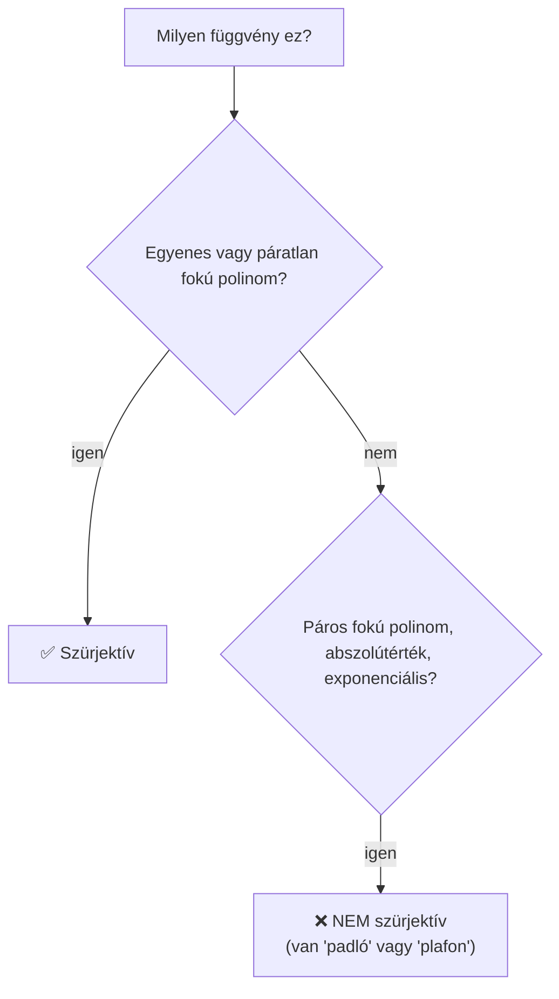

# 🧠 Halmazok és függvények – ZH felkészülés

> [!abstract] Hogyan használd ezt a jegyzetet?
> 1. Olvasd el a **gyorstalpalót** (kb. 5 perc) – ebben van minden trükk.
> 2. Minden feladatnál **először próbáld meg magad**, csak utána nyisd ki a lenyíló `Megoldás` dobozt (kattints a címére).
> 3. A végén a **gyakorló variációk** ugyanazt kérdezik más számokkal – ezek jönnek a ZH-n is.
>
> Jelölés: $\#A$ = az $A$ halmaz elemszáma (más helyen $|A|$). $\overline{A}$ = $A$ komplementere (mindaz az alaphalmazból, ami **nincs** $A$-ban).

---

# ⚡ Gyorstalpaló – a 6 trükk, amit tudnod kell

> [!tip] 1. Szürjektív $\mathbb{R}\to\mathbb{R}$ függvény?
> Kérdezd meg: **elér-e a grafikon minden magasságot?** (minden $y$ értéket)
> - páratlan fokú polinom (egyenes, $x^3$, ...) → **IGEN**
> - páros fokú polinom (parabola, $x^2$, ...) → **NEM** (van legalacsonyabb/legmagasabb pontja)
> - $2^x$ → **NEM** (sosem lesz $\le 0$)
> - $|x|$ → **NEM** (sosem lesz negatív)

> [!tip] 2. Szimmetrikus differencia
> $$\#(A\triangle B)=\#A+\#B-2\cdot\#(A\cap B)$$
> (a két „holdsarló", a közös rész **nincs** benne.)

> [!tip] 3. Legkisebb / legnagyobb elemszám – rajzolós logika
> - **Legkisebb** lesz → a halmazok **egymásba** vannak téve (amennyire csak lehet), a kivonandó halmaz teljesen belecsúszik.
> - **Legnagyobb** lesz → a halmazok **szétválnak**, a kivonandó halmaz teljesen kilóg.

> [!tip] 4. Szöveg → halmazjel fordító
> | Magyarul | Halmazjel |
> | --- | --- |
> | „nincs olyan, aki ..." | $\ldots=\varnothing$ |
> | „és" | $\cap$ |
> | „vagy" | $\cup$ |
> | „nem" / „több mint" (ha az eredeti „legfeljebb") | felülvonás $\overline{\phantom{A}}$ |
> | „minden ... ...", „ha ..., akkor ..." | $\subset$ |

> [!tip] 5. Három halmaz uniója (szitaformula)
> $$\#(A\cup B\cup C)=\#A+\#B+\#C-\#(A\cap B)-\#(A\cap C)-\#(B\cap C)+\#(A\cap B\cap C)$$
> **Ritmus:** `+ egyesek − párok + hármas`

> [!tip] 6. De Morgan (komplementer „átfordítja" a jelet)
> $$\overline{A\cup B}=\overline{A}\cap\overline{B}\qquad\overline{A\cap B}=\overline{A}\cup\overline{B}$$
> Meg: $X\setminus Y = X\cap\overline{Y}$ („kivonás = metszet a komplementerrel").

---

# 1️⃣ Feladat – Melyik függvény szürjektív?

> [!question] Feladat
> Az alábbi függvények közül melyek szürjektívek? (Több is lehet.) Mind $f:\mathbb{R}\to\mathbb{R}$.
> - ☐ a) $f(x)=x^3-x$
> - ☐ b) $f(x)=3x^2-8x+5$
> - ☐ c) $f(x)=2^x$
> - ☐ d) $f(x)=|x|$
> - ☐ e) $f(x)=5x-2$

> [!info] Mit jelent a szürjektív?
> Egy $f:\mathbb{R}\to\mathbb{R}$ függvény **szürjektív**, ha az értékkészlete **az egész $\mathbb{R}$** – vagyis **bármilyen** $y$ számot választasz, van olyan $x$, amire $f(x)=y$.
>
> **Hétköznapi kép:** a grafikon rajzolása közben a tollad **minden magasságot érint**. Ha van olyan magasság (pl. $y=-100$), amit a grafikon sosem ér el → **nem szürjektív**.

## Levezetés függvényenként

### a) $x^3-x$ ✅
- Ha $x\to+\infty$, akkor $x^3$ „nyer" → $f(x)\to+\infty$.
- Ha $x\to-\infty$, akkor $f(x)\to-\infty$.
- A függvény **folytonos** (nincs benne ugrás), tehát „lentről fentig" **mindent** bejár.

$\Rightarrow$ értékkészlet $=\mathbb{R}$ → **szürjektív**.

### b) $3x^2-8x+5$ ❌
Ez egy **felfelé nyíló parabola** → van legalacsonyabb pontja (csúcs), az alatt semmi.

A csúcs helye: $x_v=\dfrac{-b}{2a}=\dfrac{8}{6}=\dfrac43$.

A csúcs magassága:
$$f\!\left(\tfrac43\right)=3\cdot\tfrac{16}{9}-8\cdot\tfrac43+5=\tfrac{16}{3}-\tfrac{32}{3}+\tfrac{15}{3}=-\tfrac13$$

$\Rightarrow$ értékkészlet $=\left[-\tfrac13,\infty\right)\neq\mathbb{R}$ → **NEM szürjektív** (pl. $y=-5$-öt sosem éri el).

### c) $2^x$ ❌
Egy pozitív szám hatványa **mindig pozitív**. Értékkészlet: $(0,\infty)$. A $0$-t és a negatívokat sosem éri el → **NEM**.

### d) $|x|$ ❌
Az abszolútérték **sosem negatív**. Értékkészlet: $[0,\infty)$ → **NEM** (pl. $-1$ nincs).

### e) $5x-2$ ✅
Egyenes, nem vízszintes. Bármilyen $y$-ra megoldható: $5x-2=y\Rightarrow x=\dfrac{y+2}{5}$. Mindig van megoldás → **szürjektív**.

> [!success]- ✅ Megoldás
> **a) és e)**

> [!example] ⚡ Leggyorsabb módszer
> Nem kell számolni! Csak nézd meg a típust:
> - **páratlan fokú vagy egyenes** → igen
> - **bármi más** ($x^2$, $2^x$, $|x|$) → nem
>
> Egyetlen dolog van, amit érdemes kiszámolni: a parabola csúcsát, ha **bizonyítani** kell (de a „páros fokú → nem" szabály a ZH-hoz elég).

> [!warning] Gyakori hiba
> Sokan azt hiszik, hogy az $x^2$-típusú függvény szürjektív, mert „nagyon nagy is lehet". De **negatívot** sosem vesz fel → nem szürjektív.

---

# 2️⃣ Feladat – Hány elemű $B$?

> [!question] Feladat
> Hány elemű a $B$ halmaz, ha $\#(A\triangle B)=15$, $\#(A\cap B)=4$ és $\#A=12$?

> [!info] Mi az a $\triangle$?
> $A\triangle B$ = azok az elemek, amik **pontosan az egyikben** vannak (a közös rész **kimarad**). Két holdsarló.

## Levezetés – rajzolva (a legbiztosabb)

Két kör, három terület:

| Terület | Jelölés | Elemszám |
| --- | --- | --- |
| csak $A$-ban | $A\setminus B$ | ? |
| mindkettőben | $A\cap B$ | $4$ |
| csak $B$-ben | $B\setminus A$ | ? |

**1. lépés – csak $A$-ban lévők.** $A$-nak összesen 12 eleme van, ebből 4 a közös részben:
$$\#(A\setminus B)=12-4=8$$

**2. lépés – a szimmetrikus differencia = a két holdsarló együtt:**
$$\#(A\triangle B)=\#(A\setminus B)+\#(B\setminus A)\;\Rightarrow\;15=8+\#(B\setminus A)\;\Rightarrow\;\#(B\setminus A)=7$$

**3. lépés – $B$ = csak-$B$ + közös rész:**
$$\#B=7+4=11$$

> [!success]- ✅ Megoldás
> **11**

> [!example] ⚡ Leggyorsabb módszer – egy képlet
> $$\#(A\triangle B)=\#A+\#B-2\#(A\cap B)$$
> $$15=12+\#B-2\cdot4\;\Rightarrow\;15=4+\#B\;\Rightarrow\;\#B=11$$
> **Miért a 2×?** A közös részt mind $\#A$, mind $\#B$ megszámolta, de a $\triangle$-ban egyszer sincs benne → kétszer kell kivonni.

> [!warning] Gyakori hiba
> Nem kivonni a közös részt kétszer, hanem csak egyszer (az az unióhoz való képlet: $\#A+\#B-\#(A\cap B)$). A $\triangle$-nál **kétszer**!

---

# 3️⃣ Feladat – Legkisebb és legnagyobb lehetséges elemszám

> [!question] Feladat
> $\#A=24$, $\#B=22$, $\#C=14$. Add meg a lehetséges legkisebb és legnagyobb értékét:
> 1. $\#\big((A\cup B)\setminus C\big)$
> 2. $\#\big((A\cap B)\setminus C\big)$
>
> (Nincs megadva más információ – a halmazok akárhogy elhelyezkedhetnek.)

> [!info] A gondolkodásmód
> Nem képlet, hanem **„hogyan tegyem a köröket, hogy a lehető legkisebb / legnagyobb legyen?"**
> - Kis eredmény → sok átfedés, kivonandó rész **teljesen belelóg**.
> - Nagy eredmény → nulla átfedés, kivonandó rész **teljesen kilóg**.

## 1. rész: $(A\cup B)\setminus C$

**Legnagyobb:**
- $A\cup B$ akkor a legnagyobb, ha $A$ és $B$ **nem fedik egymást**: $24+22=46$.
- $C$ akkor nem vesz el semmit, ha **teljesen kívül** van: $C\cap(A\cup B)=\varnothing$.
- $\Rightarrow$ **46**

**Legkisebb:**
- $A\cup B$ akkor a legkisebb, ha a kisebbik teljesen benne van a nagyobbikban ($B\subset A$): $\#(A\cup B)=24$.
- $C$ akkor vesz el a legtöbbet, ha **teljesen belefér** az unióba ($C\subset A\cup B$, mert $14\le24$): kivonunk $14$-et.
- $\Rightarrow 24-14=$ **10**

## 2. rész: $(A\cap B)\setminus C$

**Legnagyobb:**
- $A\cap B$ legfeljebb akkora, mint a kisebbik halmaz: $B\subset A$ esetén $\#(A\cap B)=22$.
- $C$ legyen **kívül** az $A\cap B$-n → nem vesz el semmit.
- $\Rightarrow$ **22**

**Legkisebb:**
- Lehet, hogy $A$ és $B$ **diszjunktak**: $\#(A\cap B)=0$, és akkor már nincs mit kivonni.
- Negatív nem lehet az elemszám.
- $\Rightarrow$ **0**

> [!success]- ✅ Megoldás
> | | legkisebb | legnagyobb |
> | --- | --- | --- |
> | $(A\cup B)\setminus C$ | **10** | **46** |
> | $(A\cap B)\setminus C$ | **0** | **22** |

> [!example] ⚡ Leggyorsabb módszer – szabályok
> | Kifejezés | Minimum | Maximum |
> | --- | --- | --- |
> | $\#(A\cup B)$ | $\max(\#A,\#B)$ | $\#A+\#B$ |
> | $\#(A\cap B)$ | $0$ | $\min(\#A,\#B)$ |
> | $\#(X\setminus C)$ | $\max(0,\#X_{\min}-\#C)$ | $\#X_{\max}$ |
>
> A kivonásnál a **minimumhoz** a legkisebb $X$-ből vonod ki a teljes $C$-t, a **maximumhoz** a legnagyobb $X$-ből **semmit**.

> [!warning] Gyakori hibák
> - A legkisebb $(A\cup B)\setminus C$-nél sokan $46-14=32$-t írnak (rossz irány!). Minimumhoz **kis** uniót kell venni.
> - Az $(A\cap B)\setminus C$ minimuma **0**, nem $22-14$. Ha $A$ és $B$ szétválik, az átfedés maga is $0$.

---

# 4️⃣ Feladat – Ekvivalens állítások (webáruház)

> [!question] Feladat
> $X$ = a webáruház látogatói. Részhalmazok:
> - $F$: 30 évesnél fiatalabbak
> - $E$: pontosan **1** terméket vásárlók
> - $K$: legalább **2** terméket vásárlók
> - $T$: táblagépet vásárlók
> - $L$: laptopot vásárlók
> - $H$: legfeljebb **20000 Ft** értékben vásárlók
>
> Melyek ekvivalensek azzal, hogy: *„Nincs olyan 30 évesnél fiatalabb vásárló, aki több mint 20000 Ft-ot költött és csak 1 terméket vásárolt."*
> - ☐ a) $(F\cap T)\subset(\overline{H}\cap L)$
> - ☐ b) $(\overline{F}\cup T\cap L)\setminus H=\varnothing$
> - ☐ c) $F\cap\overline{H}\cap E=\varnothing$
> - ☐ d) $(F\cap\overline{H})\subset K$
> - ☐ e) $F\cap H\cap E\cup L=\varnothing$

## 1. lépés – fordítsd le a mondatot, darabonként

| A mondat része | Halmaz |
| --- | --- |
| „30 évesnél fiatalabb" | $F$ |
| „**több mint** 20000 Ft-ot költött" | $\overline{H}$ (mert $H$ = *legfeljebb* 20000, ennek a **tagadása** a „több mint") |
| „csak 1 terméket vásárolt" | $E$ |
| „és" | $\cap$ |
| „**nincs olyan**" | $=\varnothing$ |

$$\boxed{F\cap\overline{H}\cap E=\varnothing}$$

Ez pontosan a **c) opció** – ez tehát biztosan jó.

## 2. lépés – a többi opció ellenőrzése

- **a)** $(F\cap T)\subset(\overline{H}\cap L)$: „a fiatal táblagépvásárlók mind sokat költenek **és** laptopot vesznek". Teljesen más állítás → ❌
- **b)** $(\overline{F}\cup T\cap L)\setminus H=\varnothing$ azt mondja: „a *nem fiatalok* és a tablet+laptop vásárlók mind legfeljebb 20000 Ft-ot költöttek". Nem a fiatalokról és nem az 1 termékről szól → ❌
- **e)** Van benne $H$ (legfeljebb 20000), pedig nekünk $\overline{H}$ kell, ráadásul az $L$ is belekeveredik → ❌

## 3. lépés – a d) opció (ez a trükkös)

$$(F\cap\overline{H})\subset K\quad\Longleftrightarrow\quad\text{„minden fiatal, aki sokat költött, legalább 2 terméket vett"}$$

Ez ugyanaz, mint azt mondani, hogy **nincs** olyan fiatal, aki sokat költött, **de nem** vett legalább 2 terméket:
$$F\cap\overline{H}\cap\overline{K}=\varnothing$$

A kérdés: ha valaki **sokat költött** ($\overline{H}$) és **nem** vett legalább 2 terméket ($\overline{K}$), akkor pontosan mennyit vett? Ha 20000 Ft-nál többet költött, akkor **biztosan vásárolt**, tehát legalább 1 terméket vett; ha nem legalább 2, akkor **pontosan 1** ($E$).

$$\overline{H}\cap\overline{K}=\overline{H}\cap E$$

Tehát $F\cap\overline{H}\cap\overline{K}=\varnothing\iff F\cap\overline{H}\cap E=\varnothing$ → a d) is **ekvivalens** a c)-vel.

> [!success]- ✅ Megoldás
> **c) és d)**

> [!example] ⚡ Leggyorsabb módszer
> 1. **A mondatot fordítsd át szóról szóra** → megkapod a „főjelöltet" (ez a c).
> 2. A többi opciónál csak azt nézd: **ugyanazok a betűk szerepelnek-e** ($F,\overline{H},E$)? Ha nem → kiesik (a, b, e).
> 3. Ha a „$\subset$" jelet látod, írd át $\varnothing$-ra:
>
> $$X\subset Y\iff X\cap\overline{Y}=\varnothing$$
>
> A d)-ből így lesz: $F\cap\overline{H}\cap\overline{K}=\varnothing$, és a „nem legalább 2" = „0 vagy 1 termék", de a sokat költő biztosan vett valamit → $E$.

> [!warning] Figyelem
> A d) csak azért jó, mert aki 20000 Ft-nál többet költött, az **biztosan vásárolt**. Ez az a „logikai lépés", amit a ZH szerzője ellenőrizni akar. Ha a d)-t kihagyod, elveszted a pontot, mert „több válasz is lehet".

---

# 5️⃣ Feladat – Nyelveket beszélők (szitaformula)

> [!question] Feladat
> 89 tagú társaságban 50 ember beszél angolul, 46 németül, 42 franciául. 29 tag angolul **és** németül is, 25 franciául és angolul is, 24 németül és franciául is beszél. 15 ember mindhárom nyelven tud. Hány olyan tagja van a társaságnak, aki a három nyelv egyikét sem beszéli?
>
> a) 16 b) 23 c) 10 d) 14 e) 7 f) 11

> [!info] Alapötlet
> **Nem beszélők = mindenki − legalább egy nyelvet beszélők.** Tehát az unió méretét kell kiszámolni.

## Levezetés

Jelölés: $A$ = angol, $N$ = német, $F$ = francia.

$$\#A=50,\quad\#N=46,\quad\#F=42$$
$$\#(A\cap N)=29,\quad\#(A\cap F)=25,\quad\#(N\cap F)=24,\quad\#(A\cap N\cap F)=15$$

**1. lépés – szitaformula** (`+ egyesek − párok + hármas`):
$$\#(A\cup N\cup F)=50+46+42-29-25-24+15$$
$$=138-78+15=75$$

**2. lépés – a többi:**
$$89-75=\mathbf{14}$$

## 🔍 Ellenőrzés – tartományokra bontva

| Terület | Számítás | Fő |
| --- | --- | --- |
| mindhárom | | $15$ |
| csak angol+német | $29-15$ | $14$ |
| csak angol+francia | $25-15$ | $10$ |
| csak német+francia | $24-15$ | $9$ |
| csak angol | $50-15-14-10$ | $11$ |
| csak német | $46-15-14-9$ | $8$ |
| csak francia | $42-15-10-9$ | $8$ |
| **Összesen** | | $\mathbf{75}$ ✅ |

Tehát $89-75=14$ ember nem beszél egyet sem.

> [!success]- ✅ Megoldás
> **d) 14**

> [!example] ⚡ Leggyorsabb módszer
> Csak ezt a **egyetlen sort** kell fejben tartani:
> $$\text{none}=\text{total}-(\text{singles}-\text{pairs}+\text{triple})$$
> $$89-(138-78+15)=89-75=14$$
> Ne rajzolj, ne bontsd tartományokra – a képlet elég (a tartományos táblázat csak ellenőrzésre való).

> [!warning] Gyakori hibák
> - A hármas metszetet **hozzáadni** kell, nem kivonni (`+ egyesek − párok + hármas`).
> - Az eredmény a **nem beszélők** száma, nem az unió (75). Olvasd el újra a kérdést!

---

# 6️⃣ Feladat – Legkevesebb hány eleme lehet $A\cap B$-nek?

> [!question] Feladat
> Legkevesebb hány eleme lehet az $A\cap B$ halmaznak, ha $A$ egy 29, $B$ pedig egy 47 elemű halmaz?

## Levezetés

Nincs megadva alaphalmaz, ami korlátozná, hova tehetők az elemek. Tehát $A$ és $B$ lehet **teljesen szétválasztva** (egyetlen közös elem nélkül).

$$A\cap B=\varnothing\;\Rightarrow\;\#(A\cap B)=0$$

Ennél kisebb nem lehet (elemszám nem negatív).

> [!success]- ✅ Megoldás
> **0**

> [!example] ⚡ Leggyorsabb módszer
> Ha **nincs megadva alaphalmaz** ($X$), a minimum mindig **0**. Ne kezdj el számolni!

> [!warning] Mi van, ha **van** alaphalmaz?
> Akkor kényszerül az átfedés. Ha az összes elem $\#X$:
> $$\#(A\cap B)\ge\max(0,\;\#A+\#B-\#X)$$
> **Példa:** $\#X=60$: $29+47-60=16$ → legalább $16$ közös elem kell. Erre készülj: a ZH-n **ilyen** verziót is kaphatsz!

---

# 7️⃣ Feladat – De Morgan

> [!question] Feladat
> $A$ és $B$ ugyanannak az $X$ alaphalmaznak a részhalmazai. Melyik halmaz **biztosan egyenlő** az $\overline{A}\cap\overline{B}$ halmazzal?
> - a) $\overline{A\cup B}$
> - b) $A\setminus B$
> - c) $\overline{A}\setminus B$
> - d) $\overline{A}\cap B$
> - e) $A\cap\overline{B}$
> - f) $A\cup\overline{B}$

## Levezetés – De Morgan

Mit jelent $\overline{A}\cap\overline{B}$? „**Sem** $A$-ban, **sem** $B$-ben nincs" = az **unión kívül** van:
$$\overline{A}\cap\overline{B}=\overline{A\cup B}$$
→ **a) opció** ✅

## Tesztelés kis példán (ha nem hiszed)

$X=\{1,2,3,4\}$, $A=\{1,2\}$, $B=\{2,3\}$.

| Kifejezés | Eredmény |
| --- | --- |
| $\overline{A}\cap\overline{B}=\{3,4\}\cap\{1,4\}$ | $\{4\}$ ← **célérték** |
| a) $\overline{A\cup B}=\overline{\{1,2,3\}}$ | $\{4\}$ ✅ |
| b) $A\setminus B$ | $\{1\}$ ❌ |
| c) $\overline{A}\setminus B=\{3,4\}\setminus\{2,3\}$ | $\{4\}$ ✅ |
| d) $\overline{A}\cap B$ | $\{3\}$ ❌ |
| e) $A\cap\overline{B}$ | $\{1\}$ ❌ |
| f) $A\cup\overline{B}$ | $\{1,2,4\}$ ❌ |

> [!success]- ✅ Megoldás
> **a) $\overline{A\cup B}$**
>
> Megjegyzés: a **c)** is matematikailag egyenlő, mert $\overline{A}\setminus B=\overline{A}\cap\overline{B}$ (a „kivonás = metszet a komplementerrel" szabály miatt). A feladat „Select one", tehát a **klasszikus De Morgan-válasz, az a)** a szándékolt. Ha a ZH-n több választ lehet bejelölni, jelöld be mindkettőt.

> [!example] ⚡ Leggyorsabb módszer
> Csak 2 szabályt kell tudni:
> 1. $\overline{A}\cap\overline{B}=\overline{A\cup B}$ (De Morgan)
> 2. $X\setminus Y=X\cap\overline{Y}$
>
> Ha nem vagy biztos, **rajzolj 4 elemű mintát** (mint fent). Kb. 30 másodperc, és ellenőriz mindent.

---

# 8️⃣ Feladat – Nemüres részhalmazok száma

> [!question] Feladat
> Add meg egy 8 elemű halmaz összes **nemüres** részhalmazainak számát!

## Levezetés – miért $2^n$?

Minden elemnél **két döntés** van: **benne van** a részhalmazban, vagy **nincs**.

$$\underbrace{2\cdot2\cdot2\cdot2\cdot2\cdot2\cdot2\cdot2}_{8\text{ elem}}=2^8=256$$

Ez az **összes** részhalmaz, az **üres halmazzal együtt** (amikor mindenre azt mondtuk: „nincs benne"). Az üreset ki kell venni:

$$2^8-1=256-1=\mathbf{255}$$

> [!success]- ✅ Megoldás
> **255**

> [!example] ⚡ Leggyorsabb módszer
> $$\#\text{nonempty subsets}=2^n-1$$
> Csak a hatványokat kell fejből tudni: $2^5=32,\;2^6=64,\;2^7=128,\;2^8=256,\;2^{10}=1024$.

> [!warning] Szótár – ne keverd
> | Kérdés | Képlet | $n=8$ |
> | --- | --- | --- |
> | összes részhalmaz | $2^n$ | $256$ |
> | **nemüres** részhalmaz | $2^n-1$ | **255** |
> | valódi részhalmaz (a halmaz **önmaga nem**) | $2^n-1$ | $255$ |
> | nemüres **és** valódi | $2^n-2$ | $254$ |

---

# 9️⃣ Feladat – Eltolt parabola

> [!question] Feladat
> Kék: $f(x)=x^2$. Piros: $g(x)=(x-1)^2+1$. Melyik ábra (A, B, C, D) az?

## Levezetés – a „két szám" szabály

Az $f(x)=x^2$ csúcsa: $(0,0)$.

A $g(x)=(x-\textcolor{red}{1})^2+\textcolor{blue}{1}$ alakban:

| Hol áll                      | Mi az | Mit csinál                              |
| ---------------------------- | ----- | --------------------------------------- |
| a **zárójelben** ($x-1$)     | $-1$  | **jobbra** 1-et (fordítva gondolkodsz!) |
| a **zárójelen kívül** ($+1$) | $+1$  | **felfelé** 1-et (úgy, ahogy írva van)  |

$$\text{a csúcs}: (1,\,1)$$

> [!tip] Ellenőrzés behelyettesítéssel
> $g(1)=0^2+1=1$ → a csúcs $x=1$-nél, $y=1$ magasságban van (jobbra + fel).
> $g(0)=(-1)^2+1=2$ → az $y$ tengelyt a **$2$-nél** metszi, vagyis a kék csúcsa **felett**.

## Melyik ábra?

| Ábra | A piros parabola | Jó? |
| --- | --- | --- |
| **A** | jobbra **és** felfelé | ✅ |
| B | balra és felfelé | ❌ ($g(x)=(x+1)^2+1$) |
| C | balra és lefelé | ❌ ($(x+1)^2-1$) |
| D | jobbra és lefelé | ❌ ($(x-1)^2-1$) |

> [!success]- ✅ Megoldás
> **a) A**

> [!example] ⚡ Leggyorsabb módszer
> Csak a csúcsot keresd: $g(x)=(x-a)^2+b\;\Rightarrow\;\text{csúcs}=(a,\;b)$.
> Itt $(1,1)$: **jobb-felső** irányba tolódott. Nézd meg, melyik ábrán van a piros csúcs a kékhez képest **jobbra ÉS fent**.

> [!warning] Gyakori hiba
> A zárójeles rész **fordítva** működik: $(x-1)$ = jobbra, $(x+1)$ = balra. A zárójelen kívüli szám viszont **természetes**: $+1$ = fel, $-1$ = le.

---

# 🎯 Gyakorló variációk (ilyen jöhet a ZH-n)

> [!question]- Variáció 1 – szimmetrikus differencia
> $\#(A\triangle B)=20$, $\#(A\cap B)=6$, $\#A=17$. Mennyi $\#B$?
> > [!success]- Megoldás
> > $20=17+\#B-2\cdot6\Rightarrow\#B=15$.

> [!question]- Variáció 2 – szitaformula
> 100 fős csoportban 60-an tudnak angolul, 40-en németül, 30-an franciául. Angol és német: 20, angol és francia: 15, német és francia: 10. Mindhárom: 5. Hányan nem tudnak egyet sem?
> > [!success]- Megoldás
> > Unió: $60+40+30-20-15-10+5=90$. Nem tudnak egyet sem: $100-90=10$.

> [!question]- Variáció 3 – min/max
> $\#A=10$, $\#B=6$, $\#C=4$. Mennyi $\#((A\cup B)\setminus C)$ legkisebb és legnagyobb értéke?
> > [!success]- Megoldás
> > Legkisebb: $\max(10,6)-4=6$. Legnagyobb: $10+6=16$.

> [!question]- Variáció 4 – alaphalmaz van
> $\#X=50$, $\#A=30$, $\#B=35$. Legkevesebb hány elemű $A\cap B$?
> > [!success]- Megoldás
> > $30+35-50=15$.

> [!question]- Variáció 5 – részhalmazok
> Hány nemüres részhalmaza van egy 10 elemű halmaznak?
> > [!success]- Megoldás
> > $2^{10}-1=1023$.

> [!question]- Variáció 6 – eltolás
> $g(x)=(x+2)^2-3$. Hova tolódik $x^2$ csúcsa?
> > [!success]- Megoldás
> > $(-2,\,-3)$: 2-t **balra**, 3-at **lefelé**.

> [!question]- Variáció 7 – szürjektív
> Szürjektív-e $f:\mathbb{R}\to\mathbb{R}$, $f(x)=x^5+x$? És $f(x)=-x^2+4$?
> > [!success]- Megoldás
> > $x^5+x$: páratlan fok → **igen**. $-x^2+4$: lefelé nyíló parabola, maximum $4$ → **nem**.

---

# 📌 Összefoglaló csalólap (nyomtatásra)

| Téma | Amit tudni kell |
| --- | --- |
| Szürjektív $\mathbb{R}\to\mathbb{R}$ | páratlan fokú / egyenes → igen; $x^2$, $2^x$, $\lvert x\rvert$ → nem |
| $\triangle$ | $\#A+\#B-2\#(A\cap B)$ |
| Unió (2 halmaz) | $\#A+\#B-\#(A\cap B)$ |
| Unió (3 halmaz) | `+ egyesek − párok + hármas` |
| Min $\#(A\cap B)$ | $0$ (vagy $\max(0,\#A+\#B-\#X)$, ha van $X$) |
| Max $\#(A\cap B)$ | $\min(\#A,\#B)$ |
| Min $\#(A\cup B)$ / Max | $\max(\#A,\#B)$ / $\#A+\#B$ |
| De Morgan | $\overline{A\cup B}=\overline{A}\cap\overline{B}$, $\overline{A\cap B}=\overline{A}\cup\overline{B}$ |
| Kivonás | $X\setminus Y=X\cap\overline{Y}$ |
| Tartalmazás | $X\subset Y\iff X\cap\overline{Y}=\varnothing$ |
| Részhalmazok | összes: $2^n$; nemüres: $2^n-1$ |
| Parabola eltolás | $(x-a)^2+b\Rightarrow$ csúcs $(a,b)$ |
