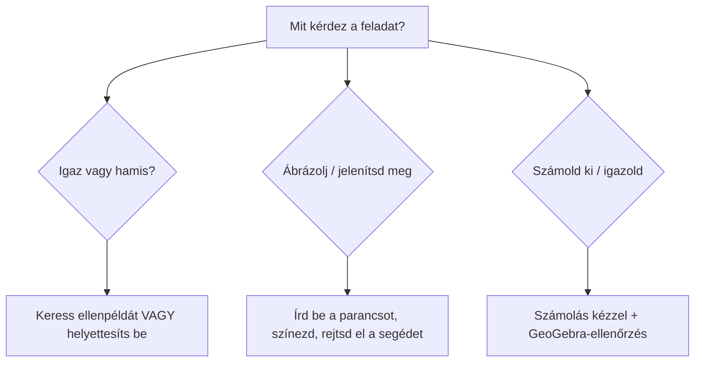

# 📐 Számítógépes matematika és vizualizáció – ZH felkészülés

> [!abstract] Hogyan használd?
> 1. Olvasd el a **0. fejezetet** (GeoGebra alapszabályok, 10 perc). A legtöbb pont itt vész el: szintaktikai hibán.
> 2. Menj végig a **14 gyakorlófeladaton**. Mindegyiknél van **matematikai levezetés**, **GeoGebra-parancs**, lenyíló `Megoldás` és `⚡ Leggyorsabb módszer`.
> 3. A **15. fejezet a nehezebb változatok**, mert az oktató szerint a ZH nehezebb lehet, mint a gyakorló feladatok. Ezeket is oldd meg.
> 4. Közben **nyisd meg a GeoGebrát, és írd be a parancsokat** (Classic 6 ajánlott). Aki csak olvassa, nem tanulja meg.

> [!warning] Fontos
> - A feladatok **két dolgot kérnek**: (1) matematikai gondolkodás (igazolás, számolás), (2) GeoGebra-kezelés (ábrázolás, parancsok).
> - Ahol a feladat azt írja, hogy **„nem használható a Pont / Érintő parancs"**, ott pontosan ezt nem szabad használni, különben nem kapsz pontot.
> - Ahol az áll, hogy „**igazolja matematikai úton**", ott **számolás is kell**, nem elég a GeoGebra-ábra.

> [!note] A jegyzet jelölései
> - A parancsokat **angolul** adom meg (a GeoGebra magyar felületen is elfogadja az angol parancsneveket).
> - `így néz ki` = amit **be kell gépelned** a Bevitel (Input) sorba.
> - 🔥 = nehezebb változat, ami a ZH-n előfordulhat.

---

## 0. GeoGebra alapok – a 10 szabály, ami mindent megment

> [!tip] 1. Pont = NAGYBETŰ, vektor = kisbetű
> `A = (2, 4)` → **pont**. `v = (2, 4)` → **vektor**. Ha véletlenül kisbetűvel adsz meg egy pontot, vektor lesz belőle, és később furcsa hibák jönnek.

> [!tip] 2. Szorzás: szóköz vagy `*`
> `5 x y^2` vagy `5*x*y^2`. Az `5xy^2` gyakran hibás (a GeoGebra „xy" nevű változónak nézheti). A `3x^6` jó, mert szám × betű.

> [!tip] 3. Tizedespont, nem tizedesvessző
> `2.9`, nem `2,9`. A vessző a koordinátákat és az argumentumokat választja el: `(1.23, 4)`.

> [!tip] 4. Hatvány `^`, π = `pi`
> `x^3`, `12 pi`. A `π` betűt is lehet írni, a GeoGebra felismeri.

> [!tip] 5. Függvény definiálása
> `f(x) = 2x^4 + 3x - 3` → megjelenik a grafikonja. Az érték kiszámítása: `f(2)`.

> [!tip] 6. Indexes név: aláhúzással
> `P_0`, `P_1`, `P_2` a P₀, P₁, P₂ pontok nevei. Ugyanígy `t_0` a t₀ csúszka neve.

> [!tip] 7. Egy objektum eltüntetése (segédobjektum)
> Kattints az Algebra nézetben az objektum előtti **körre** (vagy: `SetVisibleInView(f, 1, false)`). Ha a feladat azt írja, hogy „más segédobjektumot ne jelenítsen meg", **minden segédobjektumot rejts el**.

> [!tip] 8. Szín és vonalstílus parancsból
> - `SetColor(c, "Red")`, `SetColor(g, "Green")`, `SetColor(c, "Blue")`
> - `SetLineStyle(v, 1)` → szaggatott (0 = folytonos, 1 = hosszú szaggatott, 2 = rövid szaggatott, 3 = pontozott, 4 = pont-vonal)
> - A stílussáv (az objektum tulajdonságai) is jó.

> [!tip] 9. Koordináták kinyerése
> `x(P)` az x-koordináta, `y(P)` az y-koordináta. Ezzel pontot is lehet építeni a Point parancs nélkül: `Q = (x(P) + 1, y(P))`.

> [!tip] 10. Pont rajzolása a Point parancs nélkül
> Egyszerűen **koordinátapárt gépelsz**: `P = (1.23, f(1.23))`. Ez nem a `Point` parancs, de pontot hoz létre.



### 0.1 Parancstár (ami a ZH-ra kell)

| Mit akarsz? | Parancs | Példa |
| --- | --- | --- |
| függvény | `f(x) = ...` | `f(x) = x^3 - x` |
| függvényérték | `f(a)` | `f(2)` |
| zérushelyek (polinom) | `Root(f)` | `Root(f)` |
| szélsőértékek (polinom) | `Extremum(f)` | `Extremum(f)` |
| inflexiós pontok (polinom) | `InflectionPoint(f)` | `InflectionPoint(f)` |
| metszéspont | `Intersect(a, b)` | `Intersect(f, yAxis)` |
| derivált | `Derivative(f)` vagy `f'` | `f'(1.23)` |
| csak adott intervallumon | `Function(f, a, b)` | `Function(f, 0.2, 1.5)` |
| egyenes két ponton át | `Line(A, B)` | `Line(A, B)` |
| meredekség | `Slope(egyenes)` | `Slope(Line(A, B))` |
| vektor két pontból | `Vector(A, B)` | `Vector(P, P + v)` |
| paraméteres görbe | `Curve(x(t), y(t), t, a, b)` | `Curve(cos(t), sin(t), t, 0, 2pi)` |
| görbepont adott t-nél | `c(t0)` | `c(9 pi)` |
| görbe deriváltja | `c'(t0)` | `c'(9 pi)` |
| csúszka | `Slider(min, max, lépés)` | `t_0 = Slider(0, pi, 0.01)` |
| színezés | `SetColor(obj, "Red")` | |
| vonalstílus | `SetLineStyle(obj, 1)` | |
| interpolációs polinom | `Polynomial({pontok})` | `Polynomial({(0,1), (1,3), (2,2)})` |
| implicit görbe illesztése | `FitImplicit(lista, fok)` | `FitImplicit(L, 3)` |
| ívhossz | `Length(c, t1, t2)` | `Length(c, 0, 2pi)` |
| távolság | `Distance(P, egyenes)` | |
| vektoriális szorzat | `Cross(u, v)` | |
| skaláris szorzat | `u * v` | |

> [!warning] Gyakori szintaktikai hibák
> - `Curve(...)` után **a paraméter neve, majd a határok** kell: `Curve(cos(t), sin(t), t, 0, 2pi)`.
> - Az **implicit görbe** egyenlet: `x^3 + y^3 - 5x y^2 - x + 1 = 0` (az egyenlőségjel is kell).
> - A `Root(f)` **polinomokra** ad minden gyököt. Nem polinomnál numerikus (`Root(f, a)`) kell.

---

# 1️⃣ Feladat – Vektorok: melyik állítás igaz?

> [!question] Feladat
> Mely állítás(ok) igaz(ak)?
> - ☐ A. Ha két vektor **vektoriális szorzata nullvektor**, akkor a két vektor **merőleges** egymásra.
> - ☐ B. Ha két vektor **skaláris szorzata nulla**, akkor a két vektor **merőleges** egymásra.
> - ☐ C. Két **egységhosszú** vektor skaláris szorzata nulla, ha a két vektor **ellentétes irányú**.

## Levezetés

> [!info] Két szorzat, két jelentés
> | Szorzat | Eredménye | Mit mér? |
> | --- | --- | --- |
> | skaláris: $u\cdot v=\lvert u\rvert\lvert v\rvert\cos\alpha$ | **szám** | a hajlásszög koszinuszát |
> | vektoriális: $\lvert u\times v\rvert=\lvert u\rvert\lvert v\rvert\sin\alpha$ | **vektor** | a két vektor által kifeszített paralelogramma területét |

**A) hamis.** Ha $u\times v=\mathbf 0$, akkor $\sin\alpha=0$, azaz $\alpha=0°$ vagy $180°$. Ez azt jelenti, hogy a két vektor **párhuzamos**, nem merőleges. (Pl. $u=(1,0,0)$, $v=(2,0,0)$: $u\times v=\mathbf 0$, de nyilván nem merőlegesek.)

**B) igaz.** Ha $u\cdot v=0$, akkor $\cos\alpha=0$, azaz $\alpha=90°$ (merőlegesek). (Matematikai megjegyzés: ha az egyik vektor a nullvektor, a szorzat szintén 0, és a nullvektort a konvenció minden vektorra merőlegesnek tekinti. Ezért a B állítás kivétel nélkül igaz.)

**C) hamis.** Egységvektorok ($\lvert u\rvert=\lvert v\rvert=1$) ellentétes iránya: $\alpha=180°$, így $u\cdot v=1\cdot1\cdot\cos180°=\mathbf{-1}$, nem $0$. A skaláris szorzat akkor $0$, ha **merőlegesek** ($\alpha=90°$).

> [!success]- ✅ Megoldás
> Csak a **B** igaz.

> [!example] ⚡ Leggyorsabb módszer – a „párhuzamos/merőleges" szótár
> | Feltétel | Jelentése |
> | --- | --- |
> | $u\cdot v=0$ | **merőleges** (cos = 0) |
> | $u\times v=\mathbf 0$ | **párhuzamos** (sin = 0) |
> | $u\cdot v=\lvert u\rvert\lvert v\rvert$ | azonos irányú |
> | $u\cdot v=-\lvert u\rvert\lvert v\rvert$ | ellentétes irányú |
>
> Ha a feladat „skaláris" és „merőleges" szavakat látsz együtt → igaz. Ha „vektoriális" és „merőleges" → majdnem biztosan hamis (az „párhuzamos" lenne a jó).

> [!example] GeoGebra-ellenőrzés
> ```text
> u = (1, 0, 0)
> v = (2, 0, 0)
> Cross(u, v)      → (0, 0, 0): a nullvektor, mégis párhuzamosak
> u * v            → 2
> ```
> (Vagy 2D-ben: `u = (3, 4)`, `v = (-4, 3)`, `u * v` → `0`, tehát merőlegesek.)

> [!warning] Gyakori hiba
> A vektoriális szorzat **nulla** → **párhuzamos**, nem merőleges. A **skaláris** nulla → merőleges.

---

# 2️⃣ Feladat – Az y-tengely metszéspontja

> [!question] Feladat
> Igaz vagy hamis? Az $f(x)=2x^4+3x-3$ függvény grafikonja az y-tengelyt a $(0,\,3)$ pontban metszi.

## Levezetés

Az y-tengely az $x=0$ egyenes. A grafikon y-tengelymetszete tehát $f(0)$:

$$f(0)=2\cdot0^4+3\cdot0-3=\mathbf{-3}$$

A metszéspont $(0,\,-3)$, **nem** $(0,\,3)$.

> [!success]- ✅ Megoldás
> **Hamis.** A metszéspont $(0,-3)$, mert $f(0)=-3\ne3$.

> [!example] ⚡ Leggyorsabb módszer
> **Y-tengelymetszet = $f(0)$** = a szabadtag (a polinomban a konstans). Itt: $-3$. Egy lépés, nincs szükség semmire.

> [!example] GeoGebra
> ```text
> f(x) = 2x^4 + 3x - 3
> f(0)                       → -3
> Intersect(f, yAxis)        → a (0, -3) pont megjelenik
> ```

> [!warning] Gyakori hiba
> A szabadtag előjelét elnézni. A $-3$ **negatív**, a feladat $+3$-at állít.

> [!tip] 🔥 Ha nehezebb jön
> „Hol metszi a grafikon az x-tengelyt?" → ott $f(x)=0$ (zérushelyek, lásd a 4. feladatot). „Hol metszi az $y=2$ egyenest?" → oldd meg: $f(x)=2$, GeoGebrában `Intersect(f, y = 2)`.

---

# 3️⃣ Feladat – Áthalad-e a grafikon egy ponton?

> [!question] Feladat
> Igaz vagy hamis? Az $f(x)=5x-6$ függvény grafikonja áthalad az $A=(2,\,4)$ ponton.

## Levezetés

Egy $(a,\,b)$ pont **akkor van rajta** a grafikonon, ha $f(a)=b$. Itt $a=2$, $b=4$:

$$f(2)=5\cdot2-6=10-6=\mathbf4$$

Az $f(2)=4$ pontosan az $A$ pont y-koordinátája → a pont rajta van.

> [!success]- ✅ Megoldás
> **Igaz.** $f(2)=4$.

> [!example] ⚡ Leggyorsabb módszer – az „áthalad" teszt
> **Pont rajta van a grafikonon ⟺ behelyettesítve az x-et, a függvényérték egyenlő az y-nal.**
> $f(\text{x-koordináta})\overset{?}{=}\text{y-koordináta}$.

> [!example] GeoGebra
> ```text
> f(x) = 5x - 6
> A = (2, 4)
> f(2) == 4        → true
> ```
> (Az ábrán az $A$ pont a vonalon ül.)

> [!warning] Gyakori hiba
> Összekeverni az x és y koordinátát: **f(x_pont)** kell, nem $f(y_\text{pont})$. $f(4)=14\ne2$ semmit nem bizonyít.

---

# 4️⃣ Feladat – A nagy függvényes feladat (a)–(g)

> [!question] Feladat
> $f:\mathbb R\to\mathbb R,\quad f(x)=3x^6-2.9x^5-4.9x^4+2.7x^3+0.9x^2+1.1x+0.5$
> - (a) Ábrázolja az $f$ függvényt!
> - (b) Jelenítse meg az $f$ **zérushelyeihez** tartozó pontokat!
> - (c) Igazolja **matematikai úton**, hogy $x=0$ **nem** zérushelye!
> - (d) Jelenítse meg az **szélsőértékhelyeihez** tartozó pontokat!
> - (e) Jelenítse meg az $x=1.23$ helyhez tartozó pontot! (**Nem** használható a `Point` parancs.)
> - (f) Ábrázolja az érintő egyenest az $x=1.23$ helyhez tartozó pontban! (**Nem** használható a `Tangent` parancs.)
> - (g) Ábrázolja zöld színnel: $g:[0.2,\,1.5]\to\mathbb R,\ g(x)=3x^6-\dots+0.5$ (ugyanaz a képlet, de csak az intervallumon).

> [!info] Fogalmak (hogy tudd, mit kérnek)
> - **Zérushely:** az az $x$, ahol $f(x)=0$. A grafikon itt metszi az x-tengelyt. A „zérushelyhez tartozó pont" a $(x_0,\,0)$.
> - **Szélsőérték(hely):** lokális maximum vagy minimum. Itt a deriváltnak $f'(x)=0$. A „szélsőértékhelyhez tartozó pont" az $(x_0,\,f(x_0))$.
> - **Érintő:** az a **egyenes**, ami az adott pontban „simul" a grafikonhoz, meredeksége $f'(x_0)$.

## (a) Ábrázolás

```text
f(x) = 3x^6 - 2.9x^5 - 4.9x^4 + 2.7x^3 + 0.9x^2 + 1.1x + 0.5
```

> [!tip] Ha „nem látszik a lényeg"
> Állítsd be a nézetet: **jobb klikk az ábrán → Graphics → xAxis : yAxis = 1 : 1 kikapcsolva**, vagy görgess/zoomolj. Vagy: `ZoomIn(-2, -3, 2.5, 5)` (xmin, ymin, xmax, ymax).

## (b) Zérushelyek

```text
Root(f)
```

A polinomra a `Root(f)` **az összes valós gyököt** megadja pontként az x-tengelyen. Alternatíva:

```text
Intersect(f, xAxis)
```

## (c) Matematikai igazolás: $x=0$ nem zérushely

Egy $x_0$ akkor zérushely, ha $f(x_0)=0$. Számoljuk ki:

$$f(0)=3\cdot0-2.9\cdot0-4.9\cdot0+2.7\cdot0+0.9\cdot0+1.1\cdot0+0.5=\mathbf{0.5}\ne0$$

Tehát $x=0$ **nem** zérushely. (A GeoGebrában `f(0)` → `0.5` mutatja.)

> [!example] ⚡ Leggyorsabb módszer
> **$f(0)$ = a szabadtag** polinomnál. Itt $0.5$. Nem 0 → nem zérushely. Egy sor.

## (d) Szélsőértékek

```text
Extremum(f)
```

A polinomra az `Extremum(f)` **az összes lokális szélsőértéket** pontként adja meg $(x_0,\,f(x_0))$ alakban.

> [!note] Kézi megoldás (ha a parancs nem működik)
> A szélsőértékhelyek a $f'(x)=0$ gyökei, és a pontok $(x_0,\,f(x_0))$:
> ```text
> d(x) = f'(x)
> Root(d)                     → a derivált zérushelyei, pl. A, B, C pontok az x-tengelyen
> E_1 = (x(A), f(x(A)))       → az első szélsőértékpont
> E_2 = (x(B), f(x(B)))       → a második, és így tovább minden gyökre
> ```
> (Ezt a módot csak végszükségben használd, az `Extremum(f)` sokkal egyszerűbb. A `Root(d)` pontjainak tényleges nevét az Algebra nézetben nézd meg.)

## (e) Az $x=1.23$ helyhez tartozó pont – `Point` nélkül

A grafikon $x=1.23$-hoz tartozó pontja: $(1.23,\,f(1.23))$. Egyszerűen koordinátapárt írsz:

```text
P = (1.23, f(1.23))
```

Ez **nem** a `Point` parancs, de ugyanazt hozza létre.

## (f) Érintő egyenes – `Tangent` nélkül

**Elmélet:** az $x_0$-beli érintő meredeksége $f'(x_0)$, és átmegy a $(x_0,\,f(x_0))$ ponton:

$$y=f'(x_0)\,(x-x_0)+f(x_0)$$

Itt $x_0=1.23$:

```text
t: y = f'(1.23) (x - 1.23) + f(1.23)
```

Az `f'(1.23)` a deriváltfüggvény értéke a $1.23$ helyen. A GeoGebra az egyenest kirajzolja.

> [!example] Egyenértékű, szebb alak
> ```text
> m = f'(1.23)
> t: y - y(P) = m (x - x(P))
> ```
> (A `P` az (e) feladat pontja. Mindkét alak jó.)

> [!warning] Tilos
> A `Tangent(P, f)` parancs **tilos** ebben a feladatban, de a fenti „képlet" megoldás szabályos.

## (g) Függvény korlátozása és színezése

```text
g = Function(f, 0.2, 1.5)
SetColor(g, "Green")
```

Alternatíva a `If` paranccsal:

```text
g(x) = If(0.2 <= x <= 1.5, 3x^6 - 2.9x^5 - 4.9x^4 + 2.7x^3 + 0.9x^2 + 1.1x + 0.5)
SetColor(g, "Green")
```

> [!success]- ✅ Összefoglaló megoldás (másold ki a parancsokat)
> ```text
> f(x) = 3x^6 - 2.9x^5 - 4.9x^4 + 2.7x^3 + 0.9x^2 + 1.1x + 0.5
> Root(f)
> f(0)
> Extremum(f)
> P = (1.23, f(1.23))
> t: y = f'(1.23) (x - 1.23) + f(1.23)
> g = Function(f, 0.2, 1.5)
> SetColor(g, "Green")
> ```
> **(c):** $f(0)=0.5\ne0$, tehát $x=0$ nem zérushely.

> [!warning] Gyakori hibák
> - **Zérushely-pontok:** a „pontok" a **(x₀, 0)**, nem csak az x érték. A `Root(f)` pontot ad, jó.
> - **Szélsőérték-pontok:** a (x₀, **f(x₀)**) pont, nem (x₀, 0). Az `Extremum(f)` jól adja.
> - **Érintő:** a **meredekség** $f'(1.23)$, nem $f(1.23)$. Elterjedt hiba.
> - A **(g)** rész: a függvény csak $[0.2,\,1.5]$-n látszik, kívül nincs. Ha az egész grafikon zöld lesz, rosszul csináltad.

> [!tip] 🔥 Ha nehezebb jön ugyanerre a függvényre
> - **„Hány zérushelye van?"** → `Root(f)` után számold a pontokat.
> - **„Hol van inflexiós pontja?"** → `InflectionPoint(f)` (a $f''(x)=0$ helyek).
> - **„Mely pontban párhuzamos az érintő az x-tengellyel?"** → ahol $f'(x)=0$, vagyis a szélsőértékeknél.
> - **„Rajzolja az érintő *normálisát* (merőleges egyenes)."** → meredeksége $-1/f'(x_0)$: `n: y = -1/f'(1.23) (x - 1.23) + f(1.23)`.
> - **„Mutassa meg, hogy az $x=1.23$ hely **nem** szélsőértékhely."** → $f'(1.23)\ne0$ (számold ki: `f'(1.23)`).

---

# 5️⃣ Feladat – Két pont meredeksége

> [!question] Feladat
> Legyen adott az $A=(2,\,4)$ és $B=(3,\,-2)$ pont. Mi a meredeksége annak az egyenesnek, amely átmegy az $A$ és $B$ ponton?

## Levezetés

A meredekség a „függőleges változás / vízszintes változás":

$$m=\frac{y_B-y_A}{x_B-x_A}=\frac{-2-4}{3-2}=\frac{-6}{1}=\mathbf{-6}$$

> [!success]- ✅ Megoldás
> $m=-6$

> [!example] ⚡ Leggyorsabb módszer
> **Képlet:** $m=\dfrac{\Delta y}{\Delta x}$. Mindig **ugyanabban a sorrendben** vond ki mindkettőt (B − A mind a két koordinátára).
>
> **GeoGebra:**
> ```text
> A = (2, 4)
> B = (3, -2)
> Slope(Line(A, B))      → -6
> ```

> [!tip] A teljes egyenes (ha kérdezik)
> $y-y_A=m(x-x_A)$: $y-4=-6(x-2)\Rightarrow y=-6x+16$. GeoGebra: `Line(A, B)`.

> [!warning] Gyakori hiba
> **Előjel-csere:** ha az egyik koordinátánál A−B-t, a másiknál B−A-t számolsz, az előjel elromlik. Következetesen **mindkettőnél B−A** (vagy mindkettőnél A−B).

> [!tip] 🔥 Ha nehezebb jön
> - **Merőleges egyenes meredeksége:** $-1/m=\tfrac16$.
> - **A pont távolsága az egyenestől:** $P=(1,6)$-tól az $y=-6x+16$ egyenesig, vagyis a $6x+y-16=0$ egyenesig: $\dfrac{\lvert6\cdot1+6-16\rvert}{\sqrt{36+1}}=\dfrac{4}{\sqrt{37}}\approx0.658$. GeoGebra: `Distance(P, Line(A, B))`.

---

# 6️⃣ Feladat – Vektor reprezentánsának végpontja

> [!question] Feladat
> Legyen adva a $P=(1,\,6)$ pont, valamint a $v=\begin{pmatrix}-2\\4\end{pmatrix}$ vektor. Adja meg a $v$ vektor $P$-ből kiinduló reprezentánsának **végpontjának** koordinátáit!

## Levezetés

Egy vektor **reprezentánsa** azt jelenti, hogy a vektort egy kiindulópontból felrajzoljuk. Ha a kezdőpont $P$, akkor a végpont $Q=P+v$:

$$Q=P+v=(1,\,6)+(-2,\,4)=(1-2,\;6+4)=\mathbf{(-1,\,10)}$$

> [!info] Konyhai hasonlat
> Olyan, mint egy útvonal-utasítás: „menj 2-t balra, 4-et felfelé". Bárhonnan indulsz, az utasítás ugyanaz. Ha a $P$-ből indulsz, ott kötsz ki, ahol $P$ + az elmozdulás.

> [!success]- ✅ Megoldás
> $Q=(-1,\,10)$

> [!example] ⚡ GeoGebra
> ```text
> P = (1, 6)
> v = (-2, 4)
> Q = P + v                 → (-1, 10)
> Vector(P, Q)              → felrajzolja a reprezentánst
> ```
> (A `v` kisbetűs → vektor, a `P`, `Q` nagybetűs → pont.)

> [!warning] Gyakori hiba
> **Kivonás összeadás helyett:** a végpont a kezdőpont **plusz** a vektor. Ha a végpontot ismerjük és a kezdőpontot keressük, akkor **kivonunk** ($P=Q-v$).

> [!tip] 🔥 Ha nehezebb jön
> - **Két pont által meghatározott vektor:** $\overrightarrow{AB}=B-A$ (végpont − kezdőpont).
> - **Vektor hossza:** $\lvert v\rvert=\sqrt{(-2)^2+4^2}=\sqrt{20}=2\sqrt5\approx4.47$.
> - **Egységvektor:** $\dfrac{v}{\lvert v\rvert}$. GeoGebra: `UnitVector(v)`.

---

# 7️⃣ Feladat – Implicit alakzat

> [!question] Feladat
> Az alakzat egyenlete: $x^3+y^3-5xy^2-x+1=0$
> - (a) Ábrázolja az alakzatot **kék** színnel!
> - (b) Lehetséges lenne-e ezt az alakzatot egy **valós értékű függvény grafikonjaként** előállítani?
> - (c) $P=(1,\,4)$. Melyik igaz? Igazolja **matematikai úton**, a GeoGebra használatával:
>   - A. A $P$ pont **rajta van** az alakzaton.
>   - B. A $P$ pont **nincs rajta** az alakzaton.

> [!info] Implicit alakzat
> Az **implicit** görbe olyan egyenlet, ahol $x$ és $y$ „együtt" szerepel, és nem lehet (feltétlenül) $y=f(x)$ alakra rendezni. Egy **pont rajta van** az alakzaton, ha a koordinátái **kielégítik az egyenletet**.

## (a) Ábrázolás kékkel

```text
c: x^3 + y^3 - 5 x y^2 - x + 1 = 0
SetColor(c, "Blue")
```

> [!warning] Szóközök!
> `5 x y^2`, nem `5xy^2`. Az egyenlőségjel is kötelező (az egyenlet bal oldala = 0).

## (b) Lehet-e függvény grafikonja?

Egy alakzat akkor lehet **függvény** grafikonja, ha **minden $x$-hez legfeljebb egy $y$** tartozik (**függőleges egyenes teszt**: egy függőleges egyenes legfeljebb egyszer metszi).

Rendezzük az egyenletet $y$ szerint:
$$y^3-5x\,y^2+(x^3-x+1)=0$$

Ez $y$-ban **harmadfokú**, ezért akár **3 különböző valós $y$** is tartozhat egy $x$-hez. Konkrét példa: $x=3$:

$$y^3-15y^2+25=0$$

Jelölje $h(y)=y^3-15y^2+25$. Ennek előjelei:

| $y$ | $-2$ | $-1$ | $0$ | $1$ | $2$ | $14$ | $15$ |
| --- | --- | --- | --- | --- | --- | --- | --- |
| $h(y)$ | $-43$ | $9$ | $25$ | $11$ | $-27$ | $-171$ | $25$ |

Az előjel háromszor vált ($-2$ és $-1$ között, $1$ és $2$ között, $14$ és $15$ között), tehát **3 valós gyök** van. Az $x=3$ egyeneshez **három** $y$ tartozik → **nem függvény**.

> [!success]- ✅ (b) válasz
> **Nem lehetséges** (függvénygrafikonként nem állítható elő), mert van olyan $x$ (pl. $x=3$), amihez három különböző $y$ tartozik. A függőleges egyenes háromszor metszi.

> [!example] ⚡ Leggyorsabb módszer GeoGebrában
> ```text
> v: x = 3
> Intersect(c, v)       → 3 metszéspont
> ```
> Három pont jelenik meg az $x=3$ egyenesen → bizonyítottuk, hogy **nem függvény**. (Ez az, amit a ZH-n leírhatsz: „az $x=3$ egyenes 3 pontban metszi a görbét".)

## (c) A $P=(1,\,4)$ pont rajta van-e?

Helyettesítsünk be: $x=1$, $y=4$:

$$1^3+4^3-5\cdot1\cdot4^2-1+1=1+64-80-1+1=\mathbf{-15}\ne0$$

Az egyenlet nem teljesül → **a pont nincs rajta**.

> [!success]- ✅ (c) válasz
> **B** igaz: a $P$ pont **nincs** rajta az alakzaton (behelyettesítve $-15\ne0$).

> [!example] GeoGebra-igazolás (két mód)
> **1. mód: kétváltozós függvény.**
> ```text
> h(x, y) = x^3 + y^3 - 5 x y^2 - x + 1
> P = (1, 4)
> h(1, 4)           → -15  (nem 0, tehát nincs rajta)
> ```
> (Ha a GeoGebra a 3D nézetet is megnyitja, az nem baj.)
>
> **2. mód: ábra.** Rajzold ki a `P` pontot, és látod, hogy **nincs az alakzaton**. (Ez csak szemléltetés, a **számítás** a bizonyíték.)

> [!warning] Gyakori hibák
> - **(b)**: „igen, mert kirajzolható" → hibás. A **kirajzolható ≠ függvény**. Kell a függőleges egyenes teszt.
> - **(c)**: a pont akkor van rajta, ha **egyenlőség** teljesül (= 0). Az $-15$ azt mutatja, hogy **nem**.

> [!tip] 🔥 Ha nehezebb jön
> - **„Rajta van-e a $(2,\,1)$ pont?"** → $8+1-10-2+1=-2\ne0$, nincs rajta.
> - **„Adjon meg egy pontot, ami rajta van."** → válassz egy $x$-et, oldd meg $y$-ra: `Intersect(c, x = 3)`.
> - **„Adja meg az alakzat érintőjét egy pontban."** → lásd a 15. fejezet 4. feladatát (gradiens-módszer).

---

# 8️⃣ Feladat – Polinom zérushelyei és a deriváltja

> [!question] Feladat
> Igaz vagy hamis? Az $f$ polinomiális függvény **zérushelyei egybeesnek** az $f'$ deriváltfüggvény zérushelyeivel.

## Levezetés

Az állítás **általánosan** azt mondja, hogy minden polinomra $\{x:f(x)=0\}=\{x:f'(x)=0\}$. Egy **ellenpélda** elég a cáfolathoz.

**Ellenpélda:** $f(x)=x^2-1$.
- Zérushelyei: $x^2-1=0\Rightarrow x=\pm1$.
- Deriváltja: $f'(x)=2x$, zérushelye: $x=0$.

A két halmaz $\{-1,\,1\}$ és $\{0\}$: **nem egyezik**.

> [!success]- ✅ Megoldás
> **Hamis.** Ellenpélda: $f(x)=x^2-1$, zérushelyei $\pm1$, a deriváltjáé $0$.

> [!info] Mi a valódi kapcsolat?
> - $f(x_0)=0$ → a grafikon **metszi az x-tengelyt**.
> - $f'(x_0)=0$ → a grafikon **érintője vízszintes** (itt lehet lokális szélsőérték).
>
> Ez két **különböző** dolog. Néha egybeesik (pl. $f(x)=x^2$: mindkettő $x=0$, mert a parabola csúcsa az x-tengelyen van), de **általában nem**.

> [!example] ⚡ Leggyorsabb módszer
> Az „igaz-e" kérdéseknél, ahol „mindig / minden / egybeesik" szerepel, **keress ellenpéldát**. A legegyszerűbb: $f(x)=x-1$ (zérushely: $1$, de $f'=1$-nek **nincs** zérushelye).
>
> **GeoGebra:**
> ```text
> f(x) = x^2 - 1
> Root(f)            → (-1, 0) és (1, 0)
> Root(f')           → (0, 0)
> ```

> [!warning] Gyakori hiba
> Egy pozitív példából („$x^2$-nél egybeesik") **nem** lehet általános igazat bizonyítani. Egyetlen **ellenpélda** viszont elég a cáfolathoz.

---

# 9️⃣ Feladat – Reláció és függvény tulajdonságai

> [!question] Feladat
> $F=\{(2,4),\,(3,8),\,(4,5),\,(6,5)\}$, $F\subseteq A\times B$, ahol $A=\{1,2,3,4,5,6\}$ és $B=\{4,5,6,7,8\}$. Mely állítás(ok) igaz(ak)?
> - ☐ A. $A$-ból képez
> - ☐ B. $A$-t képezi
> - ☐ C. $B$-be képez
> - ☐ D. $B$-re képez
> - ☐ E. $F$ függvény
> - ☐ F. $F$ invertálható függvény
> - ☐ G. $F^{-1}$ függvény

## A szótár (ez a feladat lényege)

| Kifejezés | Jelentése | Kérdés, amit felteszel |
| --- | --- | --- |
| **függvény** | minden első koordinátához **legfeljebb egy** második koordináta tartozik | van-e két pár azonos első koordinátával? |
| **$A$-ból képez** | függvény, és értelmezési tartománya $\subseteq A$ | az első koordináták mind $A$-ból valók? |
| **$A$-t képezi** | függvény, és az értelmezési tartomány **pontosan $A$** | $A$ **minden** eleme szerepel első koordinátaként? |
| **$B$-be képez** | az értékkészlet $\subseteq B$ | a második koordináták mind $B$-ből valók? |
| **$B$-re képez** | az értékkészlet **pontosan $B$** | $B$ **minden** eleme szerepel második koordinátaként? |
| **invertálható függvény** | függvény **és** kölcsönösen egyértelmű (injektív: különböző x → különböző y) | van-e két pár azonos második koordinátával? |
| **$F^{-1}$ függvény** | a megfordított reláció is függvény (ugyanaz, mint az injektivitás) | |

> [!info] Konyhai hasonlat
> $F$ egy **étterem rendelési listája**: az első koordináta az asztal, a második a rendelt étel.
> - **Függvény:** egy asztal csak egy ételt rendelt.
> - **Invertálható:** két asztal sem rendelte ugyanazt az ételt.
> - **$A$-t képezi:** **minden** asztal rendelt.
> - **$B$-re képez:** a **menü minden ételét** megrendelték.

## Levezetés

Gyűjtsük ki: első koordináták: $\{2,3,4,6\}$ (értelmezési tartomány, $\mathrm{Dom}(F)$). Második koordináták: $\{4,8,5\}$ (értékkészlet, $\mathrm{Ran}(F)$).

| Állítás | Ellenőrzés | Igaz? |
| --- | --- | --- |
| E. $F$ függvény | az első koordináták (2, 3, 4, 6) mind különbözők | ✅ |
| A. $A$-ból képez | $\{2,3,4,6\}\subseteq A$ | ✅ |
| B. $A$-t képezi | az 1 és az 5 hiányzik az első koordinátákból | ❌ |
| C. $B$-be képez | $\{4,5,8\}\subseteq B$ | ✅ |
| D. $B$-re képez | a 6 és a 7 hiányzik a második koordinátákból | ❌ |
| F. invertálható | $F(4)=5$ és $F(6)=5$ (azonos második koordináta) | ❌ |
| G. $F^{-1}$ függvény | $F^{-1}=\{(4,2),(8,3),(5,4),(5,6)\}$, az 5-höz két érték tartozik | ❌ |

> [!success]- ✅ Megoldás
> **A, C, E**

> [!example] ⚡ Leggyorsabb módszer – három kérdés
> 1. **Ismétlődik az első koordináta?** Nem → függvény.
> 2. **Ismétlődik a második koordináta?** Igen (5 kétszer) → **nem** invertálható, és az $F^{-1}$ nem függvény.
> 3. **Mindent lefed?** Hasonlítsd az első koordináták halmazát az $A$-val (→ „képezi"), a másodikakat a $B$-vel (→ „-re").
>
> Az „**-ból / -be**" = „részhalmaz" (megengedő). A „**-t / -re**" = „pontosan egyenlő" (szigorú).

> [!warning] A terminológia ellenőrzése
> A „képez" fogalmak definíciója kurzusonként kissé eltérhet. A fenti az **általános magyar konvenció**. Ha az előadáson mást definiáltak (pl. az „$A$-ból képez" nálatok „$\mathrm{Dom}=A$"), akkor a **B és A válasz felcserélődik**. Mielőtt bejelölöd, nézd meg az előadásdiát.

> [!tip] 🔥 Ha nehezebb jön
> Pl. $G=\{(1,5),(2,6),(3,7)\}\subseteq\{1,2,3,4\}\times\{5,6,7,8\}$: függvény ✅, $A$-ból képez ✅, $A$-t képezi ❌ (a 4 hiányzik), $B$-be ✅, $B$-re ❌ (8 hiányzik), invertálható ✅ (minden második koordináta különböző), $G^{-1}$ függvény ✅.

---

# 🔟 Feladat – Paraméteres görbe, pont és érintővektor

> [!question] Feladat
> $x(t)=(a-b)\cos t+b\cos\!\left(\left(\tfrac ab-1\right)t\right)$
> $y(t)=(a-b)\sin t-b\sin\!\left(\left(\tfrac ab-1\right)t\right)$
> $t\in[0,\,12\pi]$, $a=8.5$, $b=3.9$
> - (a) Ábrázolja **piros** színnel! A koordináta-függvények **külön-külön ne** kerüljenek ábrázolásra.
> - (b) Jelenítse meg a $t=9\pi$ értékhez tartozó görbepontot, jelölje $P$-vel! (**Nem** használható a `Point` parancs.)
> - (c) Ábrázolja a $P$ pontból kiindulva a $t=9\pi$-hez tartozó **érintővektort**, **szaggatott** vonalstílussal!

> [!info] Paraméteres görbe
> A pont koordinátáit egy **paraméter** ($t$) határozza meg: minden $t$-hez egy $(x(t),\,y(t))$ pont. Olyan, mint egy mozgó pont útja az idő ($t$) függvényében.
> **Érintővektor** = a **deriváltvektor**: $(x'(t),\,y'(t))$, a mozgás pillanatnyi iránya és sebessége.

## (a) Ábrázolás

Fontos: **a `Curve` parancsba egyben** írd be a két koordinátát, **ne** definiálj külön `x(t)`, `y(t)` függvényt (azok külön grafikonként megjelennének).

```text
a = 8.5
b = 3.9
c = Curve((a - b) cos(t) + b cos((a / b - 1) t), (a - b) sin(t) - b sin((a / b - 1) t), t, 0, 12 pi)
SetColor(c, "Red")
```

> [!warning] Zárójelek
> A kitevő argumentuma: `cos((a / b - 1) t)`. A **belső zárójel** az $(a/b-1)$ tag, a külső a `cos(...)` argumentuma. Ha elhagyod, a GeoGebra mást számol.

## (b) A $t=9\pi$-hez tartozó pont – `Point` nélkül

A paraméteres görbe **kiértékelhető** a paraméterrel, ez pontot ad:

```text
P = c(9 pi)
```

Ez nem a `Point` parancs. A pont: $P\approx(-5.98,\;-3.65)$.

> [!note] Kézzel (ellenőrzésképpen)
> $\cos9\pi=-1$, $\sin9\pi=0$, és $\left(\tfrac{8.5}{3.9}-1\right)\cdot9\pi=\tfrac{46}{39}\cdot9\pi\equiv\tfrac{8\pi}{13}\pmod{2\pi}$, így $\cos\approx-0.355$, $\sin\approx0.935$.
> $x=4.6\cdot(-1)+3.9\cdot(-0.355)\approx-5.98$, $y=4.6\cdot0-3.9\cdot0.935\approx-3.65$.

## (c) Az érintővektor

**Elmélet:** a derivált:
$$x'(t)=-(a-b)\big[\sin t+\sin(kt)\big],\qquad y'(t)=(a-b)\big[\cos t-\cos(kt)\big],\qquad k=\tfrac ab-1$$
(Itt $b\cdot k=a-b$, ezért egyszerűsödnek a tagok.) $t=9\pi$-nél: $v\approx(-4.30,\;-2.97)$.

**GeoGebra:** a `Derivative(c)` a görbe deriváltját adja:

```text
d = Derivative(c)
u = d(9 pi)
v = Vector(P, P + u)
SetLineStyle(v, 1)
```

A `v` a $P$-ből induló érintővektor, szaggatott vonallal.

> [!note] Ha a `d(9 pi)` hibát ad
> Számold ki kézzel és írd be: `u = (-4.30, -2.97)` (a fenti derivált-képletekkel). A lényeg: a vektor kezdőpontja $P$, iránya $(x'(9\pi),\,y'(9\pi))$.

> [!success]- ✅ Összefoglaló megoldás
> ```text
> a = 8.5
> b = 3.9
> c = Curve((a - b) cos(t) + b cos((a / b - 1) t), (a - b) sin(t) - b sin((a / b - 1) t), t, 0, 12 pi)
> SetColor(c, "Red")
> P = c(9 pi)
> d = Derivative(c)
> u = d(9 pi)
> v = Vector(P, P + u)
> SetLineStyle(v, 1)
> ```

> [!example] ⚡ Leggyorsabb módszer
> **Három sor mindig ugyanaz:** `Curve(...)` → `P = c(t0)` → `Vector(P, P + Derivative(c)(t0))`. Ezt a sémát más paraméteres görbére is használod (ellipszis, ciklois stb.).

> [!warning] Gyakori hibák
> - **Külön `x(t)`, `y(t)`** definiálása → külön grafikonok jelennek meg, ami a feladat tiltja.
> - **Pont létrehozása a `Point` paranccsal** → nem kapsz pontot. A `c(9 pi)` megfelel.
> - **Az érintővektor a P-ből induljon**, ne az origóból (ezért `P + u` a végpont).
> - A szaggatott stílus: `SetLineStyle(v, 1)`.

---

# 1️⃣1️⃣ Feladat – Egyenes szakasz mint paraméteres görbe

> [!question] Feladat
> Igaz vagy hamis? Egyenes szakasz **nem írható fel** paraméteres görbeként.

## Levezetés

**Hamis.** Az $A$ és $B$ pontokat összekötő szakasz paraméteres alakja:

$$r(t)=A+t\,(B-A),\qquad t\in[0,\,1]$$

Ellenőrzés: $t=0$-nál $r(0)=A$, $t=1$-nél $r(1)=B$, a köztes $t$-k a szakasz belső pontjait adják ($t=0.5$ a felezőpont).

**Példa:** $A=(1,2)$, $B=(4,6)$: $B-A=(3,4)$,
$$x(t)=1+3t,\qquad y(t)=2+4t,\qquad t\in[0,1]$$

> [!success]- ✅ Megoldás
> **Hamis.** Pl. az $A$-t és $B$-t összekötő szakasz: $r(t)=A+t(B-A)$, $t\in[0,1]$.

> [!example] GeoGebra
> ```text
> A = (1, 2)
> B = (4, 6)
> s = Curve(x(A) + t (x(B) - x(A)), y(A) + t (y(B) - y(A)), t, 0, 1)
> ```
> Vagy konkrétan: `Curve(1 + 3t, 2 + 4t, t, 0, 1)`.

> [!example] ⚡ Leggyorsabb módszer
> **Szakasz = „kezdőpont + t × irányvektor", $t$ a $[0,1]$-ben.** Ha egész egyenes kell, $t$ bármilyen valós szám.

> [!warning] Gyakori hiba
> A $t\in[0,1]$ határ hiánya: korlátozás nélkül **egész egyenest** kapsz, nem szakaszt.

---

# 1️⃣2️⃣ Feladat – Egységkör, csúszka, kör a ponton

> [!question] Feladat
> Az origó középpontú egységkör paraméteres görbeként.
> - (a) Ábrázolja a paraméteres görbét!
> - (b) Vegye fel a $t_0=\tfrac\pi4$ paraméterértékhez tartozó görbepontot, jelölje $P$-vel!
> - (c) Hozzon létre **csúszkát**, ami $t_0$ értékét $0$ és $\pi$ között változtatja!
> - (d) Hozza létre azt a kört **paraméteres megadással**, amelynek középpontja $P$, sugara $0.5$!

## Levezetés

Az origó középpontú egységkör: $x(t)=\cos t,\;y(t)=\sin t,\;t\in[0,2\pi]$.

A $t_0=\tfrac\pi4$ ponthoz: $P=\left(\cos\tfrac\pi4,\sin\tfrac\pi4\right)=\left(\tfrac{\sqrt2}2,\tfrac{\sqrt2}2\right)\approx(0.707,\,0.707)$.

A $P$ középpontú, $r=0.5$ sugarú kör: $x(s)=x_P+0.5\cos s,\quad y(s)=y_P+0.5\sin s,\quad s\in[0,2\pi]$.

## GeoGebra – lépésről lépésre

```text
c = Curve(cos(t), sin(t), t, 0, 2 pi)                          (a)
t_0 = Slider(0, pi, 0.01)                                      (c) a csúszka
SetValue(t_0, pi / 4)                                          (b) kezdeti érték π/4
P = c(t_0)                                                     (b) a pont a csúszkától függ
k = Curve(x(P) + 0.5 cos(s), y(P) + 0.5 sin(s), s, 0, 2 pi)    (d) a kis kör
```

> [!tip] Miért így a sorrend?
> A pontot **a csúszkához kötöd** (`P = c(t_0)`), így ha húzod a csúszkát, a $P$ és a kis kör is **mozog**. A (b) pont $\pi/4$-nél áll, mert beállítottad a csúszka értékét.

> [!success]- ✅ Összefoglaló megoldás
> ```text
> c = Curve(cos(t), sin(t), t, 0, 2 pi)
> t_0 = Slider(0, pi, 0.01)
> SetValue(t_0, pi / 4)
> P = c(t_0)
> k = Curve(x(P) + 0.5 cos(s), y(P) + 0.5 sin(s), s, 0, 2 pi)
> ```

> [!example] ⚡ Leggyorsabb módszer – a kör képlete
> **Kör: $(x_0+r\cos t,\;y_0+r\sin t)$, $t\in[0,2\pi]$.** Középpont és sugár kell, semmi más. A középpontot **`x(P)`, `y(P)`** adja.

> [!warning] Gyakori hibák
> - A **kis kör paraméterváltozója legyen más** (`s`), ne a csúszka neve, különben összekeveredik.
> - A `P` **a csúszkától függjön** (`c(t_0)`), ne egy beírt koordináta, különben a (c) rész nem működik.
> - A csúszka **tartománya $[0,\,\pi]$** (feladat szerint), nem $[0,\,2\pi]$.

---

# 1️⃣3️⃣ Feladat – Harmadfokú paraméteres görbe 4 ponton át

> [!question] Feladat
> $P_0=(140,80)$, $P_1=(60,80)$, $P_2=(90,50)$, $P_3=(120,100)$. Hozza létre azt a **harmadfokú paraméteres görbét**, amely a $P_0,P_1,P_2,P_3$ pontokon rendre a $t=0,1,2,3$ paraméterértéknél megy át.
> - (a) Ábrázolja! A kezdőpont $P_0$, a végpont $P_3$. A $P_0..P_3$ pontokon és a görbén **kívül más segédobjektumot ne jelenítsen meg**.
> - (b) Határozza meg a görbe **érintővektorát a $P_3$ pontban**, és ábrázolja ebből a pontból kiindulva!

> [!info] Az ötlet: két külön interpoláció
> Egy paraméteres görbe = két függvény: $x(t)$ és $y(t)$. Mindegyik egy **harmadfokú polinom**, ami 4 adott ponton megy át. Négy pont egy harmadfokú polinomot **pontosan meghatároz** (interpolációs polinom).
>
> | $t$ | 0 | 1 | 2 | 3 |
> | --- | --- | --- | --- | --- |
> | $x(t)$ | 140 | 60 | 90 | 120 |
> | $y(t)$ | 80 | 80 | 50 | 100 |

## (a) Megoldás GeoGebrában (a legkönnyebb)

A `Polynomial({pontok})` az interpolációs polinomot adja:

```text
P_0 = (140, 80)
P_1 = (60, 80)
P_2 = (90, 50)
P_3 = (120, 100)
fx = Polynomial({(0, 140), (1, 60), (2, 90), (3, 120)})
fy = Polynomial({(0, 80), (1, 80), (2, 50), (3, 100)})
c = Curve(fx(t), fy(t), t, 0, 3)
SetVisibleInView(fx, 1, false)
SetVisibleInView(fy, 1, false)
```

A két utolsó sor **elrejti az `fx`, `fy` segédfüggvények** grafikonját (ez a feladat kéri).

## (a) Ugyanez kézzel (hogy értsd, és ellenőrizhesd)

**Newton-féle differenciatáblázat** (a különbségeket egymás után vonjuk le):

| | $t=0$ | $t=1$ | $t=2$ | $t=3$ |
| --- | --- | --- | --- | --- |
| $x$ | 140 | 60 | 90 | 120 |
| $\Delta x$ | $-80$ | $30$ | $30$ | |
| $\Delta^2x$ | $110$ | $0$ | | |
| $\Delta^3x$ | $-110$ | | | |

$$x(t)=140-80\,t+110\cdot\tfrac{t(t-1)}{2}-110\cdot\tfrac{t(t-1)(t-2)}{6}=-\tfrac{55}{3}t^3+110t^2-\tfrac{515}{3}t+140$$

| | $t=0$ | $t=1$ | $t=2$ | $t=3$ |
| --- | --- | --- | --- | --- |
| $y$ | 80 | 80 | 50 | 100 |
| $\Delta y$ | $0$ | $-30$ | $50$ | |
| $\Delta^2y$ | $-30$ | $80$ | | |
| $\Delta^3y$ | $110$ | | | |

$$y(t)=80+0\cdot t-30\cdot\tfrac{t(t-1)}{2}+110\cdot\tfrac{t(t-1)(t-2)}{6}=\tfrac{55}{3}t^3-70t^2+\tfrac{155}{3}t+80$$

**Ellenőrzés:** $x(1)=-\tfrac{55}3+110-\tfrac{515}3+140=60$ ✅, $x(2)=90$ ✅, $x(3)=120$ ✅; $y(1)=80$ ✅, $y(2)=50$ ✅, $y(3)=100$ ✅.

**Egyetlen paranccsal, segédobjektum nélkül:**

```text
c = Curve(-(55/3) t^3 + 110 t^2 - (515/3) t + 140, (55/3) t^3 - 70 t^2 + (155/3) t + 80, t, 0, 3)
```

## (b) Érintővektor $P_3$-ban ($t=3$)

A deriváltak:
$$x'(t)=-55t^2+220t-\tfrac{515}3,\qquad y'(t)=55t^2-140t+\tfrac{155}3$$

$t=3$-nál:
$$x'(3)=-495+660-\tfrac{515}3=165-\tfrac{515}3=-\tfrac{20}3\approx-6.67$$
$$y'(3)=495-420+\tfrac{155}3=75+\tfrac{155}3=\tfrac{380}3\approx126.67$$

Az érintővektor: $v=\left(-\tfrac{20}3,\;\tfrac{380}3\right)\approx(-6.67,\;126.67)$.

**GeoGebra** ($P_3$-ból indítva):

```text
d = Derivative(c)
u = d(3)
v = Vector(P_3, P_3 + u)
```

Vagy a polinomokkal: `u = (fx'(3), fy'(3))`. Ha a deriválás nem működne: `u = (-20/3, 380/3)`.

> [!success]- ✅ Összefoglaló megoldás
> ```text
> P_0 = (140, 80)
> P_1 = (60, 80)
> P_2 = (90, 50)
> P_3 = (120, 100)
> fx = Polynomial({(0, 140), (1, 60), (2, 90), (3, 120)})
> fy = Polynomial({(0, 80), (1, 80), (2, 50), (3, 100)})
> c = Curve(fx(t), fy(t), t, 0, 3)
> SetVisibleInView(fx, 1, false)
> SetVisibleInView(fy, 1, false)
> u = (fx'(3), fy'(3))
> v = Vector(P_3, P_3 + u)
> ```
> Érintővektor: $\left(-\tfrac{20}3,\ \tfrac{380}3\right)$.

> [!example] ⚡ Leggyorsabb módszer
> **Három sor:** (1) `fx = Polynomial({(0, x₀), (1, x₁), (2, x₂), (3, x₃)})`, (2) ugyanez `fy`-ra, (3) `Curve(fx(t), fy(t), t, 0, 3)`. A többi csak elrejtés és a derivált.

> [!warning] Gyakori hibák
> - Az **x és y interpolációt külön kell** elvégezni, és a pontok **$t$-értékei** (0, 1, 2, 3) kerülnek az első koordinátába, nem a pont x-e.
> - Az **`fx`, `fy` láthatósága**: ha nem rejted el, a feladat „más segédobjektum ne legyen" feltételét megsérted.
> - A görbe $t\in[0,\,3]$-on fusson, hogy $P_0$-ban kezdődjön és $P_3$-ban végződjön.

---

# 1️⃣4️⃣ Feladat – 14 pont, két harmadfokú implicit görbe

> [!question] Feladat
> Legyen adott **14 pont**, helyzetük tetszőlegesen választható. Illesszünk egy-egy **harmadfokú implicit görbét** ezek **két tetszőleges részhalmazára**.

> [!info] Mit kell megérteni?
> Egy harmadfokú implicit görbe egyenlete:
> $$a_1x^3+a_2x^2y+a_3xy^2+a_4y^3+a_5x^2+a_6xy+a_7y^2+a_8x+a_9y+a_{10}=0$$
> **10 együttható**, de az egyenlet **skálázható** (az összes együtthatót ugyanazzal a számmal szorozva ugyanaz a görbe), tehát **9 szabad paraméter** van.
> **Minden pont egy lineáris egyenletet jelent** az együtthatókra.

## Miért működik?

- **9 pont** → 9 egyenlet, 10 ismeretlen → mindig van **nem triviális megoldás**. Tehát **bármely 9 pontra** illeszthető harmadfokú görbe.
- **14 pont** → 14 egyenlet, 10 ismeretlen → általában csak a triviális megoldás (az „összes pontra egy görbe" általában **nem** létezik).
- Ezért **két részhalmazra** osztjuk a pontokat, mindegyik legfeljebb 9 pontos.

> [!tip] Általános szabály
> A $d$-ed fokú implicit görbe $\dfrac{d(d+3)}2$ pontra illeszthető egyértelműen: egyenes ($d=1$): **2** pont, kúpszelet ($d=2$): **5** pont, harmadfokú ($d=3$): **9** pont.

## GeoGebra

Vegyél fel 14 pontot (kattintással a rajzlapon, ezek $A..N$ nevet kapnak), majd:

```text
pts = {A, B, C, D, E, F, G, H, I, J, K, L, M, N}
s1 = First(pts, 9)
s2 = Last(pts, 9)
c1 = FitImplicit(s1, 3)
c2 = FitImplicit(s2, 3)
```

Itt az `s1` az **első 9 pont**, az `s2` az **utolsó 9 pont** (a közbülső 4 pont, F, G, H és I, mindkettőben szerepel, a két görbe **együtt lefedi mind a 14 pontot**).

> [!success]- ✅ Megoldás
> Két részhalmaz (pl. az első 9 és az utolsó 9 pont), mindegyikre `FitImplicit(részhalmaz, 3)`. Mivel 9 pontra mindig illeszthető harmadfokú görbe (9 egyenlet, 10 ismeretlen), a feladat megoldható.

> [!example] ⚡ Leggyorsabb módszer
> Nem kell számolni: **pontosan 9 pontot** adj meg egy illesztéshez. Több nem fér rá (általában), kevesebbre nem egyértelmű.

> [!warning] Gyakori hibák
> - **14 pontra egy görbe**: általában nem létezik.
> - A `FitImplicit` **fokszáma 3** (harmadfokú), nem 2.
> - Ha a GeoGebra 9-nél kevesebb pontnál hibát ad, mindig **pontosan 9 pontot** adj a listában.
> - A pontok „általános helyzetben" legyenek (ne essen 4 pont egy egyenesre stb.), különben az illesztés elfajulhat.

> [!tip] 🔥 Ha nehezebb jön: miért pont 14 pont?
> $d=4$-re: $\dfrac{4\cdot7}2=14$. Tehát **pontosan 14 pont egyetlen negyedfokú implicit görbére** illeszthető:
> ```text
> c = FitImplicit(pts, 4)
> ```
> Vagyis: 14 pontra **egy** negyedfokú görbe, vagy 9 + legfeljebb 9 pontra **két** harmadfokú görbe. Ez valószínűleg a feladat mögötti gondolat.

---

# 1️⃣5️⃣ 🔥 Nehezebb változatok – erre is készülj

> [!warning] Miért ez a fejezet?
> Az oktató szerint a gyakorló feladatok **könnyebbek**, mint a ZH. Itt ugyanazokat a témákat **nehezebben** kapod: kombinált kérdések, kiszámolandó értékek, ritkább parancsok. Oldd meg **először magad**, a megoldás lenyíló.

## N1 – Vektorok (skaláris, vektoriális, szög, terület)

> [!question] Feladat
> $u=(3,-1,2)$, $v=(1,4,-2)$.
> 1. Számolja ki $u\cdot v$-t, $u\times v$-t, és a két vektor szögét!
> 2. Mekkora a $u$ és $v$ által kifeszített paralelogramma területe?
> 3. Igaz-e: ha $u\cdot v=0$ **és** $u\times v=\mathbf0$, akkor legalább az egyik vektor a nullvektor?
> 4. Egy síkbeli paralelogramma: $A=(1,2)$, $B=(4,3)$, $D=(2,6)$. Mekkora a területe?

> [!success]- ✅ Megoldás
> **1.** $u\cdot v=3\cdot1+(-1)\cdot4+2\cdot(-2)=3-4-4=\mathbf{-5}$.
> $u\times v=\big((-1)(-2)-2\cdot4,\;2\cdot1-3\cdot(-2),\;3\cdot4-(-1)\cdot1\big)=(2-8,\;2+6,\;12+1)=\mathbf{(-6,\,8,\,13)}$.
> (Ellenőrzés: ez merőleges mindkettőre: $-18-8+26=0$ és $-6+32-26=0$ ✅.)
> Szög: $\cos\alpha=\dfrac{u\cdot v}{\lvert u\rvert\lvert v\rvert}=\dfrac{-5}{\sqrt{14}\sqrt{21}}=\dfrac{-5}{\sqrt{294}}\approx-0.292$, így $\alpha\approx\mathbf{106.95^\circ}$ (tompaszög, mert a skaláris szorzat negatív).
>
> **2.** $T=\lvert u\times v\rvert=\sqrt{36+64+169}=\sqrt{269}\approx\mathbf{16.40}$.
>
> **3.** **Igaz.** Ha $u\cdot v=0$ és $u\times v=\mathbf0$, akkor $\cos\alpha=0$ **és** $\sin\alpha=0$ egyszerre, ami lehetetlen ($\sin^2+\cos^2=1$), hacsak a $\lvert u\rvert\lvert v\rvert=0$, azaz valamelyik vektor nulla.
>
> **4.** $\overrightarrow{AB}=(3,1)$, $\overrightarrow{AD}=(1,4)$. A 2D „vektoriális szorzat" (z-komponens): $3\cdot4-1\cdot1=11$. **Terület $=11$.**
>
> **GeoGebra:**
> ```text
> u = (3, -1, 2)
> v = (1, 4, -2)
> u * v                 → -5
> Cross(u, v)           → (-6, 8, 13)
> Angle(u, v)           → 106.95°
> Length(Cross(u, v))   → 16.4
> ```

> [!example] ⚡ Leggyorsabb módszer
> Vektoriális szorzat = **determináns-szabály**: $(u_yv_z-u_zv_y,\;u_zv_x-u_xv_z,\;u_xv_y-u_yv_x)$. Ellenőrzésnek **szorozd skalárisan** az eredményt $u$-val és $v$-vel (0-t kell kapnod).

## N2 – Függvényvizsgálat (zérushely, szélsőérték, inflexió, érintő)

> [!question] Feladat
> $f(x)=x^3-3x^2-9x+5$.
> 1. Határozza meg a lokális szélsőértékhelyeket és a szélsőérték-pontokat!
> 2. Hol van az inflexiós pont?
> 3. Hány zérushelye van?
> 4. Mely pontokban párhuzamos az érintő az $y=-9x$ egyenessel? Adja meg az érintők egyenletét!

> [!success]- ✅ Megoldás
> **1.** $f'(x)=3x^2-6x-9=3(x^2-2x-3)=3(x+1)(x-3)$, tehát $f'=0$ ott, ahol $x=-1$ vagy $x=3$.
> - $f(-1)=-1-3+9+5=10$ → **lokális maximum** $(-1,\,10)$ ($f'$ pozitívból negatívba vált).
> - $f(3)=27-27-27+5=-22$ → **lokális minimum** $(3,\,-22)$.
>
> **2.** $f''(x)=6x-6=0\Rightarrow x=1$, $f(1)=1-3-9+5=-6$ → inflexiós pont $(1,\,-6)$.
>
> **3.** A lokális maximum ($10>0$) felett, a minimum ($-22<0$) alatt: a grafikon **3-szor** metszi az x-tengelyt. Közelítően: $x\approx-2.18,\;0.49,\;4.69$. (Összegük $3$, ami egyezik a Viète-formulával: $-(-3)/1=3$ ✅.)
>
> **4.** Meredekség $-9$: $3x^2-6x-9=-9\Rightarrow3x^2-6x=0\Rightarrow x=0$ vagy $x=2$.
> - $x=0$: $f(0)=5$, érintő: $y=-9x+5$.
> - $x=2$: $f(2)=8-12-18+5=-17$, érintő: $y=-9(x-2)-17=-9x+1$.
>
> **GeoGebra:**
> ```text
> f(x) = x^3 - 3x^2 - 9x + 5
> Extremum(f)             → (-1, 10) és (3, -22)
> InflectionPoint(f)      → (1, -6)
> Root(f)                 → három pont
> Solve(f'(x) = -9)       → x = 0 és x = 2
> t_1: y = f'(0) (x - 0) + f(0)
> t_2: y = f'(2) (x - 2) + f(2)
> ```

> [!example] ⚡ Leggyorsabb módszer
> Négy kérdés, négy eszköz: **szélsőérték** → $f'=0$, **inflexió** → $f''=0$, **zérushely** → $f=0$, **adott meredekségű érintő** → $f'(x)=m$.

## N3 – Két függvény: metszéspont és terület

> [!question] Feladat
> $f(x)=x^2$, $g(x)=x+2$. Adja meg a metszéspontokat, és a két grafikon által közrezárt terület nagyságát!

> [!success]- ✅ Megoldás
> Metszéspont: $x^2=x+2\Rightarrow x^2-x-2=0\Rightarrow(x-2)(x+1)=0$, tehát $x=-1$ és $x=2$. Pontok: $(-1,\,1)$ és $(2,\,4)$.
> Terület ($g$ van felül): $\displaystyle\int_{-1}^{2}\big(x+2-x^2\big)dx=\left[\tfrac{x^2}2+2x-\tfrac{x^3}3\right]_{-1}^{2}=\left(2+4-\tfrac83\right)-\left(\tfrac12-2+\tfrac13\right)=\tfrac{10}3+\tfrac76=\tfrac92=\mathbf{4.5}$.
>
> **GeoGebra:**
> ```text
> f(x) = x^2
> g(x) = x + 2
> Intersect(f, g)                 → (-1, 1) és (2, 4)
> Integral(g(x) - f(x), -1, 2)    → 4.5
> ```

## N4 – Implicit görbe érintője (gradiens-módszer, `Tangent` nélkül)

> [!question] Feladat
> A $x^3+y^3=3xy$ (descartes-i levél) görbe. Mutassa meg, hogy a $P=(1.5,\,1.5)$ pont rajta van, és adja meg az érintő egyenesét $P$-ben a `Tangent` parancs nélkül!

> [!success]- ✅ Megoldás
> Legyen $h(x,y)=x^3+y^3-3xy$. $h(1.5,1.5)=3.375+3.375-6.75=0$ ✅ (rajta van).
> **Gradiens-módszer:** a görbe érintője **merőleges a gradiensre** $\nabla h=(h_x,\,h_y)$, és áthalad $P$-n:
> $$h_x(P)(x-x_P)+h_y(P)(y-y_P)=0$$
> $h_x=3x^2-3y=6.75-4.5=2.25$, $h_y=3y^2-3x=6.75-4.5=2.25$ → $2.25(x-1.5)+2.25(y-1.5)=0\Rightarrow\mathbf{x+y=3}$.
>
> **GeoGebra:**
> ```text
> h(x, y) = x^3 + y^3 - 3 x y
> c: h(x, y) = 0
> P = (1.5, 1.5)
> h(1.5, 1.5)                                          → 0
> hx = Derivative(h, x)
> hy = Derivative(h, y)
> t: hx(1.5, 1.5) (x - 1.5) + hy(1.5, 1.5) (y - 1.5) = 0
> ```
> (Az egyenes $x+y=3$ alakra egyszerűsödik.)

> [!example] ⚡ Leggyorsabb módszer
> Explicit $y=f(x)$ esetén az érintő: $y=f'(x_0)(x-x_0)+f(x_0)$. **Implicit esetén:** $h_x(P)(x-x_P)+h_y(P)(y-y_P)=0$. A két képlet ugyanaz a gondolat.

## N5 – Ciklois: érintővektor, sebesség, ívhossz

> [!question] Feladat
> $c(t)=(t-\sin t,\;1-\cos t)$, $t\in[0,\,4\pi]$.
> 1. Ábrázolja! 2. Mi az érintővektor $t=\pi$-nél? 3. Mekkora az **egy ívének** hossza ($t\in[0,2\pi]$)?

> [!success]- ✅ Megoldás
> **2.** $c'(t)=(1-\cos t,\;\sin t)$. $t=\pi$: $c'(\pi)=(2,\,0)$, vízszintes, a pont $c(\pi)=(\pi,\,2)$ (a ciklois **csúcsa**).
> **3.** Sebesség: $\lvert c'(t)\rvert=\sqrt{(1-\cos t)^2+\sin^2t}=\sqrt{2-2\cos t}=2\sin\tfrac t2$ ($t\in[0,2\pi]$). Ívhossz: $\displaystyle\int_0^{2\pi}2\sin\tfrac t2\,dt=\left[-4\cos\tfrac t2\right]_0^{2\pi}=4+4=\mathbf8$.
>
> **GeoGebra:**
> ```text
> c = Curve(t - sin(t), 1 - cos(t), t, 0, 4 pi)
> P = c(pi)
> d = Derivative(c)
> v = Vector(P, P + d(pi))
> Length(c, 0, 2 pi)         → 8
> ```

## N6 – Interpoláló paraméteres görbe, más pontokkal

> [!question] Feladat
> $P_0=(0,0)$, $P_1=(1,2)$, $P_2=(2,1)$, $P_3=(3,3)$ a $t=0,1,2,3$ értékeknél. Adja meg a görbe egyenletét és az érintővektort $P_3$-ban!

> [!success]- ✅ Megoldás
> $x(t)$: 0, 1, 2, 3 → $x(t)=t$ (egyenes, mert egyenletesen nő).
> $y(t)$: 0, 2, 1, 3. Δ: $2,-1,2$; Δ²: $-3,3$; Δ³: $6$.
> $y(t)=0+2t-3\cdot\tfrac{t(t-1)}2+6\cdot\tfrac{t(t-1)(t-2)}6=t^3-4.5t^2+5.5t$.
> Ellenőrzés: $y(1)=2$ ✅, $y(2)=8-18+11=1$ ✅, $y(3)=27-40.5+16.5=3$ ✅.
> Érintővektor: $y'(t)=3t^2-9t+5.5$, $t=3$: $27-27+5.5=5.5$. **$v=(1,\;5.5)$.**
>
> **GeoGebra:**
> ```text
> fx = Polynomial({(0, 0), (1, 1), (2, 2), (3, 3)})
> fy = Polynomial({(0, 0), (1, 2), (2, 1), (3, 3)})
> c = Curve(fx(t), fy(t), t, 0, 3)
> ```

## N7 – Bézier-görbe (harmadfokú, négy kontrollpont)

> [!question] Feladat
> $P_0=(0,0)$, $P_1=(2,4)$, $P_2=(5,4)$, $P_3=(7,0)$. A Bézier-görbe: $B(t)=(1-t)^3P_0+3(1-t)^2tP_1+3(1-t)t^2P_2+t^3P_3$, $t\in[0,1]$. Adja meg a koordinátafüggvényeket, a felezőpontot ($t=0.5$) és az érintővektort a két végpontban!

> [!success]- ✅ Megoldás
> $x(t)=3(1-t)^2t\cdot2+3(1-t)t^2\cdot5+t^3\cdot7=6t+3t^2-2t^3$, $y(t)=3(1-t)^2t\cdot4+3(1-t)t^2\cdot4=12t(1-t)$.
> $B(0.5)=\dfrac{P_0+3P_1+3P_2+P_3}8=\left(\tfrac{28}8,\tfrac{24}8\right)=\mathbf{(3.5,\;3)}$ (ellenőrzés: $x=3+0.75-0.25=3.5$ ✅).
> Érintővektor a végpontokban: $B'(0)=3(P_1-P_0)=\mathbf{(6,12)}$, $B'(1)=3(P_3-P_2)=\mathbf{(6,-12)}$.
>
> **GeoGebra:**
> ```text
> c = Curve((1-t)^3 x(P_0) + 3 (1-t)^2 t x(P_1) + 3 (1-t) t^2 x(P_2) + t^3 x(P_3), (1-t)^3 y(P_0) + 3 (1-t)^2 t y(P_1) + 3 (1-t) t^2 y(P_2) + t^3 y(P_3), t, 0, 1)
> ```

> [!example] ⚡ Gyors memóriatipp
> A Bézier-görbe a végpontokon áthalad, a kontrollpontokon (P₁, P₂) **nem**, és a végponti érintő iránya: $3(P_1-P_0)$ és $3(P_3-P_2)$.

## N8 – Relációk és függvények, plusz tulajdonságok

> [!question] Feladat
> $A=\{1,2,3,4\}$, $R=\{(1,1),(2,2),(3,3),(4,4),(1,2),(2,1),(2,3)\}\subseteq A\times A$. Reflexív, szimmetrikus, antiszimmetrikus, tranzitív?

> [!success]- ✅ Megoldás
> - **Reflexív:** ✅ minden $(a,a)$ megvan.
> - **Szimmetrikus:** ❌ $(2,3)\in R$, de $(3,2)\notin R$.
> - **Antiszimmetrikus:** ❌ $(1,2),(2,1)\in R$, de $1\ne2$.
> - **Tranzitív:** ❌ $(1,2),(2,3)\in R$, de $(1,3)\notin R$.
>
> **Szabály:** reflexív = minden elemnek megvan az önhurka. Szimmetrikus = minden pár „oda-vissza". Antiszimmetrikus = nincs két **különböző** elem, ami oda-vissza kapcsolt. Tranzitív = $(a,b),(b,c)\Rightarrow(a,c)$.

## N9 – Egyenesek: merőleges, talppont, távolság

> [!question] Feladat
> $A=(2,4)$, $B=(3,-2)$, $P=(1,6)$. Adja meg az $AB$ egyenes egyenletét, a $P$-n átmenő merőlegest, a talppontot és $P$ távolságát az egyenestől!

> [!success]- ✅ Megoldás
> $AB$: meredekség $-6$ → $y=-6x+16$. Merőleges meredeksége $\tfrac16$: $y=6+\tfrac{x-1}6$.
> Talppont: $-6x+16=6+\tfrac{x-1}6\Rightarrow-36x+96=x+35\Rightarrow x=\tfrac{61}{37}$, $y=\tfrac{226}{37}$ → **$F\approx(1.649,\;6.108)$**.
> Távolság: $\dfrac{\lvert6\cdot1+6-16\rvert}{\sqrt{37}}=\dfrac4{\sqrt{37}}\approx\mathbf{0.658}$.
>
> **GeoGebra:**
> ```text
> A = (2, 4)
> B = (3, -2)
> P = (1, 6)
> l = Line(A, B)
> m = PerpendicularLine(P, l)
> F = Intersect(l, m)
> Distance(P, l)
> ```

## N10 – Csúszka és érintő (animáció)

> [!question] Feladat
> Az $y=x^2$ parabola egy mozgó pontja $Q=(s,\,s^2)$, ahol $s\in[-2,\,2]$ csúszka. Ábrázolja a $Q$-beli érintőt!

> [!success]- ✅ Megoldás
> Meredekség: $y'=2x\Rightarrow2s$. Érintő: $y=2s(x-s)+s^2=2sx-s^2$.
> ```text
> f(x) = x^2
> s = Slider(-2, 2, 0.01)
> Q = (s, s^2)
> t: y = 2 s (x - s) + s^2
> ```
> A csúszkát húzva az érintő „gördül" a parabolán.

---

# 📌 Csalólap (nyomtatásra)

> [!tip] A ZH-n hogyan írj „matematikai igazolást"?
> 1. **Mit akarok megmutatni?** („Meg kell mutatni, hogy $f(0)\ne0$.")
> 2. **Behelyettesítés / számolás** látszik: „$f(0)=3\cdot0-\dots+0.5=0.5$".
> 3. **Következtetés** egy mondatban: „Ezért $x=0$ nem zérushely."
>
> Igaz/hamis esetén: **igaz** → röviden miért; **hamis** → **ellenpélda**.

| Téma | Mit tudni kell |
| --- | --- |
| Pont a grafikonon | $f(a)=b$ ⟺ $(a,b)$ rajta van |
| Y-tengelymetszet | $f(0)$ (a szabadtag) |
| Zérushely | $f(x)=0$; GeoGebra: `Root(f)` |
| Szélsőérték | $f'(x)=0$; `Extremum(f)` |
| Érintő $x_0$-ban | $y=f'(x_0)(x-x_0)+f(x_0)$ |
| Meredekség | $\dfrac{y_2-y_1}{x_2-x_1}$ |
| Vektor végpontja | $Q=P+v$ |
| Skaláris = 0 | merőleges; vektoriális = $\mathbf0$ → párhuzamos |
| Implicit: pont rajta? | behelyettesít, $=0$-e? |
| Függvény-e az alakzat? | függőleges egyenes teszt (egy $x$-hez 1 $y$) |
| Függvény/reláció | függvény: első koordináta egyedi; invertálható: második is egyedi |
| Paraméteres görbe | `Curve(x(t), y(t), t, a, b)`; pont: `c(t0)`; derivált: `Derivative(c)` |
| Szakasz | $A+t(B-A)$, $t\in[0,1]$ |
| Kör | $(x_0+r\cos t,\;y_0+r\sin t)$, $t\in[0,2\pi]$ |
| Interpoláció (4 pont) | `Polynomial({(0,x₀),(1,x₁),(2,x₂),(3,x₃)})`, külön $x$-re és $y$-ra |
| Implicit illesztés | $d(d+3)/2$ pont: 2 / 5 / 9 / 14 ($d=1,2,3,4$) |
| Elrejtés | `SetVisibleInView(obj, 1, false)` |
| Szín, vonal | `SetColor(obj, "Red")`, `SetLineStyle(obj, 1)` |

> [!tip] Vizsga előtti checklist
> - ☐ Tudom: pont = nagybetű, vektor = kisbetű.
> - ☐ Tudom: szorzás szóközzel, tizedespont.
> - ☐ Tudom a `Curve`, `Root`, `Extremum`, `Derivative`, `Slider`, `Polynomial`, `FitImplicit` parancsokat.
> - ☐ Tudom kézzel is: $f(0)$, érintő-képlet, meredekség, behelyettesítés.
> - ☐ Ha „nem használható a Point/Tangent parancs" → koordinátapár / képlet.
> - ☐ Segédobjektumokat elrejtem, ha a feladat kéri.
